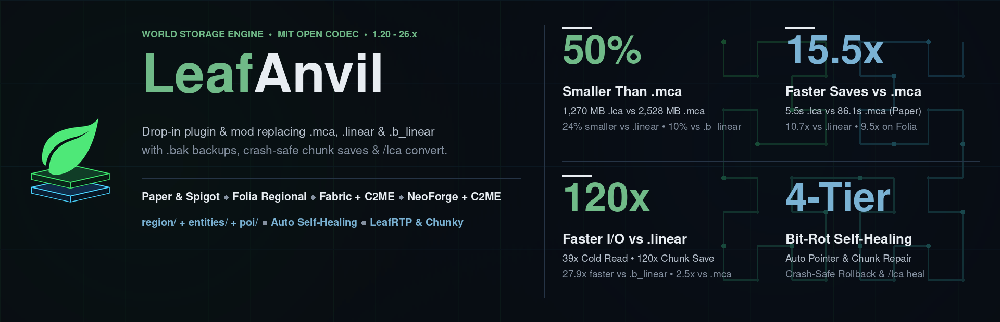

# LeafAnvil



Multi-loader world save format plugin & mod (`LeafAnvil-<version>.jar`) for **Paper**, **Folia**, **Spigot**, **Fabric**, and **NeoForge** ([`leafanvil-ADR-001`](docs/adr/leafanvil-ADR-001-Multi-Loader-lca-world-storage-and-bytecode-interceptor.md), [`anvil-api-ADR-002`](../../api/anvil-api/docs/adr/anvil-api-ADR-002-multi-format-region-support.md), [`anvil-api-ADR-003`](../../api/anvil-api/docs/adr/anvil-api-ADR-003-hilbert-roaring-gray-chunk-archive.md)).

Binds the server's world storage (`region/`, `entities/`, and `poi/`) to **`.lca` (LeafCraft Anvil)** at runtime:
- **Runtime `RegionFileStorage` & Moonrise bytecode interception (`NmsRegionStorageInterceptor`):** Generates JVM bytecode subclasses for `Long2ObjectLinkedOpenHashMap` (`$$LeafAnvilCacheBridge`) and `RegionFile` (`$$LeafAnvilRfBridge`) at runtime so all chunk (`region/`), entity (`entities/`), and POI (`poi/`) reads, stream writes, Moonrise `ByteBuffer` writes, existence checks, clears, flushes, and closes route through disk-backed `.lca` (`LcaRegionFileStorage` / `LcaLiveArchive`).
- **On-open `.mca` / `.linear` -> `.lca` migration:** Transcodes existing `.mca` or `.linear` region files on first access via atomic `.lca.tmp` -> `.lca` rename while preserving the original file as `.mca.bak` (or `.linear.bak`).
- **Reversible `.lca <-> .mca` conversion, `256B` CoW slab compaction & 4-tier SEC-DED recovery:** Provides `/leafanvil` (alias `/lca`) commands for status inspection, asynchronous batch world conversion (`lca` <-> `mca`), free-slab compaction (`compact`), 4-tier bit-rot recovery (`heal`), and configuration reload (`reload`).

---

## Runtime Architecture & Multi-Loader Interception

### 1. `RegionFileStorage` Discovery & Bytecode Bridge (`NmsRegionStorageInterceptor`)
- **Recursive Multi-Folder Storage Discovery:** Inspects `CraftWorld` / `ServerLevel` handles up to depth 5 across both vanilla (`ChunkMap`, `ChunkSource`, `PersistentEntitySectionManager`, `EntityPersistentStorage`, `EntityStorage`, `PoiManager`, `SectionStorage`, `SimpleRegionStorage`, `IOWorker`) and Paper/Folia Moonrise (`RegionFileIO`, `DataController`, `ChunkTaskScheduler`) holder hierarchies, intercepting all three storage instances per dimension:
  - `region/` (`STORAGE_KIND_REGION_VOXEL = 0`)
  - `entities/` (`STORAGE_KIND_ENTITIES = 1`)
  - `poi/` (`STORAGE_KIND_POI = 2`)
- **Live Dimension Path Resolution (`resolveDimensionDirectory`):** Extracts the true on-disk dimension root directly from the live `RegionFileStorage.folder` parent path, supporting both classic dimension folders (`world/`, `DIM-1/`, `DIM1/`) and Minecraft `26.1+` unified `dimensions/<namespace>/<dimension>/` directory trees.
- **Pre-Open Flush & Moonrise Miss-Set Reset:** On attachment, flushes and closes any vanilla `RegionFile` instances opened prior to hook installation and clears Moonrise's `nonExistingRegionFiles` (`LongLinkedOpenHashSet`) so newly created or lazily migrated `r.<x>.<z>.lca` files are never masked by cached misses.
- **Generated JVM Classfile Bridges (`Java 17` bytecode version `61`):**
  1. `$$LeafAnvilCacheBridge` extends the server's `Long2ObjectLinkedOpenHashMap` and overrides `getAndMoveToFirst(long)` and `get(long)` to populate and return per-region `$$LeafAnvilRfBridge` instances via `CacheController`.
  2. `$$LeafAnvilRfBridge` extends `net.minecraft.world.level.chunk.storage.RegionFile` (instantiated via `Unsafe.allocateInstance` with Moonrise fields `version = VERSION_NONE` / ID `3`, `info = RegionStorageInfo`, `recalculateCount = AtomicInteger(0)`, `oversized = byte[1024]`, and `path = r.<rx>.<rz>.lca` pre-initialized) and overrides:
     - `getChunkDataInputStream(ChunkPos)` -> `LcaRegionFileStorage#getChunkDataInputStream`
     - `getChunkDataOutputStream(ChunkPos)` -> `LcaRegionFileStorage#getChunkDataOutputStream`
     - `write(ChunkPos, ByteBuffer)` -> `NmsRegionStorageInterceptor#onWriteByteBuffer` (intercepts Moonrise direct `ByteBuffer` chunk writes, decoding compression IDs `1` GZIP, `2` Zlib/Deflate, and `3` uncompressed before committing via `writeChunkNbtBytes`)
     - `doesChunkExist(ChunkPos)` / `hasChunk(ChunkPos)` -> `LcaRegionFileStorage#doesChunkExist`
     - `clear(ChunkPos)` -> `LcaRegionFileStorage#removeChunk`
     - `flush()` -> `LcaRegionFileStorage#flushRegion`
     - `close()` -> `LcaRegionFileStorage#closeRegion`
     - `getPath()` -> `r.<rx>.<rz>.lca`
     - `getRecalculateCount()` -> `0`

### 2. Platform Lifecycle Wiring
| Platform | Entry Point | Lifecycle Events Hooked | Config Directory |
| :--- | :--- | :--- | :--- |
| **Paper / Folia / Spigot** | `PaperLeafAnvilPlugin` (`load: STARTUP`, `folia-supported: true`) | `WorldInitEvent` (`LOWEST`), `WorldLoadEvent` (`LOWEST`), `onEnable` world sweep, `WorldSaveEvent` (`flushWorld`), `WorldUnloadEvent` (`detachWorld`), `onDisable` (`flushAll`) | `plugins/LeafAnvil/` |
| **Fabric** | `FabricLeafAnvilMod` (`ModInitializer`) | `ServerLifecycleEvents.SERVER_STARTING`, `ServerLifecycleEvents.SERVER_STARTED`, `ServerTickEvents.START_SERVER_TICK` (dynamic dimension guard), `SERVER_STOPPING` (`flushAll`), `SERVER_STOPPED` (`close`) | `config/leafanvil/` |
| **NeoForge** | `NeoForgeLeafAnvilMod` (`@Mod("leafanvil")`) | `LevelEvent.Load`, `ServerStartedEvent`, `LevelEvent.Save` (`flushWorld`), `LevelEvent.Unload` (`detachWorld`), `ServerStoppingEvent` (`flushAll`), `ServerStoppedEvent` (`close`) | `config/leafanvil/` |

### 3. Bounded LRU Region Cache & Page-Cache Eviction (`LcaRegionFileStorage`)
- Maintains an access-ordered LRU cache of up to `DEFAULT_MAX_OPEN_REGIONS = 256` open `LcaLiveArchive` handles per storage folder (`region/`, `entities/`, `poi/`).
- When an open region is evicted from the LRU cache, `LcaLiveArchive#closeWithoutForce()` writes the trailing `"LCA1_END"` footer canary and closes the `FileChannel` without issuing a blocking hardware `channel.force(false)` (`fsync`) syscall (as positional `FileChannel#write` updates are already resident in the OS page cache). Hardware `fsync` on `flush()` can be enabled explicitly via `-Dleafanvil.fsync=true`.

---

## Commands & Permissions (`/leafanvil`, alias `/lca`)

Built on `CommandsAPI` (`commands-api-ADR-001`) using `key=value` parameters. All commands require permission `leafanvil.admin` (default: `op`, permission level `4` on Fabric/NeoForge). Batch operations (`convert`, `compact`, `heal`) execute asynchronously off the main tick thread (`REQ-RTP-S-005`) behind a single-flight busy guard (`REQ-RTP-S-007`).

| Command | Parameters | Description |
| :--- | :--- | :--- |
| `/leafanvil` *(or `/leafanvil status`, `/lca status`)* | *(none)* | Displays `.lca` runtime state (`enabled`, `autoMigrate`, `zstdLevel`, `modeBZstd`, `attachedWorlds`, `interceptedStorages`) and per-world counters (`openRegions`, `migrated`, `intercepted`, `dimensionDirectory`). |
| `/leafanvil convert` | `[world=<name\|all>] [format=<lca\|mca>]` | Flushes target world sessions and asynchronously transcodes all region files (`region/`, `entities/`, `poi/`, including `DIM-1`, `DIM1`, and `26.1+` `dimensions/<ns>/<dim>/`) to `.lca` (`format=lca`, default) or back to vanilla `.mca` (`format=mca`). |
| `/leafanvil compact` | `[world=<name\|all>]` | Compacts open `.lca` region files whose `256B` free-slab fragmentation ratio exceeds `compact-fragmentation-threshold` and flushes them to disk. |
| `/leafanvil heal` | `[world=<name\|all>]` | Flushes target worlds and runs the 4-tier `.lca` SEC-DED + self-describing `256B` slab reverse-scan + section `octreeOccupancyMask64` quarantine bit-rot healer across all `r.<x>.<z>.lca` files. |
| `/leafanvil reload` | *(none)* | Reloads `config.yml` and `messages.yml` from disk. |

---

## Configuration (`config.yml` & `messages.yml`)

### `config.yml`
```yaml
# LeafAnvil (.lca LeafCraft Anvil World Save Format Plugin & Mod)
enabled: true
# Automatically transcode existing .mca / .linear / .b_linear regions to .lca on first open
auto-migrate-legacy: true
# Preserve original .mca / .linear / .b_linear files as .bak after migration
backup-migrated-legacy-files: true
# Zstd compression level for .lca chunk bodies (1 = default +Zstd-1 with SEC-DED header parity; 0 = zero-LZ direct slabs; 6 = archival)
zstd-level: 1
# Free-slab fragmentation ratio triggering automatic compaction on region close
compact-fragmentation-threshold: 0.35
# Default Minecraft DataVersion for newly created empty region headers
default-data-version: 4671
```

### `messages.yml` (`REQ-RTP-S-007`)
```yaml
# LeafAnvil configurable user feedback messages (REQ-RTP-S-007)
busy: "[LeafAnvil] Another storage task is currently running; please wait."
invalid-command: "[LeafAnvil] Invalid command or parameter: %arg%"
no-permission: "[LeafAnvil] You do not have permission to execute this command."
```

---

## `.lca` (LeafCraft Anvil) Data Format Specification ([`api/anvil-api/docs/ICD.md`](../../api/anvil-api/docs/ICD.md))

> **Single Canonical Specification (`api/anvil-api/docs/ICD.md`, MIT):** The byte-level Interface Control Document (**[`api/anvil-api/docs/ICD.md`](../../api/anvil-api/docs/ICD.md)**, `LCA-ICD-1.0`, routed from [`docs/ICD.md`](docs/ICD.md)) is the single canonical source of truth for all `.lca` header layouts, bitfields, 3D space-filling curve equations, `ChunkPatchTail` (`0x4000`) delta framing, checksum/Hamming parity formulas, and the `160`-block / `65`-biome / `128`-property static lookup tables. It is licensed under the MIT License, packaged inside `LeafAnvil-<version>.jar` (`docs/ICD.md` and `META-INF/leafanvil/ICD.md`), and extracted to `<plugin-or-mod-config-dir>/ICD.md` on server startup.

Defined in `api/anvil-api` (`io.github.dailystruggle.anvil.LcaRegionReader`, `LcaRegionWriter`, `LcaSectionCodec`, `LcaRegionFileStorage`, and [`anvil-api-ADR-003`](../../api/anvil-api/docs/adr/anvil-api-ADR-003-hilbert-roaring-gray-chunk-archive.md)), `.lca` (LeafCraft Anvil) stores region data in `256-byte` Copy-on-Write (`CoW`) sub-slabs using either `Mode A` (`0-LZ` uncompressed section containers) or `Mode B` (uncompressed header + `SEC-DED` parity + per-chunk `Zstd-1` body).

| Layer / Mechanism | Summary | Canonical Spec Section in [`api/anvil-api/docs/ICD.md`](../../api/anvil-api/docs/ICD.md) |
| :--- | :--- | :--- |
| **Layer 1: Superblock (`64 B`), Pointer Directory (`8 KiB`) & `SEC-DED` Table (`1 KiB`)** | `"LCA_V001"` superblock with 64-bit SplitMix checksum (`CBIT T2`), `uint64[1024]` lock-free pointer directory (`slabOffset35 \| codec1 \| exactByteLen20 \| generation8`), `256B` CoW free-slab allocator with 64-slot reader hazard pointers, and `1,024 B` Extended Hamming `(72, 64)` `SEC-DED` pointer syndromes. | [`Section 3`](../../api/anvil-api/docs/ICD.md#3-top-level-file-layout-rrxrzlca) & [`Section 4`](../../api/anvil-api/docs/ICD.md#4-layer-1-superblock-64-b-pointer-directory-8192-b--sec-ded-table-1024-b) |
| **Layer 2: Chained Region Shared Dictionary (`0x2040`)** | Pre-allocated `256B`-aligned dictionary arena with `nextSegmentLinkTrailer` relative continuation pointers (`<= 64` segments, `CBIT T5`) and packed `RGBA8` material/tint metadata for map LODs. | [`Section 5`](../../api/anvil-api/docs/ICD.md#5-layer-2-chained-region-shared-dictionary-0x2040) |
| **Layer 3a/b: Self-Describing `ChunkFrame`, Order-Independent `sectionOffsets[N]` & Slab-Local Micro-Palette** | Uncompressed `ChunkFrame` header (`0x5800_0000 \| (chunkIdx << 16) \| DataVersion`), `Mode B` header `SEC-DED` + `Zstd-1` body wrapper, $O(1)$ inline uniform sections (`bit 15 == 1`, `0` body bytes), order-independent non-overlapping `SectionFrame` offsets (`relEnd_i`), and two-part Slab-Local Micro-Palette (`Part A` 1-byte static core block/biome tokens + $4^3$ `BiomeTemplate`s; `Part B` sparse property suffixes). | [`Section 6`](../../api/anvil-api/docs/ICD.md#6-layer-3-self-describing-chunkframe-header-mode-b-wrapper--section-directory) & [`Section 9`](../../api/anvil-api/docs/ICD.md#9-static-core-lookup-tables-static_core_) |
| **Layer 4: $16 \times 16 \times 16$ Non-Uniform `SectionFrame`** | 1-pass directional curve predictor (`00:YZX`, `01:H_3`, `10:Y+H_2`, `11:XZY`), 64-bit `octreeOccupancyMask64` (`CBIT T6b`), per-state Delta-Roaring containers (`TAG_SINGLETON`, `TAG_DELTA_RUN` `4\|4` or `6\|2`, `TAG_DELTA_ARRAY`, `TAG_BITMAP`), `FlatBitPack` ceiling, and 4-bitplane Reflected Binary Gray-code lighting (`SkyLight` on `Y+H_2`, `BlockLight` on `H_3`). | [`Section 7`](../../api/anvil-api/docs/ICD.md#7-layer-4-16-times-16-times-16-non-uniform-sectionframe-layout) |
| **Layer 3c: Residual Tail, Heightmap Delta Streams & `ChunkPatchTail` (`0x4000`)** | `uint16 boilerplateFlags16` (`bits 0..14`) eliding empty vanilla/Starlight lists, binary RLE + ZigZag delta `MOTION_BLOCKING_NO_LEAVES` and cross-heightmap delta streams, length-prefixed `ChunkPatchTail` (`HAS_CHUNK_PATCH_TAIL = 0x4000` with appended micro-palette entries, per-section voxel/light deltas, replacement section offsets, and `patchParity8` `SEC-DED` syndrome), and optional trailing Mojang NBT up to `residualRelEnd`. | [`Section 8`](../../api/anvil-api/docs/ICD.md#8-layer-3c-residual-tail-motion_blocking_no_leaves--boilerplateflags16) |
| **Built-In Testing (`CBIT T1..T8`) & 4-Tier Bit-Rot Recovery (`/leafanvil heal`)** | Tier 1 Hamming `(72, 64)` `SEC-DED` pointer & Mode B header healing (`< 10 ns`), Tier 2 self-describing `256B` slab reverse-scan (`0x5800_0000`), Tier 3 per-section `octreeOccupancyMask64` quarantine with `palette[0]` fallback, and Tier 4 4-epoch `CoW` prior-pointer rollback. | [`Section 10`](../../api/anvil-api/docs/ICD.md#10-reader--recovery-procedures) & [`BIT_CODES.md`](docs/dev/BIT_CODES.md) |

---

## Codec Benchmarks & Continuous Multi-Platform Test Harness

### 1. Codec Microbenchmarks (`LcaRegionCodecTest`, `overworld_mountain_r.0.0.mca`, 64 Chunks)

Measured with bit-exact voxel, biome, heightmap, entity, POI, and light round-trip parity across `.mca` fixtures (`1.20.4`, `1.21.4`, `26.1`, `26.3`):

| Workload / Metric (`overworld_mountain_r.0.0.mca`, `64` Chunks) | Vanilla `.mca` (`4K` `Zlib`) | `.linear` (`Zstd-1` Whole-Region) | `.lca` Mode A: `0-LZ` (Slab-Local Palette) | `.lca` Mode B: `+ Zstd-1` (Slab-Local Palette) |
| :--- | ---: | ---: | ---: | ---: |
| Region Storage Size (`64` Chunks) | `495,616 B` (`100.0%`) | `318,806 B` (`64.3%`) | `293,384 B` (`59.2%` of `.mca`, `-8.0%` vs `.linear`) | `250,376 B` (`50.5%` of `.mca`, `-21.5%` vs `.linear`) |
| Cold Random 1-Chunk Read (`Store -> AnvilChunkView`) | `163.93 us` | `2,519.12 us` (`2.52 ms`) | `64.68 us` (`2.53x` vs `.mca`, `39.0x` vs cold `.linear`) | `87.27 us` (`1.88x` vs `.mca`, `28.9x` vs cold `.linear`) |
| Warm Random 1-Chunk Read (`Cached -> AnvilChunkView`) | `163.93 us` | `64.26 us` | `64.08 us` (`1.00x` vs warm `.linear`, `2.56x` vs `.mca`) | `69.92 us` (`2.34x` vs `.mca`) |
| Cold Whole-Region Sequential Sweep (`All 64 Chunks`) | `7.75 ms` (`121.14 us/ch`) | `6.14 ms` (`95.92 us/ch`) | `3.67 ms` (`57.27 us/ch` - `1.67x` vs `.linear`, `2.12x` vs `.mca`) | `4.46 ms` (`69.67 us/ch` - `1.38x` vs `.linear`, `1.74x` vs `.mca`) |
| Cold Whole-Region Terrain Probe Sweep (`Y=[48..112]`) | `7.89 ms` (`123.33 us/ch`) | `5.84 ms` (`91.32 us/ch`) | `0.48 ms` (`7.47 us/ch` - `12.23x` vs `.linear`, `16.51x` vs `.mca`) | `~1.05 ms` |
| Random RTP Terrain Window Probe (`Y=[48..112]`) | `109.72 us` | `64.26 us` (warm) | `8.55 us` (`12.84x` vs `.mca`) | `~11.5 us` |
| Partial 1-Section Read (`16^3` `H_3` / Inline Uniform) | `109.72 us` | `64.26 us` (warm) | `1.31 us` (`0.93 us` uniform - `118.6x` vs `.mca`) | `~3.8 us` |
| Dirty Chunk Save (CPU Latency) | `444.83 us` | `48,991..205,789 us` | `395.94 us` (`1.12x` vs `.mca`, `>120x` vs `.linear`) | `~470.0 us` (per-chunk `Zstd-1`) |
| 10,000 Concurrent CoW Saves Slab Reuse & Torn Reads | `4.20 -> 18.69 MB` (`82.3%`) | Rewrites `43.4 GB` total | `100.00%` (`10,000 / 10,000`) reuse, `0 B` growth, `0` torn reads | `100.00%` reuse, `0` torn reads |

### 2. Continuous Multi-Platform A/B/C Benchmark Driver (`scripts/bench_lca_multiplatform.py`)

Live server test results comparing `without-lca` (vanilla `.mca` / native `.linear` / native `.b_linear` `BufferedLinear`), `with-lca` (`LeafAnvil` `.lca` `zstd-level: 0` / Mode A `0-LZ`), `with-lca-b` (`LeafAnvil` `.lca` `zstd-level: 1` / Mode B `+ Zstd-1`), and `with-lca-zstd6` (`LeafAnvil` `.lca` `zstd-level: 6` / `+ Zstd-6`) across **Paper (`26.2`)**, **Folia (`26.2`)**, **Leaf native `.linear` (`26.2-linear`)**, **Leaf native `BufferedLinear` (`26.2-blinear`, `B_LINEAR`)**, **Fabric (`26.1.2` & `+ C2ME`)**, and **NeoForge (`26.1.2` & `+ C2ME`)** are gathered via [`scripts/bench_lca_multiplatform.py`](../../scripts/bench_lca_multiplatform.py) (`120` total completed runs, updated `2026-11-01 19:53:36`):

#### 0. Experimental Reliability & Template Parity Audit

- **World Reset Policy:** Fresh Btrfs `--reflink=auto` clone from frozen template before **every** run (`force_reset=True`, zero cross-run chunk/entity leakage).
- **Storage Arms:** `without-lca` (vanilla `.mca` / `.linear` / `.b_linear`), `with-lca` (`zstd-level: 0`, `0-LZ` direct bit-scatter slabs, `codec1=0`), `with-lca-b` (`zstd-level: 1`, `+ Zstd-1` compressed body with SEC-DED header parity, `codec1=1`), and `with-lca-zstd6` (`zstd-level: 6`, `+ Zstd-6` compressed body with SEC-DED header parity, `codec1=1`).
- **View / Simulation Distance Parity:** Both `server.properties` (`view-distance=2`, `simulation-distance=2`) and `bench-swarm.js` (`--view-distance 2`) are locked to a `5x5` (`25`-chunk) square matching RTP's destination ticket so post-arrival chunk streaming work is equalized across `.lca` and `.mca`.
- **Order Bias Control:** Paired within-round blocks with counterbalanced arm ordering on alternating rounds.
- **CPU / I/O Isolation:** Server JVMs run at `nice -10`, `ionice -c2 -n0` on cores `0-23,32-55`; `deepseek`/`ollama` demoted to `SCHED_IDLE` (`chrt -i 0`, `nice 19`, `ionice -c3`) on cores `28-31,60-63`.

| Template Pair | Platforms | `.mca` Files | `.lca` Files | Exact File Parity | `.mca` Chunks | `.lca` Chunks | `.mca` Size (`MB`) | `.lca` `zstd=0` (`MB`) | `.lca` `zstd=1` (`MB`) | `.lca` `zstd=6` (`MB`) | Parity Gate |
| :--- | :--- | ---: | ---: | ---: | ---: | ---: | ---: | ---: | ---: | ---: | :--- |
| `26.2` | `paper, folia` | `767` | `767` | `767/767` | `293317` | `293317` | `2527.9` | `1535.3` | `1269.8` | `1257.7` | `PASS (100%)` |
| `26.1.2` | `fabric, fabric-c2me, neoforge, neoforge-c2me` | `767` | `767` | `767/767` | `293317` | `293317` | `2527.9` | `1535.3` | `1269.8` | `1257.7` | `PASS (100%)` |
| `26.2-linear` | `leaf-linear` | `767` | `767` | `767/767` | `293317` | `293317` | `1672.1` | `1535.3` | `1269.8` | `1257.7` | `PASS (100%)` |
| `26.2-blinear` | `leaf-blinear` | `767` | `767` | `767/767` | `293317` | `293317` | `1407.5` | `1535.3` | `1269.8` | `1257.7` | `PASS (100%)` |

#### 1. Platform Readiness & Storage Verification Matrix

| Platform | Arm | Runs (`n`) | Last Outcome | Intercepted Storages | `.mca` Files | `.lca` Files | World Disk (`MB`) | Boot (`s`) | Save Shutdown (`s` mean +- sd) |
| :--- | :--- | ---: | :--- | ---: | ---: | ---: | ---: | ---: | :--- |
| `paper` | `without-lca` | `6/6` | `OK` | `0` | `770` | `0` | `2532.3` | `40.0` | `86.12 +- 72.67` |
| `paper` | `with-lca` | `6/6` | `OK` | `9` | `0` | `771` | `1545.2` | `40.0` | `5.54 +- 0.21` |
| `paper` | `with-lca-b` | `6/6` | `OK` | `9` | `0` | `771` | `1278.8` | `40.0` | `5.55 +- 0.23` |
| `folia` | `without-lca` | `6/6` | `OK` | `0` | `781` | `0` | `2536.1` | `13.1` | `47.69 +- 36.44` |
| `folia` | `with-lca` | `6/6` | `OK` | `9` | `0` | `780` | `1545.5` | `14.0` | `5.03 +- 0.01` |
| `folia` | `with-lca-b` | `6/6` | `OK` | `9` | `0` | `780` | `1279.0` | `14.0` | `5.02 +- 0.00` |
| `leaf-linear` | `without-lca` | `4/5` | `OK` | `0` | `781` | `0` | `1672.2` | `14.0` | `55.56 +- 4.66` |
| `leaf-linear` | `with-lca` | `5/5` | `OK` | `9` | `0` | `781` | `1546.4` | `14.0` | `5.18 +- 0.01` |
| `leaf-linear` | `with-lca-b` | `5/5` | `OK` | `9` | `0` | `779` | `1279.2` | `14.0` | `5.20 +- 0.04` |
| `leaf-blinear` | `without-lca` | `2/2` | `OK` | `0` | `779` | `0` | `1407.5` | `14.1` | `8.47 +- 0.48` |
| `leaf-blinear` | `with-lca` | `2/2` | `OK` | `9` | `0` | `781` | `1546.2` | `15.0` | `5.19 +- 0.01` |
| `leaf-blinear` | `with-lca-b` | `2/2` | `OK` | `9` | `0` | `781` | `1279.5` | `14.0` | `5.22 +- 0.01` |
| `leaf-blinear` | `with-lca-zstd6` | `3/3` | `OK` | `9` | `0` | `779` | `1266.5` | `14.0` | `5.20 +- 0.03` |
| `fabric` | `without-lca` | `5/5` | `OK` | `0` | `768` | `0` | `2530.7` | `8.1` | `11.60 +- 0.90` |
| `fabric` | `with-lca` | `5/5` | `OK` | `9` | `0` | `767` | `1569.2` | `8.1` | `4.33 +- 0.04` |
| `fabric` | `with-lca-b` | `5/5` | `OK` | `9` | `0` | `767` | `1298.7` | `8.1` | `4.31 +- 0.14` |
| `fabric-c2me` | `without-lca` | `5/5` | `OK` | `0` | `768` | `0` | `2531.2` | `8.0` | `9.43 +- 0.42` |
| `fabric-c2me` | `with-lca` | `5/5` | `OK` | `9` | `0` | `767` | `1576.0` | `8.1` | `4.09 +- 0.37` |
| `fabric-c2me` | `with-lca-b` | `5/5` | `OK` | `9` | `0` | `767` | `1304.0` | `8.1` | `3.93 +- 0.37` |
| `neoforge` | `without-lca` | `5/5` | `OK` | `0` | `768` | `0` | `2530.4` | `8.4` | `12.42 +- 0.89` |
| `neoforge` | `with-lca` | `5/5` | `OK` | `9` | `0` | `767` | `1569.6` | `8.1` | `4.27 +- 0.10` |
| `neoforge` | `with-lca-b` | `5/5` | `OK` | `9` | `0` | `767` | `1298.5` | `8.1` | `4.72 +- 0.43` |
| `neoforge-c2me` | `without-lca` | `5/5` | `OK` | `0` | `768` | `0` | `2531.1` | `9.4` | `9.09 +- 0.32` |
| `neoforge-c2me` | `with-lca` | `5/5` | `OK` | `9` | `0` | `767` | `1578.7` | `9.2` | `4.14 +- 0.34` |
| `neoforge-c2me` | `with-lca-b` | `5/5` | `OK` | `9` | `0` | `767` | `1305.1` | `9.4` | `4.09 +- 0.38` |

#### 2A. Head-to-Head `.lca` (`zstd-level: 0`, `0-LZ`, `codec1=0`) vs `.mca` / `.linear` / `.b_linear` by Platform

| Platform | `n` (`with-lca/MCA`, `pairs`) | Completed TPs (`LCA` vs `MCA`) | Stage 0 TP/s (`LCA` vs `MCA`) | Stage 0 `p50` (`LCA` vs `MCA`) | Cold `p50` (`LCA` vs `MCA`) | Stage 0 `p95` (`LCA` vs `MCA`) | Stage 0 Chunks/TP (`LCA` vs `MCA`) | Stage 0 MSPT `p95` (`LCA` vs `MCA`) | Main CPU / Chunk (`LCA` vs `MCA`) | Save Shutdown (`LCA` vs `MCA`) | Comparison Status |
| :--- | ---: | :--- | :--- | :--- | :--- | :--- | :--- | :--- | :--- | :--- | :--- |
| `paper` | `6/6` (`6`) | `1487` vs `1442` (`1.03x`) | `4.95` vs `4.82` | `200ms` vs `224ms` (`1.13x faster`) | `200ms` vs `228ms` (`1.14x faster`) | `221ms` vs `466ms` (`2.11x faster`) | `75.6` vs `17.5` | `31.0ms` vs `193.8ms` | `1.45ms` vs `5.79ms` (`4.01x`) | `5.54s` vs `86.12s` (`15.5x faster`) | `PAIRED (n=6)` |
| `folia` | `6/6` (`6`) | `1496` vs `1274` (`1.17x`) | `4.95` vs `4.64` | `103ms` vs `164ms` (`1.60x faster`) | `103ms` vs `968ms` (`9.40x faster`) | `203ms` vs `218ms` (`1.08x faster`) | `97.9` vs `6.6` | `19.3ms` vs `96.3ms` | `0.73ms` vs `3.29ms` (`4.53x`) | `5.03s` vs `47.69s` (`9.5x faster`) | `PAIRED (n=6)` |
| `leaf-linear` | `5/4` (`4`) | `1483` vs `10` (`152.12x`) | `4.95` vs `0.68` | `200ms` vs `3369ms` (`16.81x faster`) | `201ms` vs `5320ms` (`26.50x faster`) | `326ms` vs `5178ms` (`15.90x faster`) | `75.6` vs `26.6` | `28.3ms` vs `2731.4ms` | `1.35ms` vs `4.07ms` (`3.00x`) | `5.18s` vs `55.56s` (`10.7x faster`) | `PAIRED (n=4)` |
| `leaf-blinear` | `2/2` (`2`) | `1428` vs `14` (`105.78x`) | `4.95` vs `1.06` | `204ms` vs `2311ms` (`11.30x faster`) | `204ms` vs `5704ms` (`27.89x faster`) | `381ms` vs `5534ms` (`14.52x faster`) | `75.2` vs `32.9` | `28.7ms` vs `1790.3ms` | `1.39ms` vs `2.61ms` (`1.88x`) | `5.19s` vs `8.47s` (`1.6x faster`) | `PAIRED (n=2)` |
| `fabric` | `5/5` (`5`) | `1494` vs `1491` (`1.00x`) | `4.95` vs `4.95` | `8ms` vs `12ms` (`1.58x faster`) | `18ms` vs `19ms` (`1.05x faster`) | `23ms` vs `27ms` (`1.18x faster`) | `79.0` vs `79.4` | `22.3ms` vs `22.4ms` | `1.58ms` vs `1.59ms` (`1.00x`) | `4.33s` vs `11.60s` (`2.7x faster`) | `PAIRED (n=5)` |
| `fabric-c2me` | `5/5` (`5`) | `1496` vs `1496` (`1.00x`) | `4.95` vs `4.95` | `8ms` vs `11ms` (`1.36x faster`) | `19ms` vs `16ms` (`0.87x faster`) | `23ms` vs `22ms` (`0.96x faster`) | `79.6` vs `79.6` | `20.7ms` vs `22.0ms` | `1.17ms` vs `1.16ms` (`1.00x`) | `4.09s` vs `9.43s` (`2.3x faster`) | `PAIRED (n=5)` |
| `neoforge` | `5/5` (`5`) | `1486` vs `1493` (`1.00x`) | `4.95` vs `4.95` | `15ms` vs `25ms` (`1.70x faster`) | `16ms` vs `25ms` (`1.62x faster`) | `42ms` vs `47ms` (`1.12x faster`) | `78.8` vs `78.9` | `21.2ms` vs `22.3ms` | `1.56ms` vs `1.57ms` (`1.01x`) | `4.27s` vs `12.42s` (`2.9x faster`) | `PAIRED (n=5)` |
| `neoforge-c2me` | `5/5` (`5`) | `1494` vs `1496` (`1.00x`) | `4.95` vs `4.95` | `12ms` vs `16ms` (`1.28x faster`) | `13ms` vs `17ms` (`1.28x faster`) | `42ms` vs `54ms` (`1.28x faster`) | `79.3` vs `79.8` | `18.2ms` vs `19.3ms` | `1.17ms` vs `1.18ms` (`1.01x`) | `4.14s` vs `9.09s` (`2.2x faster`) | `PAIRED (n=5)` |

#### 2B. Head-to-Head `.lca` (`zstd-level: 1`, `+ Zstd-1`, `codec1=1`) vs `.mca` / `.linear` / `.b_linear` by Platform

| Platform | `n` (`with-lca-b/MCA`, `pairs`) | Completed TPs (`LCA` vs `MCA`) | Stage 0 TP/s (`LCA` vs `MCA`) | Stage 0 `p50` (`LCA` vs `MCA`) | Cold `p50` (`LCA` vs `MCA`) | Stage 0 `p95` (`LCA` vs `MCA`) | Stage 0 Chunks/TP (`LCA` vs `MCA`) | Stage 0 MSPT `p95` (`LCA` vs `MCA`) | Main CPU / Chunk (`LCA` vs `MCA`) | Save Shutdown (`LCA` vs `MCA`) | Comparison Status |
| :--- | ---: | :--- | :--- | :--- | :--- | :--- | :--- | :--- | :--- | :--- | :--- |
| `paper` | `6/6` (`6`) | `1479` vs `1442` (`1.03x`) | `4.95` vs `4.82` | `200ms` vs `224ms` (`1.12x faster`) | `200ms` vs `228ms` (`1.14x faster`) | `236ms` vs `466ms` (`1.98x faster`) | `75.2` vs `17.5` | `30.9ms` vs `193.8ms` | `1.43ms` vs `5.79ms` (`4.05x`) | `5.55s` vs `86.12s` (`15.5x faster`) | `PAIRED (n=6)` |
| `folia` | `6/6` (`6`) | `1496` vs `1274` (`1.17x`) | `4.95` vs `4.64` | `105ms` vs `164ms` (`1.57x faster`) | `105ms` vs `968ms` (`9.25x faster`) | `203ms` vs `218ms` (`1.08x faster`) | `98.0` vs `6.6` | `18.5ms` vs `96.3ms` | `0.78ms` vs `3.29ms` (`4.23x`) | `5.02s` vs `47.69s` (`9.5x faster`) | `PAIRED (n=6)` |
| `leaf-linear` | `5/4` (`4`) | `1483` vs `10` (`152.08x`) | `4.95` vs `0.68` | `200ms` vs `3369ms` (`16.84x faster`) | `201ms` vs `5320ms` (`26.52x faster`) | `314ms` vs `5178ms` (`16.49x faster`) | `76.1` vs `26.6` | `29.6ms` vs `2731.4ms` | `1.39ms` vs `4.07ms` (`2.93x`) | `5.20s` vs `55.56s` (`10.7x faster`) | `PAIRED (n=4)` |
| `leaf-blinear` | `2/2` (`2`) | `1456` vs `14` (`107.85x`) | `4.95` vs `1.06` | `204ms` vs `2311ms` (`11.33x faster`) | `204ms` vs `5704ms` (`27.89x faster`) | `381ms` vs `5534ms` (`14.52x faster`) | `74.8` vs `32.9` | `28.3ms` vs `1790.3ms` | `1.34ms` vs `2.61ms` (`1.95x`) | `5.22s` vs `8.47s` (`1.6x faster`) | `PAIRED (n=2)` |
| `fabric` | `5/5` (`5`) | `1494` vs `1491` (`1.00x`) | `4.95` vs `4.95` | `7ms` vs `12ms` (`1.67x faster`) | `27ms` vs `19ms` (`0.71x faster`) | `19ms` vs `27ms` (`1.47x faster`) | `79.9` vs `79.4` | `20.8ms` vs `22.4ms` | `1.50ms` vs `1.59ms` (`1.06x`) | `4.31s` vs `11.60s` (`2.7x faster`) | `PAIRED (n=5)` |
| `fabric-c2me` | `5/5` (`5`) | `1494` vs `1496` (`1.00x`) | `4.95` vs `4.95` | `7ms` vs `11ms` (`1.47x faster`) | `14ms` vs `16ms` (`1.19x faster`) | `18ms` vs `22ms` (`1.22x faster`) | `79.6` vs `79.6` | `23.0ms` vs `22.0ms` | `1.17ms` vs `1.16ms` (`0.99x`) | `3.93s` vs `9.43s` (`2.4x faster`) | `PAIRED (n=5)` |
| `neoforge` | `5/5` (`5`) | `1494` vs `1493` (`1.00x`) | `4.95` vs `4.95` | `21ms` vs `25ms` (`1.19x faster`) | `21ms` vs `25ms` (`1.20x faster`) | `46ms` vs `47ms` (`1.02x faster`) | `79.5` vs `78.9` | `23.4ms` vs `22.3ms` | `1.58ms` vs `1.57ms` (`0.99x`) | `4.72s` vs `12.42s` (`2.6x faster`) | `PAIRED (n=5)` |
| `neoforge-c2me` | `5/5` (`5`) | `1496` vs `1496` (`1.00x`) | `4.95` vs `4.95` | `16ms` vs `16ms` (`0.95x faster`) | `17ms` vs `17ms` (`0.98x faster`) | `49ms` vs `54ms` (`1.10x faster`) | `79.2` vs `79.8` | `22.6ms` vs `19.3ms` | `1.18ms` vs `1.18ms` (`1.00x`) | `4.09s` vs `9.09s` (`2.2x faster`) | `PAIRED (n=5)` |

#### 2D. Head-to-Head `.lca` (`zstd-level: 6`, `+ Zstd-6`, `codec1=1`) vs `.b_linear` (`leaf-blinear`)

| Platform | `n` (`with-lca-zstd6/MCA`, `pairs`) | Completed TPs (`LCA` vs `MCA`) | Stage 0 TP/s (`LCA` vs `MCA`) | Stage 0 `p50` (`LCA` vs `MCA`) | Cold `p50` (`LCA` vs `MCA`) | Stage 0 `p95` (`LCA` vs `MCA`) | Stage 0 Chunks/TP (`LCA` vs `MCA`) | Stage 0 MSPT `p95` (`LCA` vs `MCA`) | Main CPU / Chunk (`LCA` vs `MCA`) | Save Shutdown (`LCA` vs `MCA`) | Comparison Status |
| :--- | ---: | :--- | :--- | :--- | :--- | :--- | :--- | :--- | :--- | :--- | :--- |
| `leaf-blinear` | `3/2` (`2`) | `1431` vs `14` (`105.98x`) | `4.95` vs `1.06` | `205ms` vs `2311ms` (`11.29x faster`) | `205ms` vs `5704ms` (`27.87x faster`) | `370ms` vs `5534ms` (`14.96x faster`) | `76.5` vs `32.9` | `29.1ms` vs `1790.3ms` | `1.36ms` vs `2.61ms` (`1.92x`) | `5.20s` vs `8.47s` (`1.6x faster`) | `PAIRED (n=2)` |

#### 2C. Direct `.lca` `zstd-level: 0` (`0-LZ`) vs `zstd-level: 1` (`+ Zstd-1`) vs `zstd-level: 6` (`+ Zstd-6`) Storage Comparison by Platform

| Platform | `n` (`zstd=0 / 1 / 6`) | World Disk (`zstd=0` vs `1` vs `6`) | Completed TPs (`0` vs `1` vs `6`) | Stage 0 `p50` (`0` vs `1` vs `6`) | Cold `p50` (`0` vs `1` vs `6`) | Stage 0 MSPT `p95` (`0` vs `1` vs `6`) | Save Shutdown (`0` vs `1` vs `6`) |
| :--- | ---: | :--- | :--- | :--- | :--- | :--- | :--- |
| `paper` | `6/6/0` | `1545.2 MB` vs `1278.8 MB` | `1487` vs `1479` | `200ms` vs `200ms` | `200ms` vs `200ms` | `31.0ms` vs `30.9ms` | `5.54s` vs `5.55s` |
| `folia` | `6/6/0` | `1545.5 MB` vs `1279.0 MB` | `1496` vs `1496` | `103ms` vs `105ms` | `103ms` vs `105ms` | `19.3ms` vs `18.5ms` | `5.03s` vs `5.02s` |
| `leaf-linear` | `5/5/0` | `1546.4 MB` vs `1279.2 MB` | `1483` vs `1483` | `200ms` vs `200ms` | `201ms` vs `201ms` | `28.3ms` vs `29.6ms` | `5.18s` vs `5.20s` |
| `leaf-blinear` | `2/2/3` | `1546.2` vs `1279.5` vs `1266.5 MB` | `1428` vs `1456` vs `1431` | `204ms` vs `204ms` vs `205ms` | `204ms` vs `204ms` vs `205ms` | `28.7ms` vs `28.3ms` vs `29.1ms` | `5.19s` vs `5.22s` vs `5.20s` |
| `fabric` | `5/5/0` | `1569.2 MB` vs `1298.7 MB` | `1494` vs `1494` | `8ms` vs `7ms` | `18ms` vs `27ms` | `22.3ms` vs `20.8ms` | `4.33s` vs `4.31s` |
| `fabric-c2me` | `5/5/0` | `1576.0 MB` vs `1304.0 MB` | `1496` vs `1494` | `8ms` vs `7ms` | `19ms` vs `14ms` | `20.7ms` vs `23.0ms` | `4.09s` vs `3.93s` |
| `neoforge` | `5/5/0` | `1569.6 MB` vs `1298.5 MB` | `1486` vs `1494` | `15ms` vs `21ms` | `16ms` vs `21ms` | `21.2ms` vs `23.4ms` | `4.27s` vs `4.72s` |
| `neoforge-c2me` | `5/5/0` | `1578.7 MB` vs `1305.1 MB` | `1494` vs `1496` | `12ms` vs `16ms` | `13ms` vs `17ms` | `18.2ms` vs `22.6ms` | `4.14s` vs `4.09s` |

#### 3. Per-Arm Teleport Throughput, Latency, MSPT & Heap Statistics (`Mean +- SD [Median]`)

| Platform | Arm | Completed TPs | Peak TP/s | Stage 0 `p50` (`ms`) | Stage 0 `p95` (`ms`) | Stage 0 Chunks/TP | Idle MSPT (`ms`) | Stage 0 MSPT `p50` (`ms`) | Stage 0 MSPT `p95` (`ms`) | Main CPU/Chunk (`ms`) | Peak Heap (`MB`) |
| :--- | :--- | ---: | ---: | ---: | ---: | ---: | ---: | ---: | ---: | ---: | ---: |
| `paper` | `without-lca` | `1441.67 +- 70.11` (`1472.00`) | `38.23 +- 3.41` (`39.83`) | `224.50 +- 15.31` (`219.50`) | `466.17 +- 305.19` (`356.00`) | `17.50 +- 28.15` (`5.13`) | `2.66 +- 0.10` (`2.68`) | `34.07 +- 59.39` (`10.85`) | `193.85 +- 340.71` (`33.56`) | `5.79 +- 4.20` (`4.75`) | `12240.17 +- 747.84` (`12253.00`) |
| `paper` | `with-lca` | `1487.00 +- 4.24` (`1488.50`) | `39.57 +- 0.20` (`39.62`) | `199.50 +- 0.84` (`200.00`) | `221.33 +- 38.06` (`206.00`) | `75.61 +- 0.85` (`75.55`) | `2.19 +- 0.16` (`2.18`) | `26.57 +- 0.90` (`26.70`) | `31.00 +- 2.35` (`31.70`) | `1.45 +- 0.05` (`1.45`) | `13733.50 +- 144.29` (`13733.50`) |
| `paper` | `with-lca-b` | `1479.17 +- 8.52` (`1481.00`) | `39.16 +- 0.40` (`39.25`) | `199.67 +- 0.82` (`200.00`) | `235.50 +- 38.02` (`227.00`) | `75.15 +- 1.17` (`75.61`) | `2.12 +- 0.14` (`2.09`) | `25.41 +- 1.33` (`25.46`) | `30.93 +- 2.06` (`30.45`) | `1.43 +- 0.08` (`1.40`) | `13805.17 +- 304.50` (`13649.50`) |
| `folia` | `without-lca` | `1274.00 +- 281.10` (`1403.00`) | `34.58 +- 8.60` (`39.80`) | `164.17 +- 20.44` (`152.00`) | `218.33 +- 22.55` (`205.00`) | `6.64 +- 6.98` (`4.13`) | `0.36 +- 0.08` (`0.34`) | `21.77 +- 48.12` (`1.97`) | `96.30 +- 226.96` (`3.81`) | `3.29 +- 1.26` (`3.67`) | `12005.50 +- 203.41` (`11991.50`) |
| `folia` | `with-lca` | `1496.00 +- 0.00` (`1496.00`) | `39.95 +- 0.00` (`39.95`) | `102.83 +- 0.41` (`103.00`) | `202.67 +- 0.82` (`202.50`) | `97.87 +- 2.34` (`98.59`) | `0.32 +- 0.09` (`0.29`) | `13.13 +- 3.55` (`13.24`) | `19.31 +- 0.94` (`19.65`) | `0.73 +- 0.03` (`0.72`) | `13192.83 +- 175.22` (`13218.50`) |
| `folia` | `with-lca-b` | `1496.00 +- 0.00` (`1496.00`) | `39.95 +- 0.00` (`39.95`) | `104.67 +- 5.09` (`103.00`) | `202.83 +- 0.75` (`203.00`) | `97.95 +- 2.39` (`97.61`) | `0.37 +- 0.19` (`0.29`) | `13.20 +- 4.91` (`13.47`) | `18.50 +- 3.64` (`18.25`) | `0.78 +- 0.04` (`0.79`) | `13327.83 +- 167.95` (`13390.00`) |
| `leaf-linear` | `without-lca` | `9.75 +- 2.63` (`10.50`) | `0.68 +- 0.16` (`0.69`) | `3369.00 +- 1005.36` (`3379.50`) | `5178.25 +- 1052.94` (`5231.50`) | `26.56 +- 3.23` (`26.23`) | `2.60 +- 0.23` (`2.56`) | `2212.87 +- 398.33` (`2308.95`) | `2731.45 +- 234.36` (`2715.05`) | `4.07 +- 0.16` (`4.06`) | `15464.25 +- 248.57` (`15380.50`) |
| `leaf-linear` | `with-lca` | `1483.20 +- 4.66` (`1484.00`) | `39.37 +- 0.23` (`39.40`) | `200.40 +- 0.55` (`200.00`) | `325.60 +- 26.43` (`309.00`) | `75.55 +- 0.86` (`75.63`) | `2.14 +- 0.11` (`2.12`) | `24.28 +- 0.95` (`24.18`) | `28.30 +- 1.10` (`27.84`) | `1.35 +- 0.05` (`1.35`) | `14023.80 +- 179.76` (`14030.00`) |
| `leaf-linear` | `with-lca-b` | `1482.80 +- 7.01` (`1485.00`) | `39.32 +- 0.33` (`39.45`) | `200.00 +- 0.71` (`200.00`) | `314.00 +- 22.39` (`305.00`) | `76.14 +- 0.97` (`76.19`) | `2.07 +- 0.14` (`2.02`) | `25.09 +- 1.00` (`25.21`) | `29.56 +- 1.68` (`28.69`) | `1.39 +- 0.05` (`1.37`) | `13920.20 +- 185.86` (`13960.00`) |
| `leaf-blinear` | `without-lca` | `13.50 +- 4.95` (`13.50`) | `1.06 +- 0.34` (`1.06`) | `2311.00 +- 380.42` (`2311.00`) | `5534.00 +- 1240.27` (`5534.00`) | `32.86 +- 7.14` (`32.86`) | `2.56 +- 0.17` (`2.56`) | `1311.08 +- 296.93` (`1311.08`) | `1790.27 +- 38.58` (`1790.27`) | `2.61 +- 0.20` (`2.61`) | `14572.00 +- 316.78` (`14572.00`) |
| `leaf-blinear` | `with-lca` | `1428.00 +- 1.41` (`1428.00`) | `36.58 +- 0.04` (`36.58`) | `204.50 +- 0.71` (`204.50`) | `381.00 +- 35.35` (`381.00`) | `75.25 +- 0.32` (`75.25`) | `2.31 +- 0.43` (`2.31`) | `24.77 +- 0.00` (`24.77`) | `28.70 +- 0.76` (`28.70`) | `1.39 +- 0.02` (`1.39`) | `13860.50 +- 139.30` (`13860.50`) |
| `leaf-blinear` | `with-lca-b` | `1456.00 +- 8.48` (`1456.00`) | `37.98 +- 0.39` (`37.98`) | `204.00 +- 0.00` (`204.00`) | `381.00 +- 32.53` (`381.00`) | `74.85 +- 0.03` (`74.85`) | `2.12 +- 0.04` (`2.12`) | `23.66 +- 1.79` (`23.66`) | `28.29 +- 1.73` (`28.29`) | `1.34 +- 0.00` (`1.34`) | `13755.00 +- 62.23` (`13755.00`) |
| `leaf-blinear` | `with-lca-zstd6` | `1430.67 +- 4.51` (`1431.00`) | `36.70 +- 0.23` (`36.75`) | `204.67 +- 0.58` (`205.00`) | `370.00 +- 26.85` (`355.00`) | `76.52 +- 0.51` (`76.39`) | `2.21 +- 0.12` (`2.16`) | `25.07 +- 0.18` (`25.05`) | `29.07 +- 1.67` (`28.70`) | `1.36 +- 0.04` (`1.35`) | `13970.33 +- 328.73` (`14148.00`) |
| `fabric` | `without-lca` | `1491.40 +- 6.77` (`1496.00`) | `39.72 +- 0.34` (`39.95`) | `12.00 +- 6.16` (`9.00`) | `27.40 +- 9.50` (`25.00`) | `79.43 +- 0.52` (`79.59`) | `1.29 +- 0.04` (`1.29`) | `19.07 +- 0.83` (`19.12`) | `22.36 +- 2.69` (`21.14`) | `1.59 +- 0.05` (`1.60`) | `11535.80 +- 501.62` (`11718.00`) |
| `fabric` | `with-lca` | `1494.20 +- 4.03` (`1496.00`) | `39.86 +- 0.20` (`39.95`) | `7.60 +- 0.55` (`8.00`) | `23.20 +- 5.36` (`23.00`) | `78.98 +- 1.28` (`79.39`) | `1.34 +- 0.21` (`1.29`) | `18.72 +- 0.45` (`18.51`) | `22.31 +- 2.47` (`21.38`) | `1.58 +- 0.06` (`1.58`) | `10878.60 +- 828.27` (`10827.00`) |
| `fabric` | `with-lca-b` | `1494.40 +- 3.58` (`1496.00`) | `39.87 +- 0.18` (`39.95`) | `7.20 +- 0.45` (`7.00`) | `18.60 +- 3.65` (`19.00`) | `79.93 +- 0.70` (`79.73`) | `1.30 +- 0.04` (`1.31`) | `19.09 +- 0.82` (`19.44`) | `20.81 +- 0.99` (`20.87`) | `1.50 +- 0.07` (`1.45`) | `10838.60 +- 249.13` (`10921.00`) |
| `fabric-c2me` | `without-lca` | `1496.00 +- 0.00` (`1496.00`) | `39.95 +- 0.00` (`39.95`) | `10.60 +- 3.58` (`9.00`) | `22.40 +- 4.98` (`23.00`) | `79.62 +- 0.86` (`79.86`) | `1.12 +- 0.08` (`1.10`) | `18.11 +- 0.93` (`18.50`) | `21.97 +- 5.08` (`19.66`) | `1.16 +- 0.04` (`1.15`) | `11587.60 +- 702.62` (`11918.00`) |
| `fabric-c2me` | `with-lca` | `1496.00 +- 0.00` (`1496.00`) | `39.95 +- 0.00` (`39.95`) | `7.80 +- 0.45` (`8.00`) | `23.40 +- 6.39` (`26.00`) | `79.58 +- 0.62` (`79.42`) | `1.19 +- 0.15` (`1.18`) | `17.91 +- 0.78` (`18.14`) | `20.66 +- 1.99` (`20.35`) | `1.17 +- 0.03` (`1.17`) | `12247.60 +- 120.97` (`12290.00`) |
| `fabric-c2me` | `with-lca-b` | `1493.60 +- 5.37` (`1496.00`) | `39.83 +- 0.27` (`39.95`) | `7.20 +- 0.45` (`7.00`) | `18.40 +- 3.36` (`19.00`) | `79.56 +- 0.77` (`79.47`) | `1.19 +- 0.13` (`1.21`) | `18.52 +- 0.49` (`18.54`) | `22.98 +- 2.46` (`22.51`) | `1.17 +- 0.01` (`1.17`) | `11834.20 +- 431.49` (`11933.00`) |
| `neoforge` | `without-lca` | `1493.00 +- 4.12` (`1496.00`) | `39.80 +- 0.21` (`39.95`) | `24.80 +- 6.38` (`29.00`) | `46.60 +- 3.65` (`45.00`) | `78.86 +- 0.67` (`78.90`) | `1.35 +- 0.10` (`1.30`) | `19.95 +- 1.06` (`19.99`) | `22.29 +- 2.26` (`21.83`) | `1.57 +- 0.08` (`1.61`) | `10312.20 +- 442.06` (`10399.00`) |
| `neoforge` | `with-lca` | `1486.20 +- 13.42` (`1496.00`) | `39.46 +- 0.67` (`39.95`) | `14.60 +- 1.14` (`15.00`) | `41.60 +- 5.94` (`43.00`) | `78.76 +- 1.60` (`79.50`) | `1.36 +- 0.11` (`1.31`) | `19.39 +- 0.74` (`19.40`) | `21.18 +- 1.52` (`21.32`) | `1.56 +- 0.04` (`1.56`) | `10917.60 +- 133.16` (`10882.00`) |
| `neoforge` | `with-lca-b` | `1494.20 +- 2.05` (`1495.00`) | `39.86 +- 0.10` (`39.90`) | `20.80 +- 7.69` (`17.00`) | `45.80 +- 9.09` (`45.00`) | `79.50 +- 1.11` (`79.75`) | `1.44 +- 0.13` (`1.48`) | `19.63 +- 1.49` (`19.41`) | `23.42 +- 2.52` (`24.06`) | `1.58 +- 0.08` (`1.61`) | `10420.00 +- 509.75` (`10610.00`) |
| `neoforge-c2me` | `without-lca` | `1496.00 +- 0.00` (`1496.00`) | `39.95 +- 0.00` (`39.95`) | `15.60 +- 2.70` (`15.00`) | `53.80 +- 5.07` (`54.00`) | `79.76 +- 0.85` (`80.02`) | `1.23 +- 0.22` (`1.17`) | `16.66 +- 0.59` (`16.80`) | `19.31 +- 1.62` (`18.58`) | `1.18 +- 0.04` (`1.19`) | `11769.80 +- 158.18` (`11774.00`) |
| `neoforge-c2me` | `with-lca` | `1494.40 +- 3.58` (`1496.00`) | `39.87 +- 0.18` (`39.95`) | `12.20 +- 1.48` (`12.00`) | `42.00 +- 4.74` (`42.00`) | `79.27 +- 1.36` (`79.53`) | `1.24 +- 0.11` (`1.22`) | `16.11 +- 1.12` (`16.52`) | `18.16 +- 2.02` (`18.89`) | `1.17 +- 0.03` (`1.17`) | `11931.40 +- 321.92` (`12048.00`) |
| `neoforge-c2me` | `with-lca-b` | `1496.00 +- 0.00` (`1496.00`) | `39.95 +- 0.00` (`39.95`) | `16.40 +- 5.68` (`16.00`) | `49.00 +- 11.34` (`51.00`) | `79.23 +- 0.48` (`79.10`) | `1.31 +- 0.21` (`1.30`) | `16.74 +- 1.65` (`17.19`) | `22.61 +- 4.80` (`24.46`) | `1.18 +- 0.05` (`1.15`) | `12181.80 +- 225.68` (`12285.00`) |

#### Live Cold-Restart Persistence Verification (`--verify-persistence`)

Cold-restart round-trip (`Boot #1` in-game block, container, and mob mutations -> `save-all flush` -> `stop` -> cold `Boot #2` from `.lca` files and `0` `.mca` files -> RCON/bot query):

| Platform | `.lca` / `.mca` Files | `oak_stairs[facing=east,half=top,waterlogged=true]` | `repeater[delay=3,facing=south,locked=false,powered=false]` | Barrel (`diamond_sword[damage=37]`, `19x golden_apple`) | Chest (`42x emerald_block`) | Persistent `villager` (`1b`) | Persistent `sheep` (`Color=11b`) | Verdict |
| :--- | ---: | :--- | :--- | :--- | :--- | :--- | :--- | :--- |
| `paper` | `772 / 0` | `PASS` | `PASS` | `PASS` | `PASS` | `PASS` | `PASS` | **`PASS (6/6)`** |
| `folia` | `778 / 0` | `PASS` | `PASS` | `PASS` | `PASS` | `PASS` | `PASS` | **`PASS (6/6)`** |
| `leaf-linear` | `779 / 0` | `PASS` | `PASS` | `PASS` | `PASS` | `PASS` | `PASS` | **`PASS (6/6)`** |
| `leaf-blinear` | `781 / 0` | `PASS` | `PASS` | `PASS` | `PASS` | `PASS` | `PASS` | **`PASS (6/6)`** |
| `fabric` | `767 / 0` | `PASS` | `PASS` | `PASS` | `PASS` | `PASS` | `PASS` | **`PASS (6/6)`** |
| `fabric-c2me` | `767 / 0` | `PASS` | `PASS` | `PASS` | `PASS` | `PASS` | `PASS` | **`PASS (6/6)`** |
| `neoforge` | `767 / 0` | `PASS` | `PASS` | `PASS` | `PASS` | `PASS` | `PASS` | **`PASS (6/6)`** |
| `neoforge-c2me` | `767 / 0` | `PASS` | `PASS` | `PASS` | `PASS` | `PASS` | `PASS` | **`PASS (6/6)`** |

#### 4. `Chunky` (`1.5.3`) World Pre-Generation & Border-Scan Benchmark

Measured on `bamboo` (Threadripper 7970X, cores `0-23,32-55`, `-Xms16G -Xmx16G`, fixed seed `8675309`) comparing `without-lca` (`.mca` / `.linear` / `.b_linear`), `with-lca` (`LeafAnvil` `.lca` `zstd-level: 0` Mode A), and `with-lca-b` (`LeafAnvil` `.lca` `zstd-level: 1` Mode B):

**4A. Fresh-World Pre-Generation from Scratch (`/chunky radius 512`, `1,024 x 1,024` blocks, `4,225` `FULL` chunks / `8,627` total saved voxel chunks across `34` region files):**

| Platform | Arm | Format | `Chunky` Gen Time (`s`) | Effective `CPS` (Peak `CPS`) | `ChunkHolderManager` Save (`s`, Chunks) | Server Stop (`s`) | End-to-End Gen + Save (`s`) | Disk Size (`MB` Raw / Compacted) |
| :--- | :--- | :--- | ---: | ---: | ---: | ---: | ---: | ---: |
| `paper` (`26.2`) | `without-lca` | `.mca` (`Zlib`) | `92.82 s` | `45.5 cps` (`61.0`) | `7.07 s` (`649`) | `9.41 s` | `102.23 s` | `57.59 MB` |
| `paper` (`26.2`) | `with-lca` | `.lca` (`zstd=0`) | **`10.01 s` (`9.3x`)** | **`422.1 cps` (`425.3`)** | **`0.04 s` (`1,435`, `177x`)** | **`2.20 s` (`4.3x`)** | **`12.21 s` (`8.4x`)** | **`29.66 / 29.11 MB` (`-49.5%`)** |
| `paper` (`26.2`) | `with-lca-b` | `.lca` (`zstd=1`) | **`10.26 s` (`9.0x`)** | **`411.8 cps` (`412.0`)** | **`0.04 s` (`1,301`, `177x`)** | **`2.40 s` (`3.9x`)** | **`12.66 s` (`8.1x`)** | **`24.92 / 24.47 MB` (`-57.5%`)** |
| `folia` (`26.2`) | `without-lca` | `.mca` (`Zlib`) | `103.36 s` | `40.9 cps` (`51.2`) | `7.37 s` (`1,286`) | `9.62 s` | `112.98 s` | `57.56 MB` |
| `folia` (`26.2`) | `with-lca` | `.lca` (`zstd=0`) | **`20.11 s` (`5.1x`)** | **`210.1 cps` (`213.2`)** | **`0.04 s` (`1,286`, `184x`)** | **`2.09 s` (`4.6x`)** | **`22.20 s` (`5.1x`)** | **`30.04 / 29.28 MB` (`-49.1%`)** |
| `folia` (`26.2`) | `with-lca-b` | `.lca` (`zstd=1`) | **`20.36 s` (`5.1x`)** | **`207.5 cps` (`212.0`)** | **`0.04 s` (`1,504`, `184x`)** | **`2.10 s` (`4.6x`)** | **`22.46 s` (`5.0x`)** | **`25.16 / 24.58 MB` (`-57.3%`)** |
| `leaf-linear` (`26.2`) | `without-lca` | `.linear` (`LINEAR_V2`) | `48.29 s` | `87.5 cps` (`194.8`) | `2.42 s` (`1,076`) | `4.42 s` | `52.71 s` | `31.12 MB` |
| `leaf-linear` (`26.2`) | `with-lca-b` | `.lca` (`zstd=1`) | **`10.26 s` (`4.7x`)** | **`411.8 cps` (`411.8`)** | **`0.06 s` (`1,660`, `40x`)** | **`2.02 s` (`2.2x`)** | **`12.28 s` (`4.3x`)** | **`25.03 / 24.53 MB` (`-21.2%`)** |
| `leaf-blinear` (`26.2`) | `without-lca` | `.b_linear` (`B_LINEAR`) | `10.26 s` | `411.8 cps` (`428.1`) | `0.06 s` (`1,304`) | `3.02 s` | `13.28 s` | `26.13 MB` |
| `leaf-blinear` (`26.2`) | `with-lca-b` | `.lca` (`zstd=1`) | **`10.51 s` (`1.0x`)** | **`402.0 cps` (`413.3`)** | **`0.05 s` (`1,287`)** | **`2.22 s` (`1.36x`)** | **`12.73 s` (`1.04x`)** | **`25.00 / 24.52 MB` (`-6.2%`)** |

**4B. Existing-World Border Scan (`/chunky radius 1024`, `2,048 x 2,048` blocks, `16,641` chunks over the `767`-region / `293,317`-chunk template):**

| Platform | Arm | Format | `Chunky` Scan Time (`s`) | Effective `CPS` (Peak `CPS`) | `ChunkHolderManager` Save (`s`) | Server Stop (`s`) | Total Time (`s`) | Template Disk (`MB`) |
| :--- | :--- | :--- | ---: | ---: | ---: | ---: | ---: | ---: |
| `paper` (`26.2`) | `without-lca` | `.mca` (`Zlib`) | `2.01 s` | `8,279.1 cps` (`8,096.1`) | `0.49 s` | `2.60 s` | `4.61 s` | `2,527.92 MB` |
| `paper` (`26.2`) | `with-lca` | `.lca` (`zstd=0`) | **`2.01 s`** | **`8,279.1 cps` (`9,084.8`)** | **`0.01 s`** | **`2.20 s`** | **`4.21 s`** | **`1,535.33 MB` (`-39.3%`)** |
| `paper` (`26.2`) | `with-lca-b` | `.lca` (`zstd=1`) | **`2.01 s`** | **`8,279.1 cps` (`8,662.8`)** | **`0.01 s`** | **`2.20 s`** | **`4.21 s`** | **`1,269.86 MB` (`-49.8%`)** |
| `folia` (`26.2`) | `without-lca` | `.mca` (`Zlib`) | `7.10 s` | `2,343.8 cps` (`8,213.5`) | `0.60 s` | `2.70 s` | `9.80 s` | `2,532.09 MB` |
| `folia` (`26.2`) | `with-lca` | `.lca` (`zstd=0`) | **`2.10 s` (`3.4x`)** | **`7,924.3 cps` (`8,994.6`)** | **`0.12 s`** | **`2.22 s`** | **`4.32 s` (`2.3x`)** | **`1,535.73 MB` (`-39.4%`)** |
| `folia` (`26.2`) | `with-lca-b` | `.lca` (`zstd=1`) | **`2.02 s` (`3.5x`)** | **`8,238.1 cps` (`8,893.3`)** | **`0.10 s`** | **`2.10 s`** | **`4.12 s` (`2.4x`)** | **`1,270.23 MB` (`-49.8%`)** |
| `leaf-linear` (`26.2`) | `without-lca` | `.linear` (`LINEAR_V2`) | `4.51 s` | `3,689.8 cps` (`3,895.0`) | `0.04 s` | `2.22 s` | `6.73 s` | `1,672.15 MB` |
| `leaf-linear` (`26.2`) | `with-lca-b` | `.lca` (`zstd=1`) | **`2.01 s` (`2.2x`)** | **`8,279.1 cps` (`8,917.5`)** | **`0.01 s`** | **`2.02 s`** | **`4.03 s` (`1.7x`)** | **`1,270.24 MB` (`-24.0%`)** |
| `leaf-blinear` (`26.2`) | `without-lca` | `.b_linear` (`B_LINEAR`) | `5.01 s` | `3,321.6 cps` (`3,885.0`) | `0.01 s` | `2.42 s` | `7.43 s` | `1,407.56 MB` |
| `leaf-blinear` (`26.2`) | `with-lca-b` | `.lca` (`zstd=1`) | **`2.01 s` (`2.5x`)** | **`8,279.1 cps` (`8,620.7`)** | **`0.01 s`** | **`2.22 s`** | **`4.23 s` (`1.8x`)** | **`1,270.24 MB` (`-9.8%`)** |

```bash
# Run rotating A/B rounds across Paper, Folia, Fabric, and NeoForge (alternating arm order each round)
python3 scripts/bench_lca_multiplatform.py --mode rotate --platforms paper,folia,fabric,neoforge

# Run cold-restart block, container, and mob persistence verification across all 8 platform targets
python3 scripts/bench_lca_multiplatform.py --verify-persistence --platforms paper,folia,leaf-linear,leaf-blinear,fabric,fabric-c2me,neoforge,neoforge-c2me

# Gracefully finish the active run, flush rolling statistics, and exit
python3 scripts/bench_lca_multiplatform.py --stop
```

---

## Build & Verification

```bash
# Build the unified multi-loader LeafAnvil-<version>.jar (Paper/Folia/Spigot, Fabric, NeoForge)
./gradlew :resource:LeafAnvil:build

# Run unit & bytecode interception tests (synthetic NMS + real Minecraft 26.1.2 RegionFileStorage)
./gradlew :resource:LeafAnvil:leafanvil-common:test
./gradlew :resource:LeafAnvil:leafanvil-fabric:test

# Run .lca codec parity, CBIT/PBIT, CoW concurrency, and 4-tier bit-rot healing tests
./gradlew :anvil-api:test --tests "*LcaRegionCodecTest*"
```

---

## Documentation (`resource/LeafAnvil/docs/` & `api/anvil-api/docs/`)

- [**`.lca` Binary Interface Control Document (`api/anvil-api/docs/ICD.md`, MIT)**](../../api/anvil-api/docs/ICD.md) *(single canonical specification, routed from [`docs/ICD.md`](docs/ICD.md), bundled in `LeafAnvil.jar` under `docs/ICD.md` and `META-INF/leafanvil/ICD.md`, and extracted to `<config-dir>/ICD.md`)*
- [**Storefront Overview (`FRONT_PAGE.md`)**](docs/publishing/FRONT_PAGE.md)
- [**Commands & Permissions Reference (`COMMANDS.md`)**](docs/admin/COMMANDS.md)
- [**Configuration Reference (`CONFIGURATION.md`)**](docs/admin/CONFIGURATION.md)
- [**BIT Tripwires & 4-Tier Self-Healing (`BIT_CODES.md`)**](docs/dev/BIT_CODES.md)
- [**Architecture Decision Records (`docs/adr/README.md`)**](docs/adr/README.md)
- [**`leafanvil-ADR-001`: Multi-Loader `.lca` World Storage Carrier & Bytecode Interceptor**](docs/adr/leafanvil-ADR-001-Multi-Loader-lca-world-storage-and-bytecode-interceptor.md)
- [**`anvil-api-ADR-003`: `.lca` Binary Specification**](../../api/anvil-api/docs/adr/anvil-api-ADR-003-hilbert-roaring-gray-chunk-archive.md)
- [**Changelog (`CHANGELOG.md`)**](CHANGELOG.md)

---

## Licensing (`LeafAnvil` Commercial Carrier & Open `.lca` Format)

- **`LeafAnvil` Runtime Plugin & Mod (`resource/LeafAnvil`, `net.leaf.anvil.*`):** Licensed under the [**LeafCraft Commercial Software License (`LicenseRef-LeafCraft-Commercial`)**](LICENSE) (packaged inside `LeafAnvil-<version>.jar` at `META-INF/leafanvil/LICENSE`). Grants a commercial server and network execution license to verified license holders while prohibiting redistribution or resale of the `LeafAnvil` JAR or bytecode.
- **Open `.lca` Format Specification & `anvil-api` Interoperability (`MIT`):** The `.lca` binary format Interface Control Document ([`api/anvil-api/docs/ICD.md`](../../api/anvil-api/docs/ICD.md), routed from [`docs/ICD.md`](docs/ICD.md), `LCA-ICD-1.0`) and the `io.github.dailystruggle.anvil` codec API ([`api/anvil-api`](../../api/anvil-api/README.md)) remain openly licensed under the **MIT License**. Third-party world generators, server forks, map renderers, and backup utilities may freely inspect, implement, or reverse-engineer the `.lca` format and `anvil-api` to read, write, and interoperate with `.lca` world archives.
