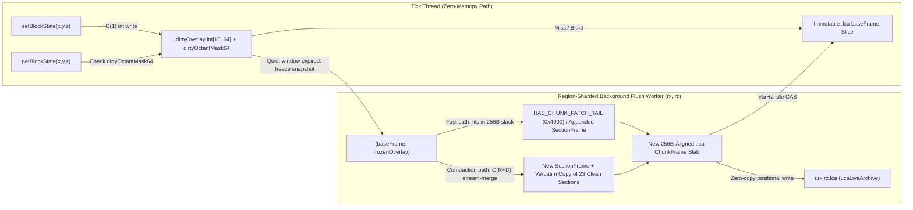

# leafanvil-ADR-002: In-Memory `.lca` Chunk Representation, $O(1)$ Dirty-Overlay Buffer & Non-Overlapping Slab Compaction

- **Status:** Proposed
- **Date:** 2026-04-19
- **Scope:** `:resource:LeafAnvil` (`leafanvil-common`, `leafanvil-paper`, `leafanvil-fabric`, `leafanvil-neoforge`) & `:anvil-api` (`io.github.dailystruggle.anvil`)
- **Related ADRs & Specs:** [`leafanvil-ADR-001`](leafanvil-ADR-001-Multi-Loader-lca-world-storage-and-bytecode-interceptor.md), [`leafanvil-ADR-003`](leafanvil-ADR-003-negotiated-lca-chunk-network-streaming-and-delta-sync.md), [`anvil-api-ADR-002`](../../../../api/anvil-api/docs/adr/anvil-api-ADR-002-multi-format-region-support.md), [`anvil-api-ADR-003`](../../../../api/anvil-api/docs/adr/anvil-api-ADR-003-hilbert-roaring-gray-chunk-archive.md), [`leafrtp-ADR-072`](../../../LeafRTP/docs/adr/leafrtp-ADR-072-zero-reallocation-flat-bitpacked-chunk-sections.md), [`LCA-ICD-1.0` (`api/anvil-api/docs/ICD.md`)](../../../../api/anvil-api/docs/ICD.md)

---

## Context

`leafanvil-ADR-001` intercepts chunk persistence at the `RegionFileStorage` / `RegionFile` stream boundary (`NmsRegionStorageInterceptor`, `LcaRegionFileStorage`, `LcaLiveArchive`), while `api/anvil-api` (`anvil-api-ADR-002`, `anvil-api-ADR-003`) provides the `.lca` (`LCA_V001`, `LCA-ICD-1.0`) binary codec and `AnvilChunkView` / `PaletteSection` reader models.

While `.lca` eliminates `4 KiB` `.mca` sector slack (`-39.3%` to `-50.2%` disk footprint) and `.linear` whole-region `Zstd` bucket stalls (`15.5x` faster shutdown saves), profiling live servers and chunk I/O pipelines exposes **three distinct memory-pressure and copy-amplification boundaries**:

### 1. Boundary A — The Mojang NBT Serialization Round-Trip (`LevelChunk` $\leftrightarrow$ `CompoundTag` $\leftrightarrow$ `byte[]` $\leftrightarrow$ `Map<String, Object>` $\leftrightarrow$ `.lca` `ChunkFrame`)

- **On Chunk Save (`LcaPreEncodingOutputStream` / `onWriteByteBuffer`):**
  1. Minecraft (`ChunkSerializer#write` in `1.20.4–1.21.1` or `SerializableChunkData#write` in `1.21.4+` / `26.1+`) copies every `LevelChunkSection`'s `PalettedContainer<BlockState>` (`long[]` bit-storage + palette), `PalettedContainer<Holder<Biome>>`, and `DataLayer` / Starlight `SWMRNibbleArray` (`byte[2048]`) into a heap tree of Mojang `CompoundTag` / `ListTag` / `LongArrayTag` / `ByteArrayTag` objects (`~40–90 KiB` of short-lived heap allocations per chunk).
  2. `NbtIo#write` serializes that `CompoundTag` tree into an uncompressed binary NBT `byte[]` inside `LcaPreEncodingOutputStream` (or Paper/Folia Moonrise's `RegionFile#write(ChunkPos, ByteBuffer)`).
  3. `LcaRegionFileStorage#encodeChunkNbtForRegionSlab` calls `Nbt.readRootCompound(uncompressedNbtBytes)`, parsing the binary NBT stream *back* into a second heap tree of `LinkedHashMap<String, Object>`, `ArrayList`, boxed primitives, `long[]`, and `byte[]` (`~60–120 KiB` per chunk save) before `LcaSectionCodec` encodes the `.lca` `ChunkFrame`.
  4. In `NmsRegionStorageInterceptor#onWriteByteBuffer`, `ByteBuffer#get(byte[])` allocates an additional `byte[payloadLen]` copy before `commitPreEncodedChunkSlab`.
- **On Chunk Load (`LazyChunkNbtInputStream` / `readChunkNbtBytes`):**
  1. `LcaRegionReader` decodes the compact `.lca` `ChunkFrame` (`~3–4.5 KiB`) into `ScratchArena.nbtOutBuf` (`128 KiB` thread-local buffer) and returns `Arrays.copyOf(nbtBuf, len)` (`~35–80 KiB` uncompressed binary Mojang NBT `byte[]`) wrapped in a `ByteArrayInputStream`.
  2. Vanilla, Moonrise, or `C2ME` parses that byte stream via `NbtIo#read` to allocate a full Mojang `CompoundTag` tree in heap, and `ChunkSerializer#read` / `SerializableChunkData#parse` copies those arrays a third time into `LevelChunkSection` (`PalettedContainer` + `SimpleBitStorage`).

### 2. Boundary B — `anvil-api`'s In-Memory `AnvilChunkView` / `PaletteSection` Inflation

- When `LcaRegionReader#readChunkView` decodes a chunk for `LeafRTP` or `LeafMap`, it materializes a `PaletteSection(int sectionY, List<String> palette, long[] data)` per non-uniform section where `data` is eagerly expanded into vanilla-style `YZX` `long[256..512]` (`2–4 KiB` per section, `~30–64 KiB` per chunk), plus `List<String>` palette copies—even though the underlying `.lca` `SectionFrame` is only `~150–300 B` of Delta-Roaring runs (`anvil-api-ADR-003` Section 5.2).

### 3. Boundary C — NMS Live In-Memory `LevelChunkSection` Footprint & Naive Copy-on-Write (`CoW`) Spikes

- **Steady-State Heap Overhead:** For every loaded chunk on the server, Minecraft's `LevelChunkSection` holds a `PalettedContainer<BlockState>` backed by `SimpleBitStorage`. Vanilla `SimpleBitStorage` enforces a **minimum floor of 4 bits per entry** (`long[256]` = `2,048 B`) even when a section contains only 2–4 distinct block states (e.g., `stone` + `deepslate`, or `water` + `air`, which represent `~20%` of all sections), and jumps to `long[342]` (`2,736 B`) as soon as a 17th block state enters the section, alongside per-section `LinearPalette` / `HashMapPalette` / `CrudIncrementalIntIdentityHashBiMap` instances (`~200–600 B`) and `byte[2048]` light arrays. Across `10,000` loaded chunks (`240,000` sections), live `PalettedContainer` and `DataLayer` objects consume `~500 MB–1.2 GB` of old-generation heap, despite `~75%–90%` of loaded sections never being mutated while in memory and `66.4%` of all sections being completely uniform (`|P| = 1`).
- **Why Naive Section-Level Copy-on-Write (`CoW`) Fails Under Scattered Edits:** `.lca`'s `BLOCK_MODE_DELTA_ROARING` (`TAG_DELTA_RUN`) packs minority block states as contiguous variable-length delta-run byte streams. Splitting a run in-place when a block is placed changes the container byte length (`+1 to +4 bytes`), which shifts subsequent minority state containers `p+1 .. |P|-1` in that `SectionFrame`. Conversely, if a cold `.lca` section naively unpacked to a full `long[256..342]` `SimpleBitStorage` on the first single-block mutation (section-level `CoW`), an explosion, redstone contraption, or `WorldEdit` brush touching just 1 block across each of 500 sections would trigger **500 full 4,096-voxel unpacks and `long[256..342]` allocations** (`~1–1.5 MB` of burst `memcpy` and permanent heap expansion) for only 500 modified voxels.

---

## Decision

We propose a **three-tier architectural evolution** for `LeafAnvil` and `anvil-api`, culminating in an **Immutable `.lca` `baseFrame` + $O(1)$ `dirtyOverlay` In-Memory Section Representation** paired with **Region-Sharded, Non-Overlapping Background Slab Compaction** built directly on top of the `LCA_V001` (`LCA-ICD-1.0`) forward-compatible patch primitives (`HAS_CHUNK_PATCH_TAIL = 0x4000`, order-independent `sectionOffsets[]`, and append-only `Slab-Local Micro-Palette` delta entries).

---

### 1. Tier 1: Zero-Copy Streaming NBT Transcoder & Flyweight `AnvilChunkView` (`:anvil-api` & `:leafanvil-common`)

*Target: Eliminate intermediate `Map<String, Object>` trees, duplicate `byte[]` copies in `NmsRegionStorageInterceptor`, and expanded `long[]` allocations in `PaletteSection` with zero NMS field coupling.*

1. **Stream-To-Slab Direct Binary NBT Transcoding (`LcaStreamingNbtEncoder`):**
   - Replace `Nbt.readRootCompound(byte[])` in `LcaRegionFileStorage#encodeChunkNbtForRegionSlab` with a single-pass streaming binary NBT visitor (`LcaStreamingNbtEncoder`) in `LcaSectionCodec`.
   - The visitor scans the uncompressed binary Mojang NBT `ByteBuffer` / `byte[]` directly into thread-local `ScratchArena` buffers (`yzxPaletteIdx`, `skyLightNibbles`, `blkLightNibbles`, `packedBlockLongs`), copying unknown non-section tags as raw byte slices straight into `residualNbtPayload` without instantiating `LinkedHashMap<String, Object>`, `ArrayList`, or boxed primitives (`~60–120 KiB` saved per chunk save).
2. **Zero-Copy `ByteBuffer` Slice Handoff in `NmsRegionStorageInterceptor`:**
   - Expose the internal buffer of `LcaPreEncodingOutputStream` (and Moonrise's `onWriteByteBuffer` parameter) as a zero-copy `ByteBuffer` slice passed directly to `FileChannel#write(ByteBuffer, long)` in `LcaLiveArchive#commitPreEncodedChunkCoW`, eliminating `toByteArray()` and `new byte[payloadLen]`.
   - In `LazyChunkNbtInputStream`, stream synthesized Mojang binary NBT lazily section-by-section from the `~4 KiB` `.lca` `ChunkFrame` instead of allocating a full `Arrays.copyOf(nbtBuf, len)` (`~35–80 KiB`) upfront.
3. **Flyweight `.lca`-Backed `PaletteSection` / `AnvilChunkView`:**
   - Allow `AnvilChunkView` and `PaletteSection` to wrap the `.lca` `ChunkFrame` slice (`byte[]` or `ByteBuffer`) directly, evaluating `blockIdAt(x, y, z)` and vertical column probes over the `uint16[sectionCount]` directory, `octreeOccupancyMask64`, and Delta-Roaring containers without eagerly inflating non-uniform sections into `long[256..512]`.

---

### 2. Tier 2: Direct `LevelChunkSection` $\leftrightarrow$ `.lca` `ChunkFrame` Bridge (Bypassing `CompoundTag` & `NbtIo`)

*Target: Eliminate Mojang `CompoundTag` tree construction and `NbtIo` byte streams on both chunk load and chunk save.*

1. **Direct Section Extractor on Save (`LevelChunkSection` $\to$ `LcaSectionCodec.ScratchArena`):**
   - Hook `SerializableChunkData#fromChunk(ServerLevel, ChunkAccess)` (`1.21.4+` / `26.1+`) and `ChunkSerializer#write` (`1.20.4–1.21.1`).
   - Extract each `LevelChunkSection`'s `PalettedContainer.Data<BlockState>` directly: map `Palette<BlockState>` entries to `.lca` dictionary IDs through a fast global `Block.BLOCK_STATE_REGISTRY` ID $\to$ `.lca` `dictId` lookup table (**zero string formatting or `Name`/`Properties` `CompoundTag` allocation**), unpack `BitStorage#getRaw()` into `ScratchArena.yzxPaletteIdx[4096]`, and feed `DataLayer#getData()` (`byte[2048]`) directly into the Gray-code bitplane encoder.
   - Serialize only non-voxel residual fields (`block_entities`, `block_ticks`, `fluid_ticks`, `structures`, Bukkit `BukkitValues` PDC) to a minimal residual `CompoundTag` (`< 200 B` for 95%+ of chunks).
2. **Direct Section Hydrator on Load (`.lca` `ChunkFrame` $\to$ `LevelChunkSection`):**
   - Resolve `.lca` Tier-1 (`STATIC_CORE`), Tier-2 (region shared dictionary), and Tier-3 (slab-local micro-palette, including appended patch entries) IDs via a cached `int[] lcaIdToMojangBlockStateId` table directly to singleton NMS `BlockState` references, bypassing string allocations and Mojang `Codec` / `DataFixerUpper` parsing whenever `chunkDataVersion == currentDataVersion`.

---

### 3. Tier 3: Immutable `.lca` `baseFrame` + $O(1)$ `dirtyOverlay` In-Memory Section Representation

*Target: Keep loaded chunks in compact `.lca` form in steady-state server RAM while absorbing random single-block edits in $O(1)$ (`~1–2 ns`) with zero `baseFrame` unpacking and zero 4,096-voxel `memcpy`.*

Instead of eagerly unpacking every loaded `LevelChunkSection` into a `2,048 B` `long[256]` `SimpleBitStorage` (or triggering a full 4,096-voxel `memcpy` on the first block edit), each in-memory section pairs an **immutable `.lca` base slice** with a **tiny, fixed-capacity open-addressed delta overlay**:

#### A. Base Layer (`baseFrame` — Immutable `.lca` `SectionFrame` Slice, `~0–300 B`)
- **Inline Uniform Sections (`66.4%` of sections):** Encoded entirely in the 2-byte `uint16 sectionOffsets[i]` header word (`0x8000 | (skyLight2 << 13) | (biomeTemplate2 << 11) | localDictId11`, `LCA-ICD-1.0` Section 6.4). `baseFrame` is `null` (`0` body bytes in RAM) and backed by `ZeroBitStorage` + `SingleValuePalette`.
- **Non-Uniform Cold Sections:** `baseFrame` points directly to the section's `[relStart_i .. relEnd_i)` byte slice (`~150–300 B`) inside the chunk's `256-byte`-aligned `.lca` `ChunkFrame` slab in RAM (or a sub-4-bit `1b`/`2b` / `octreeOccupancyMask64` sparse $4 \times 4 \times 4$ octant view where only non-dominant octants with bit $k = 1$ allocate a `32-byte` `long[4]` cell, indexed in $O(1)$ via `Long.bitCount(mask & ((1L << octantIdx) - 1))`).
- **Shared Immutable Palettes:** Deduplicate immutable `Palette<BlockState>` instances across the region archive for common 2- to 4-state strata combinations (e.g., `[stone, deepslate]`, `[air, grass_block, dirt]`), eliminating per-section `LinearPalette` / `HashMapPalette` object overhead (`~200–600 B` per section).

#### B. Delta Layer (`dirtyOverlay` & `dirtyOctantMask64` — $O(1)$ Zero-`memcpy` Block Writes)
When a block is mutated in a loaded section (`setBlockState(x, y, z, newState)`):
1. **32-Bit Packed Voxel Delta Word (`4 bytes`), Section-Local Coordinate Masking & Zero-Sentinel Disambiguation:**
   - A voxel's intra-section coordinate is kept in raw native `YZX` order (`pos12 = ((y & 15) << 8) | ((z & 15) << 4) | (x & 15)`, `0..4095`) on the tick thread so zero space-filling curve permutation (`H_3`, `Y+H_2`, `XZY`) ever runs on the game thread.
   - **Section-Local $Y$ Masking Invariant ($Y \in [-64, 319]$):** Downstream hooks and mixins (especially those intercepting world-level coordinate methods where $Y$ is absolute world space) **must** mask (`& 15`) or shift $Y$ relative to `section.bottomBlockY()` before computing `pos12` and `octantIdx = (((y & 15) >>> 2) << 4) | (((z & 15) >>> 2) << 2) | ((x & 15) >>> 2)` (`0..63`). Passing an unmasked world-space $Y$ into `pos12` would overflow the 12-bit coordinate boundary and corrupt the 13-bit `(pos12 + 1)` sentinel field.
   - Because `pos12 = 0` (`(0, 0, 0)`) and `stateId = 0` (`air`) are valid values, packing stores **`(pos12 + 1)` (`1..4096`) in the upper 13 bits** and `stateId19` (`0..524,287` global `BlockState` ID or `.lca` dictionary ID) in the lower 19 bits:
     $$\mathtt{entry32} = ((\mathtt{pos12} + 1) \ll 19) \mid (\mathtt{stateId19} \ \& \ \mathtt{0x7FFFF})$$
   - This guarantees that `entry32 == 0` is **strictly the empty-slot sentinel** without requiring a separate occupancy bitmask lookup during probing.
2. **Two-Stage L1-Resident `int[16..64]` Overlay (`64–256 bytes`) & Load-Factor Ceiling:**
   - For $D \le 16$ (`64 B`, a single CPU L1 cache line), `dirtyOverlay` uses a flat unhashed `int[16]` scanned branchlessly in L1 cache (`~1–2 ns`, zero hash-collision branch mispredictions).
   - When $16 < D \le 48$ (`256 B`, capped at a **$75\%$ load factor** on `int[64]`), `dirtyOverlay` promotes to a power-of-two open-addressed `int[64]` table indexed by upper-bit 32-bit Fibonacci hashing:
     $$\mathtt{slot} = ((\mathtt{pos12} \times \mathtt{0x9E3779B9}) \ggg 26) \ \& \ 63$$
     using `entry32 == 0` as the empty-slot sentinel and **linear probing (`slot = (slot + 1) & 63`)** for collision resolution. (Extracting the top 6 bits via `>>> 26` is mandatory: because `(y << 8)` is a multiple of $2^8 = 256$, a low-bit hash `(pos12 * 0x9E37) & 63` would receive zero entropy from $Y$, causing vertical column edits at identical $(x, z)$—falling sand, pillar building, strip mining, fluid columns—to collide on the exact same initial slot.)
   - **Open-Addressed Load-Factor Invariant ($\le 75\%$ on `int[64]` / $\le 50\%$ on `int[128]`):** Open-addressed linear probing degrades sharply in probe cluster length above a `75%` load factor (reaching a worst-case 63-slot probe as $D \to 63$). To guarantee $O(1)$ tail-probe latency without cluster degradation, `int[64]` never exceeds $D = 48$ (`75%` load factor) before triggering `Section 3.D` promotion (or, if configured for a full `64`-entry overlay capacity, sizes the stage-2 table to `int[128]` / `512 B` indexed by `((pos12 * 0x9E3779B9) >>> 25) & 127` at a $\le 50\%$ load factor).
   - **In-Place Update & Unique-Voxel `dirtyCount` Invariant:** When a coordinate `pos12` is written more than once within the same overlay epoch (e.g., water placed and then overwritten with stone at the same `(x, y, z)`), the `int[16]` linear scan or `int[64]` linear probe tests `(entry32 >>> 19) == (pos12 + 1)` and **overwrites the existing slot in-place** rather than appending or inserting a duplicate `pos12` entry. `dirtyCount` (`D`) is incremented **only** when claiming a previously empty (`entry32 == 0`) slot, ensuring `D` strictly counts unique modified voxels in the section rather than total write operations.
   - `dirtyOctantMask64` is a `long` bitmask where bit `octantIdx = (((y & 15) >>> 2) << 4) | (((z & 15) >>> 2) << 2) | ((x & 15) >>> 2)` (`0..63`, corresponding to the $4 \times 4 \times 4 = 64$-voxel sub-cube) is set to `1` whenever any voxel in that octant is written.
   - **Write Cost & Inline Counter Maintenance:** `setBlockState(x, y, z, newState)` resolves `oldState` (via the octant-filtered read path below), updates `LevelChunkSection`'s `nonEmptyBlockCount`, `tickingBlockCount`, and `tickingFluidCount` (plus Paper/Moonrise bitset-indexed ticking queues) from the `oldState -> newState` property delta, writes **one `4-byte` `int`** into `dirtyOverlay`, sets `dirtyOctantMask64 |= (1L << octantIdx)`, and records `lastMutatedTick = currentTick`—with **zero `baseFrame` unpacking and zero 4,096-voxel `memcpy`**.

#### C. Read Path (`getBlockState(x, y, z)`) & 3-Layer Compaction View
1. **Clean Fast Path (`dirtyCount == 0` and `frozenOverlay == null`, `~85%–95%` of loaded sections):** Read directly from `baseFrame` (or $O(1)$ inline constant / octant cell).
2. **Octant-Filtered Dirty Path (`dirtyCount > 0` or `frozenOverlay != null`):**
   - Compute `octantIdx` (`0..63`) and test `((dirtyOctantMask64 | frozenOctantMask64) & (1L << octantIdx)) == 0L`.
   - **If `0` (`~90%+` of reads in a lightly edited section):** Skip both overlays in **1 CPU cycle** (`1` bitwise `OR` + `AND`) and read directly from `baseFrame`.
   - **If `1` (3-Layer Precedence — `activeOverlay -> frozenOverlay -> baseFrame`):**
     1. If `(dirtyOctantMask64 & (1L << octantIdx)) != 0L`, probe active `dirtyOverlay` (`overlayB`) in L1 cache (`O(1)`). If `(entry32 >>> 19) == (pos12 + 1)`, return `stateId19 = entry32 & 0x7FFFF`.
     2. Otherwise, if a background compaction is in flight (`frozenOverlay != null` and `(frozenOctantMask64 & (1L << octantIdx)) != 0L`), probe read-only `frozenOverlay` (`overlayA`). If `(entry32 >>> 19) == (pos12 + 1)`, return `stateId19 = entry32 & 0x7FFFF`.
     3. Otherwise, fall through to `baseFrame`.
   - Retaining `frozenOverlay` as a read-only secondary reference until `VarHandle#compareAndSet` atomically publishes `(newBaseFrame, null, epoch + 1)` guarantees that neither `getBlockState` nor a concurrent unload/autosave snapshot (`SerializableChunkData#fromChunk` / `ChunkSerializer#write`) ever observes a split-horizon gap while `frozenOverlay` is mid-compaction.

#### D. Adaptive Bulk-Edit Threshold (Explosions / `WorldEdit`)
- Normal gameplay edits (player building, mining, pistons, fluid flow) keep `dirtyCount <= 48` (`75%` load factor on `int[64]`, `64–256 B`; or `dirtyCount <= 64` at `50%` load factor on `int[128]`, `512 B`) inside the L1-resident overlay without ever unpacking the section.
- If a bulk operation (TNT explosion, `WorldEdit` brush) mutates `> 48` distinct voxels on `int[64]` (or `> 64` on `int[128]`) within the same section before the background flush window triggers, promote either only the affected $4 \times 4 \times 4$ sub-octants (`long[4]` = `32 B` per octant) or upgrade that single section to `BLOCK_MODE_FLAT_BITPACK` (`leafrtp-ADR-072`, `LCA-ICD-1.0` Section 7.3) until the next background slab compaction.

---

### 4. Non-Overlapping Background Slab Compaction & `LCA_V001` Patch Integration

To fold `dirtyOverlay` mutations back into compact `.lca` frames without contending with server tick threads or rewriting untouched sections, `LeafAnvil` schedules background flushes using **spatial region sharding**, **temporal quiet-window coalescing**, and **lock-free double-buffered `CAS` swaps**:

#### A. Cooldown / "Quiet-Window" Write Coalescing (`lastMutatedTick`)
- Active sections undergoing rapid consecutive mutations (redstone clocks, pistons, water/lava spread, active player building) must not trigger background re-encoding on every tick.
- Each dirty section tracks `lastMutatedTick`. While `currentTick - lastMutatedTick < quietWindowTicks` (default `20–40 ticks` / `1–2 seconds`) and `dirtyCount <= 48` (`75%` load factor on `int[64]`), all edits coalesce in-place inside the L1-resident `dirtyOverlay`.
- Only after a section remains quiet for `quietWindowTicks` (or when `dirtyCount` crosses the `48`-entry load-factor high-water mark or world save is requested) is the chunk enqueued to the regional flush planner.

#### B. Lock-Free Double-Buffered Snapshot (`VarHandle#compareAndSet`), Tombstone & Unload/Save Epoch Fence
- When a chunk is selected for background flush, the planner snapshots the immutable tuple `(baseFrame, frozenOverlay, epoch)`—retaining `frozenOverlay` (`overlayA`) as a read-only secondary layer on the section—and atomically switches the live section's active delta pointer to a fresh secondary `dirtyOverlay` slot (`overlayB`, an LSM-style memtable switch).
- The background flush worker operates **exclusively on the immutable `(baseFrame, frozenOverlay, epoch)` snapshot** using its own thread-local `LcaSectionCodec.ScratchArena` (`0` heap allocations, `0` locks held on the live `LevelChunkSection`).
- **Authoritative Tombstone / Epoch Race Invariant:** While `frozenOverlay` (`overlayA`) is being compacted in the background (`epoch`), any concurrent block mutation on the tick thread writes into the active secondary `overlayB`. Entries in `overlayB` are **strictly authoritative overwrites/tombstones** and must **never** be elided or removed simply because `newState` matches `oldBaseFrame` (for example, if a voxel toggles `air -> stone` in `overlayA` and reverts `stone -> air` in `overlayB` while `overlayA` is mid-compaction). Eliding `air` from `overlayB` against `oldBaseFrame` would lose the revert once `newBaseFrame` (containing `stone`) is published via `VarHandle#compareAndSet`. Deduplication against `baseFrame` is permitted only when no background flush is in flight (`frozenOverlay == null`) or after `newBaseFrame` publication completes and the active `epoch` advances.
- **Wait-Free Unload / Save Coalescing (`REQ-RTP-S-005` Compliance):** `ChunkMap#save`, `LevelChunk#unloadCallback`, and `SerializableChunkData#fromChunk` / `ChunkSerializer#write` execute on the main server thread (or Folia owning region thread) and **must never block (`CompletableFuture#join()`)** waiting on a background compaction worker:
  1. **Queued Task Cancellation & Single-Pass Fold:** If a background flush task for `epoch` is still queued in the regional `(rx, rz)` FIFO queue when save/unload is triggered, the tick thread atomically cancels/dequeues the pending task and folds the coherent 3-layer state `(baseFrame, frozenOverlay, overlayB)` in a single save pass.
  2. **Mid-Flight Task & Unload Tombstone Fence (`UNLOADED` Bit):** Each chunk holder tracks a monotonic `chunkEpoch` (`long`) where bit `63` (`Long.MIN_VALUE`) is the terminal `UNLOADED` tombstone flag. When a chunk unloads while its background compaction task is already mid-flight:
     - The save path extracts from the coherent 3-layer view `(baseFrame, frozenOverlay, overlayB)` (or chains the final `(+ overlayB + residualNbt)` commit onto the same single-worker `(rx, rz)` regional queue behind the in-flight task) and sets `chunkEpoch |= UNLOADED` via `VarHandle`.
     - If the in-flight background worker finishes after unload, its `VarHandle#compareAndSet` on `chunkEpoch` observes the `UNLOADED` bit, aborts in-memory publication, and recycles its scratch buffers without touching the unloaded `LevelChunkSection`.
  3. **Monotonic `lastCommittedEpoch[1024]` Guard in `LcaLiveArchive`:** `LcaLiveArchive#commitPreEncodedChunkCoW` tracks `long lastCommittedEpoch[1024]` per chunk slot `(cx & 31, cz & 31)`. Any commit carrying `taskEpoch <= lastCommittedEpoch[slotIdx]` is rejected as stale, guaranteeing that a background compaction task (`epoch N`) can never overwrite a newer unload or autosave slab (`epoch N + 1`) in `r.<rx>.<rz>.lca`.

#### C. Two-Mode Flush Leveraging `LCA-ICD-1.0` (`LCA_V001`) Patch Primitives
Because `LCA-ICD-1.0` (`anvil-api-ADR-003`) bakes patch-level primitives directly into `LCA_V001`, the background flush worker has two zero-waste flush strategies:

1. **Mode 1 — Fast Tail-Slack Patch (`HAS_CHUNK_PATCH_TAIL = 0x4000` & Out-of-Order `sectionOffsets[]`):**
   - Every `.lca` `ChunkFrame` is padded to `256-byte` sub-slabs (`slabShift = 8`), leaving an average of **`~128 bytes` of natural tail slack** inside the chunk's existing slab allocation.
   - Furthermore, the in-memory `dirtyOverlay` is **structurally isomorphic** to `LCA-ICD-1.0` Section 8.3 (`boilerplateFlags16` bit `14` = `0x4000`, `HAS_CHUNK_PATCH_TAIL`):
     - New block states or biome templates not yet in the chunk's `Slab-Local Micro-Palette` are appended to `appendedPartACount` / `appendedPartBCount` (assigned to local indices `K .. K + M - 1` so existing local indices `0 .. K - 1` in the 23 untouched sections never shift).
     - For sparse edits (`1..32` voxels), the worker serializes the sorted `(pos12, localStateIdx)` delta pairs directly into `ChunkPatchTail` (protected by `patchParity8`, `CBIT T6b`) inside the trailing `256B` sub-slab slack.
     - Alternatively, when a single section `i` is re-encoded into a new `SectionFrame` (`~150–300 B`), order-independent section bounding (`LCA-ICD-1.0` Section 6.4: $\mathtt{relEnd}_i = \min\{\mathtt{relStart}_j > \mathtt{relStart}_i, \mathtt{residualRelStart}, \mathtt{frameLen}\}$) allows appending the new `SectionFrame[i]` at the tail of the chunk frame and updating either `sectionOffsets[i]` (`2 bytes`) or `PATCH_FLAG_REPLACEMENT_OFFSET` (`0x02`) **without shifting or touching the other 23 `SectionFrame`s**.

2. **Mode 2 — Off-Thread Curve Permutation & $O(R + D)$ Stream-Merge Section-Splice Compaction:**
   - When merging `frozenOverlay` into `baseFrame`:
     - Because `dirtyOverlay` stores `pos12` in raw `YZX` coordinates to keep space-filling curve math off the tick thread, the background flush worker first permutes the $D \le 64$ `frozenOverlay` coordinates into the section's active curve order (`00:YZX`, `01:H_3`, `10:Y+H_2`, or `11:XZY`) and sorts those $\le 64$ integers inside its thread-local `ScratchArena`.
     - If `baseFrame` uses `BLOCK_MODE_DELTA_ROARING` (`TAG_DELTA_RUN`), the worker **stream-merges** the curve-sorted delta coordinates directly into the existing `TAG_DELTA_RUN` containers in **$O(R + D)$ time (`< 500 ns`, where $R \approx 30$ runs)** without decoding all 4,096 voxels into `yzxPaletteIdx[4096]`.
     - For the **20–23 unmodified sections** in that chunk (`dirtyCount == 0`), the worker copies their existing compressed `SectionFrame` byte slices (`[relStart_j .. relEnd_j)`, `~3 KiB` total) **verbatim via `System.arraycopy`** without decoding or re-encoding their blocks, biomes, or Gray-code light bitplanes.
   - The resulting `256B`-aligned `ChunkFrame` slab simultaneously serves as:
     1. **The new in-memory `baseFrame` backing slab** for all 24 sections of the live chunk (published via `VarHandle#compareAndSet`, releasing the old slab and recycling `frozenOverlay` to the pool), and
     2. **The exact byte-for-byte pre-encoded `.lca` disk slab** staged for zero-copy positional write (`FileChannel#write(ByteBuffer, slabOffset)`) in `LcaLiveArchive` on world autosave.

#### D. Spatial Non-Overlapping Region Sharding (`rx, rz`)
- Flush queues are partitioned by `.lca` region coordinates `(rx, rz)` (`r.<rx>.<rz>.lca`), aligning 1-to-1 with Folia's regional tick ownership (`Rule F-001..F-003`) and `LcaLiveArchive` instances.
- At most one background flush worker processes a given `(rx, rz)` region archive at any time, ensuring **zero cross-thread lock contention** on the region's `Tier-2 Shared Dictionary` (`0x2040`), the `uint64[1024]` atomic pointer directory, and the `256-byte` sub-slab `TreeMap` free-list allocator.

---

### 5. Lighting Lifecycle & Paper / Moonrise / Folia / Mod Compatibility

#### A. Lighting (`LIGHT_MODE_CONST` & `LIGHT_MODE_GRAY_PLANES`)
1. **Cold Uniform Light (`~75%+` of sections):**
   - Sections with uniform `SkyLight` (e.g., `0` underground or `15` open sky) and uniform `BlockLight` (`0`) are represented in `.lca` by `LIGHT_MODE_CONST = 01` (`1 byte`: `uint8 constLightNibbles = (blkConst4 << 4) | skyConst4`, or inline `skyLight2` in `sectionOffsets[i]`).
   - In RAM, these sections stay unallocated (`0 B` `byte[]` array), mapping directly to Paper/Starlight's constant/uninitialized `SWMRNibbleArray` state (or a shared read-only constant table on Fabric/NeoForge with Copy-on-Write clone on `set(...)`), saving `2,048–4,096 B` per section.
2. **Active Light Propagation Wave (Hot State & Atomic CAS Coordination):**
   - Running BFS flood-fill light updates (`Starlight` / `ThreadedLevelLightEngine`) directly on RLE-compressed `LIGHT_MODE_GRAY_PLANES` bitplanes would re-encode bitplanes hundreds of times per torch placement.
   - Therefore, when a light propagation wave enters a section, it operates on a hot mutable `byte[2048]` (`SWMRNibbleArray`) or raw 4-bitplane `long[64]` bitmap (`11 = Raw 512B Bitmap` in `LCA-ICD-1.0` Section 7.4, where nibble updates are $O(1)$ bitwise word operations).
   - **Concurrent Light Thread Coordination (`VarHandle` / `AtomicReference` CAS):** Because `ThreadedLevelLightEngine` and Paper/Folia Starlight execute light updates on asynchronous worker threads decoupled from the region tick thread running `setBlockState`, both promotion from `LIGHT_MODE_CONST` to the mutable hot buffer and demotion/compaction back to `LIGHT_MODE_CONST` / `LIGHT_MODE_GRAY_PLANES` must use an atomic compare-and-set (`VarHandle#compareAndSet` / `AtomicReference<byte[]>`, or Starlight's `SWMRNibbleArray` state lock/CAS protocol) so concurrent block mutations, light propagation workers, and background slab compaction threads never race when allocating or reclaiming the `2,048 B` light buffer.
   - Once the section's `lastMutatedTick` quiet window expires (`1–2 seconds` after light propagation settles), the background flush worker encodes the settled light array into `LIGHT_MODE_CONST` (`1 B`) or `LIGHT_MODE_GRAY_PLANES` (`~30–120 B` in the chunk slab) and atomically swaps the cold representation back in before releasing the `2,048 B` `byte[]` buffer to the pool.

#### B. Paper / Moonrise (`BlockCountingBitStorage`), Lithium & Network Packet Streaming
1. **Inline Ticking & Non-Empty Block Counter Deltas (`LevelChunkSection#setBlockState` & `hasOnlyAir()`):**
   - Vanilla and Paper/Folia's Moonrise engine (`ca.spottedleaf.moonrise.patches.block_counting`, which replaces vanilla ticking lists with bitset-indexed linked queues) maintain live per-section counters (`nonEmptyBlockCount`, `tickingBlockCount`, `tickingFluidCount`) and ticking coordinate bitsets inside `LevelChunkSection` / `PalettedContainer` to drive random block ticks, fluid ticks, and mob spawning.
   - When `dirtyOverlay` intercepts `setBlockState(x, y, z, newState)` in Tier 3 without materializing `PalettedContainer`, it must resolve `oldState` (via `getBlockState(x, y, z)`) and apply the exact `oldState -> newState` delta to `nonEmptyBlockCount`, `tickingBlockCount`, `tickingFluidCount`, and Moonrise's bitset-indexed ticking queues so ticking and spawning behavior never drift.
   - **Entry Coordinate Masking & Release-Store Visibility on `nonEmptyBlockCount` (`hasOnlyAir()`):** At `LevelChunkSection` and `PalettedContainer` hook entrypoints, coordinates shall always be masked (`x & 15`, `y & 15`, `z & 15`) before computing `pos12` or `octantIdx`. On Vanilla, Fabric, NeoForge, and Paper/Folia, `LevelChunkSection#hasOnlyAir()` (`nonEmptyBlockCount == 0`) is checked as a fast-path by entity collision and AI pathfinding workers executing across off-thread / asynchronous worker pools. Updates to `nonEmptyBlockCount`, `tickingBlockCount`, and `tickingFluidCount` during `dirtyOverlay` writes must therefore publish with volatile or release-store semantics (`VarHandle#setRelease` / `setVolatile`) strictly *after* writing `dirtyOverlay` and `dirtyOctantMask64` (and invoking `TickingCoordinateCallback` for Paper/Folia `Moonrise` `SimpleRandomTickList`) so off-thread pathfinders and collision checks never observe a non-empty count before the overlay entry is visible.
2. **Network Chunk Packet Streaming (`ClientboundLevelChunkWithLightPacket` & `leafanvil-ADR-003` Negotiated `.lca` Stream):**
   - For unmodified vanilla clients, hook `LevelChunkSection#write(FriendlyByteBuf)` / `PalettedContainer#write` to stream the standard Mojang network wire format directly from `(baseFrame, dirtyOverlay)` using `ScratchArena`'s thread-local `long[1024]` scratch buffer—avoiding permanent heap inflation of cold sections when players walk across chunks.
   - For negotiated Fabric and NeoForge clients running `LeafAnvil` ([`leafanvil-ADR-003`](leafanvil-ADR-003-negotiated-lca-chunk-network-streaming-and-delta-sync.md)), `PlayerChunkSender` slices `(baseFrame, dirtyOverlay)` directly into `ClientboundLcaChunkBatchPayload` (`O(1)` `System.arraycopy`, zero curve-to-`YZX` unpacking on the server) and attaches the `.lca` slab directly to the client's `ClientLevel` `LevelChunkSection`.
3. **Non-Pinning Ephemeral Copy-on-Read for Client Meshers (`Sodium` `WorldSlice`) & `PalettedContainer` Shell Interception:**
   - Client chunk meshers (**Sodium** `WorldSlice` / `ChunkRenderRebuildTask` and vanilla `SectionCompiler`) call `PalettedContainer#copy()` on the client main thread to hand an isolated section snapshot to background meshing worker threads, while multi-block update packets (`ClientboundSectionBlocksUpdatePacket`) mutate `LevelChunkSection` / `PalettedContainer` entries in batches.
   - Hooking both `LevelChunkSection` (`MixinLevelChunkSection`) and `PalettedContainer` (`MixinPalettedContainer`) ensures that multi-block updates always write into `LcaSectionBacking`, while `PalettedContainer#copy()` materializes a transient snapshot via `LcaSectionBacking#materializeEphemeralStateIds` (`THREAD_LOCAL_EPHEMERAL_VOXELS`) without permanently pinning an inflated `SimpleBitStorage` `long[256..342]` back onto the live `LevelChunkSection`.

---

## Consequences

### Positive
- **Eliminates Save/Load Serialization Churn (Tiers 1 & 2):** Cuts chunk load and save temporary heap allocations by **`85%–95%`** by removing the `CompoundTag` $\leftrightarrow$ `byte[]` $\leftrightarrow$ `LinkedHashMap` round-trip and string palette parsing.
- **Reduces Steady-State Loaded Chunk RAM by `40%–65%` (Tier 3):** Cold sections (`~85%–95%` of loaded sections) remain backed by their `256B`-aligned `.lca` chunk slab (`0 B` body for `66.4%` uniform sections; `~150–300 B` for non-uniform sections) with deduplicated `Palette<BlockState>` instances and unallocated constant light channels.
- **$O(1)$ (`~1–2 ns`) Single-Block Mutations with Zero Unpack `memcpy`:** Scattered single-voxel edits write a single `4-byte` `((pos12 + 1) << 19) | (stateId19 & 0x7FFFF)` `int` into `dirtyOverlay` and set 1 bit in `dirtyOctantMask64`, completely avoiding the `1–1.5 MB` burst `memcpy` spikes of naive section-level Copy-on-Write.
- **Near-Zero Autosave CPU via Unified In-Memory / On-Disk `.lca` Slabs:** Background flush workers compact only the `1–2` dirty sections per chunk (`< 500 ns` via $O(R + D)$ `TAG_DELTA_RUN` stream-merge or `HAS_CHUNK_PATCH_TAIL = 0x4000` tail-slack append) and copy the `20–23` clean `SectionFrame`s verbatim (`System.arraycopy`), producing the exact `256B`-aligned `.lca` slab needed for disk persistence off-thread before autosave even begins.
- **Zero `.lca` Format Breakage:** Relies entirely on `LCA_V001` (`LCA-ICD-1.0`) primitives already locked into `anvil-api-ADR-003` (`HAS_CHUNK_PATCH_TAIL = 0x4000`, order-independent `sectionOffsets[]`, and append-only `Slab-Local Micro-Palette` entries).

### Trade-Offs & Risks
- **Loader & NMS Hook Surface (Tiers 2 & 3):** While Tier 1 is 100% internal to `:anvil-api` and `:leafanvil-common`, Tiers 2 and 3 hook `LevelChunkSection`, `PalettedContainer`, and `BitStorage` across Paper/Folia (`1.20.4–26.1+`), Fabric (`26.1+`), and NeoForge (`26.1+`). Every NMS hook must degrade gracefully to Tier 1 if an unknown server fork replaces `PalettedContainer` internals.
- **External `BitStorage#getRaw()` Pinning:** Mods or server patches that unconditionally call `BitStorage#getRaw()` on every section at chunk load time would trigger the Copy-on-Read fallback unless routed through `LeafAnvil`'s `BlockCountingBitStorage` / collision bridge; Moonrise block-counting integration must therefore compute non-air / ticking block counts directly from `.lca`'s `SectionFrame` run totals and `dirtyOverlay` transitions during hydration.
- **Double-Buffered Overlay Lifecycle:** Background compaction workers and tick threads must strictly honor the `VarHandle#compareAndSet` epoch contract on `(baseFrame, frozenOverlay)` so concurrent block writes on the owning region thread are never lost or reordered across a compaction boundary.
