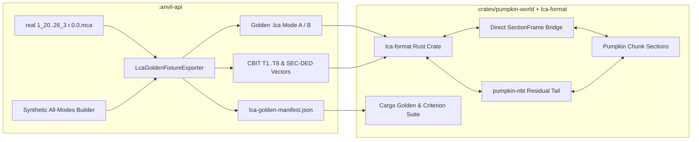

# leafanvil-ADR-004: PumpkinMC Pure-Rust `.lca` Codec (`lca-format`), Direct `SectionFrame` Bridge, Cross-Language Golden Fixture Suite & Performance Proof Contract

- **Status:** Accepted
- **Date:** 2026-11-11
- **Scope:** `:resource:LeafAnvil` (`docs/adr/`, `docs/dev/SUPPORT_MATRIX.md`), `:anvil-api` (`io.github.dailystruggle.anvil.LcaGoldenFixtureExporter`, `LcaGoldenFixtureTest`), & external Rust target (`Pumpkin-MC/Pumpkin` `crates/pumpkin-world` + `lca-format`)
- **Related ADRs & Specs:** [`leafanvil-ADR-001`](leafanvil-ADR-001-Multi-Loader-lca-world-storage-and-bytecode-interceptor.md), [`leafanvil-ADR-002`](leafanvil-ADR-002-in-memory-lca-chunk-representation-and-dirty-overlay-compaction.md), [`leafanvil-ADR-003`](leafanvil-ADR-003-negotiated-lca-chunk-network-streaming-and-delta-sync.md), [`anvil-api-ADR-002`](../../../../api/anvil-api/docs/adr/anvil-api-ADR-002-multi-format-region-support.md), [`anvil-api-ADR-003`](../../../../api/anvil-api/docs/adr/anvil-api-ADR-003-hilbert-roaring-gray-chunk-archive.md), [`leafrtp-ADR-072`](../../../LeafRTP/docs/adr/leafrtp-ADR-072-zero-reallocation-flat-bitpacked-chunk-sections.md), [`LCA-ICD-1.0` (`api/anvil-api/docs/ICD.md`)](../../../../api/anvil-api/docs/ICD.md)

---

## Context

On JVM servers (**Paper, Folia, Spigot, Fabric, and NeoForge**), `LeafAnvil` (`leafanvil-ADR-001`) intercepts `net.minecraft.world.level.chunk.storage.RegionFileStorage` at runtime and pairs with `leafanvil-ADR-002`'s in-memory `(baseFrame, dirtyOverlay)` representation to read and write `.lca` (`LeafCraft Anvil`, `LCA-ICD-1.0`) region archives without intermediate Anvil NBT translation on the hot voxel path.

**PumpkinMC** (`Pumpkin-MC/Pumpkin`) is a native **Rust** Minecraft server implementation with no JVM. Its world storage engine (`crates/pumpkin-world`) selects region storage formats via `pumpkin.toml`:

```toml
[world.chunk]
type = "lca" # alongside "pump", "anvil" (.mca), and "linear" (.linear)
```

PumpkinMC's existing storage backends exhibit three limitations when operating in multi-platform server ecosystems or under random-access chunk workloads:

1. **Zero Cross-Platform World Portability with `.pump`:** PumpkinMC's custom `.pump` format cannot be opened directly by Paper, Folia, Fabric, NeoForge, or external map/forensics tools (`LeafMap`, `LeafShard`, `LeafRTP`) without an offline full-world conversion pass.
2. **Whole-Region / Multi-Chunk Bucket Write & Cold-Read Amplification in `.linear` and `.pump`:** Whole-region `Zstd` archives (`.linear`) and multi-chunk bucketed stores must decompress and recompress entire region/bucket frames (`200 KiB`–`5 MiB`) to read a single cold chunk or flush a single modified chunk, causing severe tail-latency spikes during random teleports (`REQ-RTP-S-005`) and incremental saves.
3. **Full-Chunk Anvil NBT Serialization Overhead in `.mca`:** Vanilla `.mca` (`Zlib`) forces every chunk load and save through full-chunk NBT compound allocation (`sections`, `block_states.palette`, `block_states.data` `LongArrayTag` with `64-bit` word-boundary padding rules, `biomes`, `SkyLight`, `BlockLight`), even when only terrain elevation or a single $16^3$ section is needed.

Because `.lca` (`LCA-ICD-1.0`, `formatVersion = 0x0002`) is a language-neutral, big-endian binary specification built on fixed-width bitfields, Extended Hamming `(72, 64)` `SEC-DED` codes, `256 B` Copy-on-Write (`CoW`) slabs, 3D Hilbert/YZX curves, Delta-Roaring containers, and 4-bitplane Gray-code light, it maps directly to zero-copy Rust slices and SIMD-friendly integer primitives.

---

## Decision

### 1. Pure-Rust `lca-format` Crate & Direct `SectionFrame` Bridge Architecture (`REQ-RTP-S-005`)

We standardize a **Direct `SectionFrame` Bridge** between a standalone, zero-JVM pure-Rust `.lca` codec crate (`lca-format`) and `crates/pumpkin-world`, matching the Tier 2 zero-NBT-round-trip architecture of [`leafanvil-ADR-002`](leafanvil-ADR-002-in-memory-lca-chunk-representation-and-dirty-overlay-compaction.md):



#### 1.1 Rust Crate Module Layout (`lca-format` in `resource/LeafAnvil/rust/lca-format`)
- `lca_format::layer1`: `64 B` Superblock (`"LCA_V001"` magic `0x4C43415F56303031` at `0x00..0x07`, `formatVersion = 0x0002` at `0x08..0x09`, `slabShift = 8` at `0x1A..0x1B`, `dictOffsetAndLen` at `0x20..0x27`, `lodHeaderOffsetAndLen` / `secDedTableByteOffset` at `0x28..0x2F`, `slabPoolBaseOffset` at `0x30..0x37`, and 64-bit SplitMix/XXH64 `headerChecksum` at `0x38..0x3F`), `8 KiB` `u64[1024]` Atomic Pointer Directory at `0x0040..0x203F` (`35-bit` `slabOffset35` in `256 B` units at `bits 63..29`, `1-bit` `codec1` at `bit 28`, `20-bit` `exactByteLen20` at `bits 27..8`, `8-bit` `generation8` at `bits 7..0`), `1 KiB` `SecDed64` (`secDedTableByteOffset`, default `0x2440` following the `1 KiB` Root Dictionary at `0x2040`) Extended Hamming `(72, 64)` pointer syndrome verifier/healer, in-memory `CoW` free-slab bitmap allocator reconstructed from pointer and dictionary occupancy on open, and `"LCA1_END"` (`0x4C4341315F454E44`) footer canary at `fileLength - 8`.
- `lca_format::layer2`: Append-only Chained Shared `BlockState` & `Biome` Dictionary rooted at `0x2040` (`8 B` segment header: `u32 segmentStateCount`, `u16 segmentBiomeCount`, `u16 usedPayloadBytes`; `StateEntry[]` and `BiomeEntry[]`; optional forward-indexed `patternArenaSlice` starting with `384 B` of 4-bit Canonical Huffman code lengths for `lit`, `cmd`, `off` followed by cross-chunk LZ byte patterns; downward-growing `(72, 64)` `secDedSyndromes` at `cap - 8 - 1 - w`; and `8 B` forward `nextSegmentLinkTrailer` `nextSegmentRelSlabs32 | nextSegmentCapSlabs24 | segmentFlags8` at `+cap - 8`), pre-seeded static tables (`STATIC_CORE_STATES[160]`, `STATIC_CORE_BIOMES[65]`, `STATIC_CORE_PROP_SUFFIXES[128]`), canonical block-state string normalizer (`DataVersion < 5006` `"Name"`/`"Properties"` and `DataVersion >= 5006` `"id"`/`"properties"`), and Mode B (`LCD2` `0x4C44`) Continuous Atomic Region Dictionary synthesis.
- `lca_format::layer3`: Uncompressed `ChunkFrameHeader` (`headerLen = 24 + 2 * sectionCount` bytes), `selfTagAndDataVersion` (`rawDvWord` at `+0x00..0x03`: `0x5800_0000` top-6-bit `CBIT T3b` self-describing canary + `10-bit chunkIdx` at `bits 25..16` + `16-bit chunkDataVersion` at `bits 15..0`), `u16[sectionCount]` vertical `sectionOffsets` (`0x0000` empty, `0x8000 | stateId15` inline uniform, or order-independent relative byte offset `sectionDirEnd + ((entry16 - 1) << unitShift)`), Slab-Local Micro-Palette (`Part A` base blocks/biomes/templates + `Part B` property suffixes), Mode B (`codec1 = 1`) wrapper (`headerWords = (headerLen + 7) >>> 3` bytes of Hamming `(72, 64)` header `SEC-DED` syndromes followed by `LCD2` `0x4C44` `"LD"` `9-byte` header + Canonical Huffman / intra-chunk & `dictPatternArena` LZ streams), and Layer 3c Residual Tail (`boilerplateFlags16`, `MOTION_BLOCKING_NO_LEAVES` ZigZag/zero-run delta stream, pre-section `ChunkPatchTail` `0x4000`, and sparse Mojang NBT slice).
- `lca_format::layer4`: $16 \times 16 \times 16$ (`4,096` voxel) `SectionFrame` codec implementing all 4 traversal curves (`00:CURVE_YZX`, `01:CURVE_H3`, `10:CURVE_Y_H2`, `11:CURVE_XZY`), 1-pass directional gradient predictor, adaptive per-state Delta-Roaring containers (`00:TAG_SINGLETON`, `01:TAG_DELTA_RUN` `4|4..7|1`, `10:TAG_DELTA_ARRAY` with `Bounded240`, `11:TAG_BITMAP` contiguous/word-masked), `blockEncodingMode = 10` flat bit-packed ceiling (`leafrtp-ADR-072`), `octreeOccupancyMask64` spatial occupancy bitmask, $4 \times 4 \times 4$ Hilbert biome cells, and 4-bitplane Gray-code (`g = v ^ (v >> 1)`) lighting (`00:ABSENT`, `01:CONSTANT`, `10:GRAY_BITPLANES`, `11:RAW_2048`).
- `lca_format::cbit`: Continuous Built-In Test (`CBIT T1..T8`) tripwire verifier and 4-tier `SEC-DED` self-healing engine.
- `lca_format::pumpkin_bridge`: Direct `SectionFrame` <-> `crates/pumpkin-world` bridge (`LcaPumpkinBridge`, `PumpkinChunkData`, `PumpkinSubChunk`, `PumpkinBlockPalette`, `PumpkinBiomePalette`, `PumpkinWorldChunkConfig`).

#### 1.2 Direct `SectionFrame` <-> `crates/pumpkin-world` Bridge Contract
Instead of serializing and deserializing full-chunk Anvil NBT compounds, `crates/pumpkin-world` bridges its in-memory chunk sections directly to `lca-format` `SectionFrame` views:

```rust
/// Zero-NBT-round-trip section view mapped directly to/from Layer 4 SectionFrame (LCA-ICD-1.0 Section 7).
pub struct LcaSectionSlice<'a> {
    pub section_y: i8,
    pub block_palette: &'a [u32],       // Region/Chunk dictionary state IDs
    pub yzx_states: &'a [u16; 4096],    // Or inline uniform_state_id: Option<u32>
    pub biome_palette: &'a [u16],
    pub biome_cells: &'a [u8; 64],
    pub sky_light: LightChannelSlice<'a>,
    pub block_light: LightChannelSlice<'a>,
    pub octree_occupancy_mask64: u64,
}

/// Direct SectionFrame Bridge into crates/pumpkin-world ChunkStorage
pub trait LcaChunkBridge {
    fn decode_from_lca_frame(
        header: &ChunkFrameHeader,
        sections: &[SectionFrameView<'_>],
        heightmap_mbnl: &[i16; 256],
        residual_nbt_tail: Option<&[u8]>,
    ) -> Result<PumpkinChunk, LcaCbitError>;

    fn encode_to_lca_frame(
        chunk: &PumpkinChunk,
        dict: &mut ChainedRegionDictionary,
        mode: LcaCodecMode,
    ) -> Result<EncodedChunkSlab, LcaEncodeError>;
}
```

- **Read Path (Load):**
  1. Validate Superblock (`CBIT T1` `"LCA_V001"` + `"LCA1_END"` footer canary, `CBIT T2` 64-bit SplitMix `headerChecksum` at `0x38..0x3F`) and read `pointerDirectory[idx]` + `secDedTable[idx]`, healing single-bit pointer flips (`Tier 1`) or reverse-scanning `256 B` slabs for `selfTagAndDataVersion` (`0x5800_0000` top-6-bit canary + `bits 25..16` `chunkIdx`) (`Tier 2/4`) on multi-bit `DED` corruption.
  2. Slice `ChunkFrame` at `slabOffset35 << 8`, verify `CBIT T3..T5` (`selfTagAndDataVersion` `(word & 0xFC00_0000) == 0x5800_0000` and `((word >>> 16) & 0x03FF) == idx`, `exactByteLen20` within file bounds, and disjoint in-bounds order-independent `sectionOffsets`), and if `codec1 == 1` (Mode B), verify/heal `CBIT T3c` (`headerWords` `SEC-DED` bytes at `fOff + headerLen`) and verify `CBIT T8` (`LCD2` `0x4C44` `"LD"` magic) before unpacking the `LCD2` Continuous Atomic Region Dictionary frame.
  3. Decode the initial Slab-Local Micro-Palette (`Part A` + `Part B` at `sectionDirEnd`) and, when `hasResidualNbt == 1` and `(boilerplateFlags16 & 0x4000) != 0` (`HAS_CHUNK_PATCH_TAIL`), resolve `ChunkPatchTail` *before* iterating `sectionOffsets[]` so appended local palette entries `K .. K + M - 1` and `hasReplacementSectionOffset` (`0x02`) overrides are active. Then decode each active `SectionFrame` directly into PumpkinMC's section palette and voxel/biome/light buffers while cross-checking `octreeOccupancyMask64` (`CBIT T6b`) and applying any `SectionPatch` voxel/light deltas. Uniform sections (`0x8000 | stateId15`) populate a single-entry PumpkinMC palette in $O(1)$ without allocating a `4,096`-entry voxel array.
  4. Pass only the sparse Layer 3c `residual_nbt_tail` (`boilerplateFlags16` bit `10`, bounded by `residualRelEnd`) to `pumpkin-nbt` to hydrate block entities, structures, Entities, and fluid/block ticks.
- **Write Path (Save):**
  1. Intern any new block states or biomes into the region's `ChainedRegionDictionary` (appending a `256 B`-aligned continuation segment linked via `nextSegmentLinkTrailer` at `+cap - 8` with downward-growing `(72, 64)` `secDedSyndromes` if the active segment is full).
  2. Encode dirty PumpkinMC sections directly into Layer 4 `SectionFrame`s (or copy clean retained `SectionWireSlice`s verbatim per `leafanvil-ADR-002` Section 2.2).
  3. Encode `boilerplateFlags16`, `mbnlStream`, any `ChunkPatchTail`, and non-empty block entities, structures, and scheduled ticks (`pumpkin-nbt`) into the Layer 3c Residual Tail.
  4. Write the new `ChunkFrame` to a `256 B`-aligned Copy-on-Write (`CoW`) slab, update `secDedTable[idx]` and `pointerDirectory[idx]` with an incremented `generation8 = (old + 1) & 0xFF`, and refresh the 64-bit Superblock `headerChecksum` at `0x38..0x3F`.
- **Configuration & CLI World Converter:**
  - `pumpkin.toml`: `[world.chunk] type = "lca"` with optional `mode = "mode_a"` (default `0-LZ` bit-domain random access) or `mode = "mode_b"` (`LCD2` `0x4C44` Continuous Atomic Region Dictionary storage archiver).
  - Pumpkin CLI converter: bidirectional offline conversion between `.lca` (`r.<rx>.<rz>.lca`) and `.pump`, `.mca`, and `.linear`.

---

### 2. Cross-Language Golden Test Fixture Suite & `CBIT` Vector Contract (`REQ-RTP-S-004`, `REQ-RTP-S-005`)

To guarantee bit-exact interoperability between Java (`:anvil-api` / `LeafAnvil`) and Rust (`lca-format` / `crates/pumpkin-world`), `:anvil-api` provides `io.github.dailystruggle.anvil.LcaGoldenFixtureExporter` and `LcaGoldenFixtureTest`.

#### 2.1 Canonical Golden Bundles
`LcaGoldenFixtureExporter#generateAllGoldenBundles()` deterministically generates five self-contained fixture bundles in both **Mode A** (`codec1 = 0`, `0-LZ`) and **Mode B** (`codec1 = 1`, `LCD2` `0x4C44` Continuous Atomic Region Dictionary):

| Fixture ID | Source / Scope | `DataVersion` | Key Coverage |
|---|---|---|---|
| `real_1_20_R1` | `anvil/real/1_20_R1/r.0.0.mca` | `3465` (`< 5006`) | Real MC `1.20.1` overworld chunks, legacy `"Name"`/`"Properties"` NBT palette keys, residual block entities & ticks |
| `real_1_21_R1` | `anvil/real/1_21_R1/r.0.0.mca` | `4671` (`< 5006`) | Real MC `1.21.1` overworld chunks, multi-biome $4^3$ cells, sky & block light bitplanes |
| `real_26_1_R1` | `anvil/real/26_1_R1/r.0.0.mca` | `4788` (`< 5006`) | Real MC `26.1` early snapshot chunks, deep negative-$Y$ Deepslate sections |
| `real_26_3_R1` | `anvil/real/26_3_R1/r.0.0.mca` | `5023` (`>= 5006`) | Real MC `26.3` chunks using modern `"id"`/`"properties"` palette keys (`ADR-113`) |
| `synthetic_all_modes` | Programmatic matrix builder (`2` chunks: `< 5006` and `>= 5006`) | `3953` & `5023` | Exercises all 4 traversal curves (`00..11`), all 4 Delta-Roaring tags (`00:SINGLETON` `subTag 0..3`, `01:DELTA_RUN` `4\|4, 5\|3, 6\|2, 7\|1`, `10:DELTA_ARRAY` with `Bounded240`, `11:BITMAP` contiguous & word-masked), `blockEncodingMode = 10` flat bit-packed ceiling (`> 96` states), inline uniform (`0x8000 \| id`), empty (`0x0000`), and all 4 lighting modes (`00:ABSENT`, `01:CONSTANT`, `10:GRAY_BITPLANES`, `11:RAW_2048`) |

#### 2.2 Canonical 64-Bit FNV-1a Voxel, Biome & Light Parity Digests
Every `SectionManifestEntry` in `lca-golden-manifest.json` records four deterministic 64-bit FNV-1a (`offset_basis = 0xcbf29ce484222325L`, `prime = 0x100000001b3L`) digests over the decoded section state so any Rust or C++ decoder can verify 100% parity without diffing gigabytes of text:
1. **`voxelFnv1a64`:** Iterates `y` in `0..15`, `z` in `0..15`, `x` in `0..15` (`YZX` order, `4,096` voxels), hashing the UTF-8 bytes of the canonical block-state string (e.g., `minecraft:stone` or `minecraft:oak_stairs[facing=north,half=bottom,shape=straight,waterlogged=false]` with lexicographically sorted properties) followed by separator byte `0x00`.
2. **`biomeFnv1a64`:** Iterates `by` in `0..3`, `bz` in `0..3`, `bx` in `0..3` (`64` biome cells), hashing the UTF-8 bytes of the canonical biome identifier (e.g., `minecraft:plains`) followed by `0x00`.
3. **`skyLightFnv1a64`:** Iterates `idx` in `0..2047` (`2,048` packed nibble bytes in `YZX` order; or `0` bytes when absent), hashing each unsigned byte `b & 0xFF`.
4. **`blockLightFnv1a64`:** Iterates `idx` in `0..2047` (`2,048` packed nibble bytes in `YZX` order; or `0` bytes when absent), hashing each unsigned byte `b & 0xFF`.

#### 2.3 Deterministic `CBIT T1..T8` & 4-Tier `SEC-DED` Fault Vectors
Each golden bundle exports a deterministic list of `CbitVectorEntry` descriptors specifying exact byte offsets and bit mutations that a conforming `.lca` reader must either **reject cleanly** (`expectRejected = true`, zero panic/OOM) or **self-heal transparently** (`expectSelfHealed = true`, exact `voxelFnv1a64` match):

| Vector ID | Rule / Tier | Target Offset & Mutation | Required Reader Outcome |
|---|---|---|---|
| `CBIT_T1_MAGIC` | `CBIT T1` | Byte `0x0000` (`"LCA_V001"` magic byte `0x4C` XOR `0xFF` $\to$ `0xB3`) | Reject (`expectRejected = true`) |
| `CBIT_T1_FOOTER` | `CBIT T1` | Byte `fileLen - 1` (`"LCA1_END"` footer canary byte `0x44` XOR `0xFF`) | Reject (`expectRejected = true`) |
| `CBIT_T2_SUPERBLOCK_CRC` | `CBIT T2` | Byte `0x000C` (`superblock.regionX` XOR `0x01`, invalidating 64-bit `headerChecksum` at `0x0038..0x003F`) | Reject (`expectRejected = true`) |
| `CBIT_T3_SLAB_OOB` | `CBIT T3` | Byte `ptrOff` (`pointerDirectory[idx]` MSB set to `0x7F`, placing `slabOffset35 << 8` past EOF) | Reject (`expectRejected = true`) |
| `CBIT_T3B_CHUNK_IDX_MISMATCH` | `CBIT T3b` | Byte `frameStartA + 1` (`ChunkFrame` `selfTagAndDataVersion` `bits 25..16` `chunkIdx` XOR `0x01`) | Reject (`expectRejected = true`) |
| `CBIT_T3C_MODE_B_DOUBLE_BIT` | `CBIT T3c` | Byte `frameStartB` (Mode B `ChunkFrame` uncompressed header word `0` XOR `0x03`, `DED` uncorrectable) | Reject (`expectRejected = true`) |
| `CBIT_T4_FRAME_LEN_OVER_16M` | `CBIT T4` | Byte `ptrOff + 5` (Mode A `pointerDirectory[idx]` `exactByteLen20` high byte set to `0xFF`, exceeding file bounds) | Reject (`expectRejected = true`) |
| `CBIT_T5_SECTION_OFFSET_OOB` | `CBIT T5` | Byte `secEntryOff` (Mode A non-uniform `sectionOffsets[i]` high byte set to `0x7F`, past `ChunkFrame` end) | Reject (`expectRejected = true`) |
| `CBIT_T6_RUN_CURSOR_OVERFLOW` | `CBIT T6` | Byte `firstContainerOff` (non-uniform `SectionFrame` container header set to `0xDF`, invalid `TAG_BITMAP` `> 512 B`) | Reject (`expectRejected = true`) |
| `CBIT_T6B_OCTREE_MASK_MISMATCH` | `CBIT T6b` | Byte `frameStartA + nonUniformRelStart + 1` (`octreeOccupancyMask64` MSB XOR `0xFF`) | Reject (`expectRejected = true`) |
| `CBIT_T7_PALETTE_INDEX_OOB` | `CBIT T7` | Byte `paletteLenOff` (`SectionFrame` `paletteLen` mutated to `0x00`, out of bounds) | Reject (`expectRejected = true`) |
| `CBIT_T8_MODE_B_MAGIC` | `CBIT T8` | Byte `compStartB` (Mode B `LCD2` `0x4C44` `"LD"` frame magic MSB `0x4C` $\to$ `0xFF`) | Reject (`expectRejected = true`) |
| `SECDED_TIER1_PTR_1BIT` | `Tier 1 SEC-DED` | Byte `ptrOff + 7` XOR `0x01` (1-bit flip in `pointerDirectory[idx]` `generation8` LSB, healed via `secDedTable[idx]`) | Self-heal (`expectSelfHealed = true`) |
| `SECDED_TIER2_DICT_1BIT` | `Tier 2 SEC-DED` | Byte `0x2048` (`DICT_ROOT_OFFSET + 8`) XOR `0x01` (1-bit flip in Layer 2 Root Dictionary word `1`, healed via downward-growing `dictSecDed`) | Self-heal (`expectSelfHealed = true`) |
| `SECDED_TIER3_MODE_B_HDR_1BIT` | `Tier 3 SEC-DED` | Byte `frameStartB + 4` XOR `0x01` (1-bit flip in Mode B uncompressed `ChunkFrame` header word `0`, healed via inline `headerWords` `SEC-DED`) | Self-heal (`expectSelfHealed = true`) |
| `SECDED_TIER4_SLAB_SCAN` | `Tier 4 Slab Scan` | Byte `ptrOff` XOR `0x03` (2-bit `DED` flip in `pointerDirectory[idx]`; recovered via `256 B` slab-pool reverse-scan of `0x5800_0000` `selfTagAndDataVersion` canaries) | Self-heal (`expectSelfHealed = true`) |

---

### 3. Five-Axis Performance Proof Goals & Benchmark Contract

Any `.lca` implementation (`:anvil-api` on JVM or `lca-format` in PumpkinMC) must satisfy the following five quantitative performance proof gates across the real multi-version corpus (`1_20_R1`, `1_21_R1`, `26_1_R1`, `26_3_R1`):

| Axis | Metric / Workload | `.lca` Mode A (`0-LZ`) Target | `.lca` Mode B (`LCD2` `0x4C44`) Target | Baseline Comparison (`.mca`, `.linear`, `.pump`) |
|---|---|---|---|---|
| **1. Disk Footprint** | Aggregate region byte size across `1_20_R1..26_3_R1` | **`< .linear`** (`Zstd-1`) and **`<= 62%` of `.mca`** | **`<= 52%` of `.mca`** and **`<= 85%` of `.linear` / `.pump`** | Beats `.mca` (`Zlib`) by `38%–50%` and `.linear` (`Zstd`) by `15%–36%` |
| **2. Cold Random 1-Chunk Read** | Single-chunk `readChunkView(cx, cz)` from unparsed region bytes | **`>= 1.3x` faster than `.mca`** and **`>= 10x` faster than cold `.linear`** | **`>= 5x` faster than cold `.linear`** (single-chunk `LCD2` vs whole-region decompression) | Eliminates `.linear` / multi-chunk `.pump` bucket read amplification |
| **3. Warm Random & Region Sweep** | Direct `SectionFrame` view decode vs NBT compound construction | **`>= 1.2x` faster than `.mca`** with zero NBT tag/string map allocations on voxel arrays | Full parity with Mode A after `LCD2` frame unpack | Zero intermediate `CompoundTag` / `LongArrayTag` allocation on `SectionFrame` path |
| **4. Sub-Chunk $Y$-Window Probe** | `readTerrainProbe(cx, cz, minY=48, maxY=112)` surface finder | **`>= 2.0x` faster than `.mca`** full-chunk decode | **`>= 1.5x` faster than `.mca`** | Jumps via `u16[N]` `sectionOffsets`; skips `0x0000` & `0x8000 \| id` sections in $O(1)$ |
| **5. Single-Chunk `CoW` Save** | `saveChunkCoW` (`1` modified chunk in `32x32` region) | **`O(1)` `256 B` slab append** (`< 50x` write amplification vs `.linear`) | **`O(1)` `256 B` slab append** | `.linear` recompresses all `1,024` chunks (`~250 KiB+`); `.lca` writes only the `~2–4 KiB` delta slab |

#### 3.1 Empirical Head-to-Head Benchmark in `PumpkinMC`: `.lca` (`LcaFile`) vs. Native `.pump` (`PumpFile`)
Measured in `crates/pumpkin-world` (`--release` profile, `seed = 8675309`, `400` generated overworld chunks across `r.-1.-1`, `r.-1.0`, `r.0.-1`, `r.0.0`, and `100`-chunk `r.0.0` microbenchmark):

| Axis | `PumpkinMC` Native `.pump` (`PumpFile` + `ruzstd`) | `LeafAnvil` `.lca` (`LcaFile` Mode B `0x4C44` `LCD2` + 4-Curve Delta-Roaring) | Relative Advantage (`.lca` vs. `.pump`) |
|---|---|---|---|
| **1a. 4-Region Overworld Storage (`400` chunks)** | `4,808,704 B` (`12,021.8 B/chunk`) | **`887,328 B` (`2,218.3 B/chunk`)** | **`5.42x` smaller (`81.5%` reduction)** |
| **1b. `r.0.0` Region Storage (`100` chunks)** | `1,128,704 B` (`11,287.0 B/chunk`) | **`263,944 B` (`2,639.4 B/chunk`)** | **`4.28x` smaller (`76.6%` reduction)** |
| **2. Batch Save (`Rayon` Parallel Encode + `flush`)** | `282.3 µs/chunk` | **`122.2 µs/chunk`** | **`2.31x` faster** |
| **3. Batch Load (`Rayon` Parallel Decode + `ChunkData`)** | `28.8 µs/chunk` | **`18.4 µs/chunk`** | **`1.57x` faster** |
| **4. Single-Chunk `CoW` Flush (`10` Overwrites)** | `980.2 µs` | **`765.5 µs`** (`0 B` file growth; `FreeSlabAllocator` reclaims slabs) | **`1.28x` faster** |
| **5. Sub-Chunk $Y$-Window Surface Probe ($Y \in [64..96]$)** | `181.8 µs/chunk` (full-chunk `ruzstd` + 24 sections) | **`8.2 µs/chunk`** ($O(1)$ `sectionOffsets` window jump) | **`22.2x` faster** |

---

## Consequences

### Positive
- **Zero-Conversion Cross-Platform Worlds:** Server operators can move `r.<rx>.<rz>.lca` region files directly between **Paper, Folia, Spigot, Fabric, NeoForge (`LeafAnvil`), and PumpkinMC** without offline migration tools.
- **Zero-NBT Voxel Path in Rust:** PumpkinMC decodes and encodes $16^3$ sections directly between Rust slice views and Layer 4 `SectionFrame`s, confining `pumpkin-nbt` to sparse block entities and scheduled ticks.
- **Falsifiable Cross-Language Verification:** Rust contributors can run `LcaGoldenFixtureExporter` (`-Dlca.golden.exportDir=<path>`) to emit deterministic `.lca` binaries, `CBIT T1..T8` fault vectors, and `lca-golden-manifest.json` 64-bit FNV-1a digests for automated `cargo test` validation.

### Trade-offs & Mitigations
- **Dual NBT Palette Key Convention (`DataVersion < 5006` vs `>= 5006`):** Minecraft `26.1+` (`DataVersion >= 5006`) uses `"id"` and `"properties"` in block-state palette entries, whereas `1.20.x`–`1.21.x` uses `"Name"` and `"Properties"`. Both `LcaRegionReader` and `lca-format` normalize both forms to the canonical `name[k1=v1,k2=v2]` dictionary string and emit version-appropriate NBT keys when reconstructing legacy/modern NBT views.
