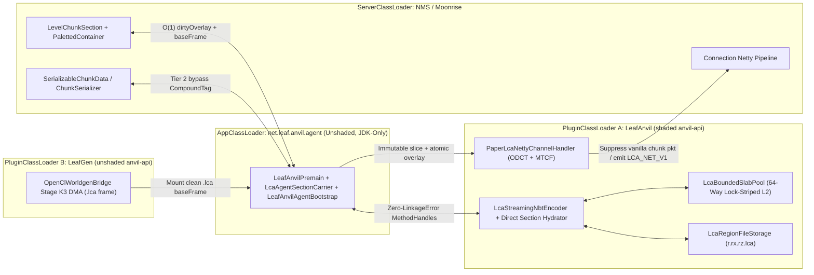

# leafanvil-ADR-005: Dual-Mode `-javaagent` Direct Section Bridge, Tier 1 Streaming NBT & Pool Concurrency, `LeafGen` Zero-Re-Encode Pass-Through & Paper/Folia Netty `LCA_NET_V1` Pipeline

- **Status:** Accepted
- **Date:** 2026-11-13
- **Scope:** `:anvil-api` (`io.github.dailystruggle.anvil`, `io.github.dailystruggle.anvil.stream`), `:resource:LeafAnvil` (`leafanvil-common`, `leafanvil-paper`, `leafanvil-fabric`, `leafanvil-neoforge`, `leafanvil-plugin`, `leafanvil-net`), & `:resource:LeafGen` (`leafgen-common`, `leafgen-plugin`)
- **Related ADRs & Specs:** [`leafanvil-ADR-001`](leafanvil-ADR-001-Multi-Loader-lca-world-storage-and-bytecode-interceptor.md), [`leafanvil-ADR-002`](leafanvil-ADR-002-in-memory-lca-chunk-representation-and-dirty-overlay-compaction.md), [`leafanvil-ADR-003`](leafanvil-ADR-003-negotiated-lca-chunk-network-streaming-and-delta-sync.md), [`leafanvil-ADR-004`](leafanvil-ADR-004-pumpkinmc-rust-lca-direct-section-bridge-and-golden-fixtures.md), [`leafgen-ADR-001`](../../../LeafGen/docs/adr/leafgen-ADR-001-runtime-worldgen-bytecode-opencl-swapper.md), [`leafgen-ADR-002`](../../../LeafGen/docs/adr/leafgen-ADR-002-end-to-end-gpu-lca-worldgen-and-hilbert-ore-seams.md), [`leafshard-ADR-002`](../../../LeafShard/docs/adr/leafshard-ADR-002-peer-netty-lcas-halo-mesh-and-border-hysteresis-handoff.md), [`anvil-api-ADR-002`](../../../../api/anvil-api/docs/adr/anvil-api-ADR-002-multi-format-region-support.md), [`anvil-api-ADR-003`](../../../../api/anvil-api/docs/adr/anvil-api-ADR-003-hilbert-roaring-gray-chunk-archive.md), [`ADR-115`](../../../../docs/adr/ADR-115-package-dag-disentanglement-and-decision-preservation-hypergraph.md), [`ADR-126`](../../../../docs/adr/ADR-126-multi-product-monorepo-release-architecture.md), [`LCA-ICD-1.0` (`api/anvil-api/docs/ICD.md`)](../../../../api/anvil-api/docs/ICD.md)

---

## Context

Across `:anvil-api`, `LeafAnvil`, `LeafAnvil-Net`, and `LeafGen`, `.lca` (`LCA-ICD-1.0`, `anvil-api-ADR-003`) serves as a unified binary representation for GPU worldgen output (`leafgen-ADR-002`), live server memory (`leafanvil-ADR-002`), Copy-on-Write (`CoW`) region disk archives (`leafanvil-ADR-001`), and negotiated client/inter-server network streaming (`leafanvil-ADR-003`).

However, inspecting the runtime boundaries across **Paper**, **Folia**, **Fabric**, and **NeoForge** exposes **four concrete CPU, concurrency, classloader, and wire-framing bottlenecks** that prevent end-to-end zero-recompression symmetry on JVM servers:

### 1. Bottleneck A — `:anvil-api` Intermediate `Map` Allocation & `LcaBoundedSlabPool` Coarse Monitor (`:anvil-api`)

1. **Heap-Tree Materialization on Chunk Save (`LcaRegionFileStorage#encodeChunkNbtForRegionSlab`):**
   - Today, `LcaRegionFileStorage#encodeChunkNbtForRegionSlab` parses uncompressed binary Mojang NBT via `Nbt.readRootCompound(byte[])`, materializing an intermediate heap tree of `LinkedHashMap<String, Object>`, `ArrayList`, boxed primitives, `long[]`, and `byte[]` (`~60–120 KiB` per chunk save) before `LcaSectionCodec` encodes the `.lca` `ChunkFrame`.
   - Simultaneously, `NmsRegionStorageInterceptor.LcaPreEncodingOutputStream` and `onWriteByteBuffer` allocate intermediate `byte[]` copies prior to `LcaLiveArchive#commitPreEncodedChunkCoW`.
2. **Coarse Monitor Over Synchronous L2 Disk I/O (`LcaBoundedSlabPool`):**
   - `LcaBoundedSlabPool` (`io.github.dailystruggle.anvil.stream.LcaBoundedSlabPool`) synchronizes every public entry point on `this`. Because `getChunkSlabEntry` and `spillToL2Disk` execute synchronous `Files.readAllBytes` and `Files.write` while holding `this`, a single L2 disk reload or spill blocks all concurrent L1 in-memory LRU cache hits across `LeafMap`, `LeafShard`, and `LeafAnvil-Net` worker threads.

### 2. Bottleneck B — Paper/Folia `SerializableChunkData` NBT Round-Trip & Missing Non-Player Mutation Hooks

1. **JVM Byte-Stream Boundary vs. Direct `SectionFrame` Hydration:**
   - Because a standard Paper/Folia plugin cannot add fields or rewrite methods inside already-loaded NMS classes (`LevelChunkSection`, `PalettedContainer`, `SerializableChunkData` on `1.21.4+`/`26.1+`, or `ChunkSerializer` on `1.20.4–1.21.1`), `NmsRegionStorageInterceptor` hooks at the `RegionFile` stream/buffer boundary via generated subclasses (`$$LeafAnvilRfBridge`, `$$LeafAnvilCacheBridge`).
   - Consequently, every chunk save and load on Paper/Folia—and currently on Fabric/NeoForge because `MixinSerializableChunkData` is not yet wired—constructs and parses full Mojang `CompoundTag` / `LongArrayTag` / `ByteArrayTag` trees (`~40–90 KiB`/chunk) across 98,304 voxels, whereas `PumpkinMC`'s Rust `LcaChunkBridge` (`leafanvil-ADR-004`) hydrates chunk sections directly from `SectionFrame` slices.
2. **Incomplete Mutation Capture on Paper/Folia (`PaperLeafAnvilPlugin`):**
   - On Fabric and NeoForge, `MixinLevelChunkSection` and `MixinPalettedContainer` implement `LcaSectionBridge` and record every `setBlockState` mutation inline in $O(1)$ (`~1–2 ns`) into `LcaSectionBacking`'s `dirtyOverlay` (`((pos12 + 1) << 19) | stateId19`).
   - Without a bytecode transformer on Paper/Folia, `PaperLeafAnvilPlugin` falls back to Bukkit `BlockBreakEvent` and `BlockPlaceEvent`, missing all non-player world mutations (pistons, explosions, fluid flow, tree/crop growth, redstone state changes, and plugin/NMS edits such as `WorldEdit`).

### 3. Bottleneck C — `LeafGen` Stage K3 GPU `.lca` Re-Encoding Waste & Cross-ClassLoader Isolation

1. **Discarding GPU-Synthesized `.lca` Frames on Paper/Folia Save:**
   - Under `leafgen-ADR-002`, `OpenClWorldgenBridge` (`Stage K3`) and `LeafGenChunkStatusInterceptor` synthesize canonical `256 B`-aligned `.lca` frames directly in pinned `CL_MEM_ALLOC_HOST_PTR` DMA memory.
   - Without a direct section carrier on Paper/Folia `LevelChunkSection`, unloading or autosaving a GPU-generated chunk causes vanilla `SerializableChunkData` to walk all 24 `LevelChunkSection`s on CPU, expand them into `CompoundTag` binary NBT, and force `LcaRegionFileStorage` to re-encode the `.lca` slab from scratch—discarding the `.lca` frame already computed by the GPU.
2. **Paperclip & Isolated `PluginClassLoader` Relocation Asymmetry:**
   - When `-javaagent:plugins/LeafAnvil.jar` launches on Paper/Folia, `Premain-Class` executes on `AppClassLoader` **before** Paperclip unpacks the Minecraft server (`ServerClassLoader`) or `org.bukkit.*`.
   - Later at plugin boot, `LeafAnvil-<version>.jar` loads in `PluginClassLoader A` with `:anvil-api` relocated via Shadow (`io.github.dailystruggle` $\to$ `net.leaf.anvil.shaded.io.github.dailystruggle`), whereas `LeafGen-<version>.jar` loads in `PluginClassLoader B` with `:anvil-api` **unrelocated** (`io.github.dailystruggle.anvil`). Sharing `LcaSectionBacking` or `LcaSectionBridge` directly across `ServerClassLoader`, `PluginClassLoader A`, and `PluginClassLoader B` would trigger `NoClassDefFoundError`, `LinkageError`, or `ClassCastException`.

### 4. Bottleneck D — Paper/Folia `32,760 B` Bukkit Plugin-Messaging Cap & Unwired `ODCT` / `MTCF` Transport

- `PaperLeafAnvilPlugin` currently sketches `LCA_NET_V1` delivery over Bukkit `Player#sendPluginMessage`, which enforces `MAX_PLUGIN_MESSAGE_BYTES = 32_760`, incurs extra channel framing overhead, and cannot suppress outbound vanilla `ClientboundLevelChunkWithLightPacket` transmission on negotiated connections.
- Meanwhile, the `500 kbps` low-bandwidth primitives (`LcaOrderlessDictTable` `ODCT`, `LcaMultiTargetConsolidator` `MTCF`, and `LcaPacketDifferentialProfiler` from `leafanvil-ADR-003` Section 7) require direct Netty pipeline integration to frame arbitrary-sized chunk batches, suppress duplicate vanilla chunk/delta packets, and preserve `ClientboundChunkBatchStartPacket` / `ServerboundChunkBatchReceivedPacket` RTT congestion pacing.

---

## Decision

We standardize a **Dual-Mode Single-Artifact Architecture** (`LeafAnvil-<version>.jar`) backed by an **Unshaded JDK-Only `AppClassLoader` Agent Bridge (`net.leaf.anvil.agent`)** and execute four coordinated engineering workstreams across `:anvil-api`, `LeafAnvil`, `LeafGen`, and `LeafAnvil-Net`:



---

### 1. Dual-Mode Single-JAR Contract & JDK-Only `AppClassLoader` Agent Bridge (`net.leaf.anvil.agent`)

1. **Single Multi-Loader Artifact with Optional `-javaagent` Activation:**
   - `:resource:LeafAnvil:leafanvil-plugin` shall package `LeafAnvil-<version>.jar` with `META-INF/MANIFEST.MF` attributes `Premain-Class: net.leaf.anvil.agent.LeafAnvilPremain`, `Can-Redefine-Classes: false`, and `Can-Retransform-Classes: false` alongside `paper-plugin.yml`, `plugin.yml`, `fabric.mod.json`, and `META-INF/neoforge.mods.toml`.
   - **Zero-Flag Drop-In Mode (`plugins/LeafAnvil.jar` only):** Shared-hosting operators without JVM startup-flag access retain full drop-in compatibility via `NmsRegionStorageInterceptor`, accelerated by `LcaStreamingNbtEncoder` (Workstream 1), lock-striped `LcaBoundedSlabPool` (Workstream 1), and `PaperLcaNettyChannelHandler` (Workstream 4).
   - **Opt-In Agent Mode (`-javaagent:plugins/LeafAnvil.jar` + `plugins/LeafAnvil.jar` on Paper/Folia):** Dedicated server and `LeafShard` operators enable load-time bytecode transformation (`LeafAnvilSectionClassTransformer`) before NMS classes initialize, unlocking `LcaAgentSectionCarrier` inline `setBlockState` tracking, `SerializableChunkData` / `ChunkSerializer` direct `.lca` `ChunkFrame` bridging, and `LeafGen` Stage K3 zero-re-encode pass-through.
2. **Strict JDK-Only `AppClassLoader` Isolation Invariant (`net.leaf.anvil.agent`):**
   - Every type inside `net.leaf.anvil.agent` (`LeafAnvilPremain`, `LcaAgentSectionCarrier`, `LeafAnvilAgentBootstrap`, `LeafAnvilSectionClassTransformer`) shall import **exclusively JDK bootstrap/platform types** (`byte[]`, `int[]`, `long`, `java.nio.ByteBuffer`, `java.lang.invoke.MethodHandle`, `java.lang.instrument.*`).
   - `net.leaf.anvil.agent` shall contain **zero** references to `org.bukkit.*`, `io.papermc.*`, `net.minecraft.*`, `net.leaf.anvil.common.*`, `net.leaf.anvil.paper.*`, or `io.github.dailystruggle.*`. This guarantees `premain` never triggers `NoClassDefFoundError` before Paperclip unpacks the server JAR and never causes `AppClassLoader` to prematurely load plugin classes ahead of Paper's child-first `PaperPluginClassLoader`.
   - `:resource:LeafAnvil:leafanvil-plugin/build.gradle` shall keep `net/leaf/anvil/agent/**` **unrelocated** while continuing to relocate `io.github.dailystruggle` to `net.leaf.anvil.shaded.io.github.dailystruggle`. Because `ServerClassLoader`, `LeafAnvil`'s `PluginClassLoader`, and `LeafGen`'s `PluginClassLoader` all delegate `net.leaf.anvil.agent.*` upward to `AppClassLoader`, all three classloaders share `LcaAgentSectionCarrier` and `LeafAnvilAgentBootstrap` with zero `LinkageError` or `ClassCastException`:

```java
package net.leaf.anvil.agent;

import java.lang.instrument.Instrumentation;
import java.lang.invoke.MethodHandle;

public final class LeafAnvilPremain {
    public static void premain(String agentArgs, Instrumentation inst);
    public static boolean isAgentActive();
}

public interface LcaAgentSectionCarrier {
    byte[] leafanvil$getBaseFrame();
    void leafanvil$mountBaseFrame(byte[] baseFrame, int uniformStateId, int dataVersion, long secDed64);
    int leafanvil$recordBlockMutation(int pos12, int stateId19, long currentTick);
    int leafanvil$getDirtyCount();
    long leafanvil$getDirtyOctantMask64();
    int[] leafanvil$snapshotDirtyOverlay();
    void leafanvil$clearDirtyAfterCompaction(byte[] newBaseFrame, long newSecDed64);
}

public final class LeafAnvilAgentBootstrap {
    public static void registerChunkCodecHooks(
            MethodHandle directChunkSerializeHook,   // (Object serverLevel, Object chunkAccess) -> byte[] lcaFrameOrNull
            MethodHandle directChunkHydrateHook,     // (Object serverLevel, long chunkPos, byte[] lcaFrame) -> Object serializableDataOrNull
            MethodHandle sectionMutationListener     // (Object section, int pos12, int prevStateId, int newStateId) -> void
    );
}
```

---

### 2. Workstream 1 — `:anvil-api` Universal Zero-Flag Codec & Slab-Pool Concurrency (`:anvil-api`)

1. **Single-Pass Binary NBT Visitor (`LcaStreamingNbtEncoder`):**
   - Introduce `LcaStreamingNbtEncoder` in `:anvil-api` (`io.github.dailystruggle.anvil`) and wire it into `LcaRegionFileStorage#encodeChunkNbtForRegionSlab`.
   - `LcaStreamingNbtEncoder` shall parse uncompressed binary Mojang NBT (`byte[]` or `ByteBuffer`) in a single forward pass directly into `LcaSectionCodec.ScratchArena` buffers (`yzxPaletteIdx`, `packedBlockLongs`, `skyLightNibbles`, `blkLightNibbles`), supporting both legacy (`DataVersion < 5006`: `"Name"` / `"Properties"`) and modern (`DataVersion >= 5006`: `"id"` / `"properties"`, `ADR-113`) block-state palette schemas while slicing non-voxel residual compounds (`block_entities`, `block_ticks`, `fluid_ticks`, `structures`, `BukkitValues` PDC) verbatim into `residualNbtPayload` without allocating `LinkedHashMap<String, Object>` or `ArrayList` trees.
   - `NmsRegionStorageInterceptor.LcaPreEncodingOutputStream` and `onWriteByteBuffer` shall pass zero-copy `ByteBuffer` slices directly to `LcaRegionFileStorage`, eliminating duplicate `toByteArray()` and `new byte[payloadLen]` copies.
2. **Lock-Striped L1 / L2 Separation in `LcaBoundedSlabPool`:**
   - Refactor `LcaBoundedSlabPool` (`io.github.dailystruggle.anvil.stream.LcaBoundedSlabPool`) to separate the short, non-blocking L1 `LinkedHashMap` LRU metadata critical section from a 64-way region-coordinate striped L2 disk lock array (`Object[64]` indexed via golden-ratio `(rx, rz)` mixing so diagonal and axis-aligned regions disperse evenly across all 64 stripes).
   - Synchronous L2 `Files.readAllBytes` and `Files.write` operations during disk spills and cold reloads shall execute strictly under the region stripe lock—never while holding the global L1 map lock—so L1 RAM cache hits remain non-blocking across concurrent threads.

---

### 3. Workstream 2 — Load-Time Section/Chunk Transformation & Fabric/NeoForge `MixinSerializableChunkData` Parity

1. **Paper/Folia Load-Time Transformation (`LeafAnvilSectionClassTransformer`):**
   - When `LeafAnvilPremain#isAgentActive()` is `true`, `LeafAnvilSectionClassTransformer` shall inspect class loads matching NMS `LevelChunkSection`, `PalettedContainer`, `SerializableChunkData` (`1.21.4+` / `26.1+`), and `ChunkSerializer` (`1.20.4–1.21.1`) using raw JVM classfile / JDK ClassFile structural descriptor matching:
     - **`LevelChunkSection` & `PalettedContainer`:** Implement `LcaAgentSectionCarrier`, inject backing fields (`byte[] baseFrame`, `int uniformStateId`, `int dataVersion`, `long baselineSecDed64`, `int dirtyCount`, `long dirtyOctantMask64`, `int[] dirtyOverlay`), and record every `setBlockState` write in $O(1)$ using the packed 32-bit sentinel word `((pos12 + 1) << 19) | (stateId19 & 0x7FFFF)` (`leafanvil-ADR-002`). Section-local coordinates shall be strictly masked via `(x & 15, y & 15, z & 15)` before computing `pos12`, and hooks shall run *after* (or mirror) `LevelChunkSection`'s scalar count updates (`nonEmptyBlockCount`, `tickingBlockCount`, `tickingFluidCount`) and Moonrise's `IBlockDataList` (`SimpleRandomTickList`) synchronizer (`LcaInMemoryChunkCoordinator`).
     - **`SerializableChunkData` & `ChunkSerializer`:** Invoke `LeafAnvilAgentBootstrap`'s volatile `MethodHandle` hooks (`directChunkSerializeHook`, `directChunkHydrateHook`) once registered by `PaperLeafAnvilPlugin#onEnable`. When `chunkDataVersion == currentDataVersion`, voxel sections extract and hydrate directly between `LevelChunkSection` (`PalettedContainer` + `DataLayer` / Starlight `SWMRNibbleArray`) and `.lca` `ChunkFrame`s via cached `Block.BLOCK_STATE_REGISTRY` $\leftrightarrow$ `.lca` `dictId` `int[]` lookup tables, serializing only sparse non-voxel residual tags (`block_entities`, `block_ticks`, `fluid_ticks`, `structures`, `BukkitValues`) to NBT.
   - **Per-Class Structural Fail-Safe (`REQ-RTP-S-004`):** If an unrecognized server fork alters expected field or method descriptors on a target class, `LeafAnvilSectionClassTransformer` shall return `null` (unmodified bytecode) for that class, emit a single structured `WARNING` diagnostic (`S-004`), and leave `NmsRegionStorageInterceptor` + `LcaStreamingNbtEncoder` active as the lossless fallback.
2. **Fabric & NeoForge Tier 2 Parity (`MixinSerializableChunkData`):**
   - `:resource:LeafAnvil:leafanvil-fabric` and `:resource:LeafAnvil:leafanvil-neoforge` shall add `MixinSerializableChunkData` (and `MixinChunkSerializer` where applicable in target version subprojects), registered in their respective `leafanvil.mixins.json` descriptors, sharing the exact common direct-hydration and direct-extraction helper in `leafanvil-common` without requiring `-javaagent` on Mixin-native loaders.

---

### 4. Workstream 3 — `LeafGen` Stage K3 GPU `.lca` Zero-Re-Encode Pass-Through (`:leafgen-common` & `:leafanvil-common`)

1. **Cross-ClassLoader GPU `baseFrame` Mounting (`LeafGenChunkStatusInterceptor`):**
   - When `OpenClWorldgenBridge` (`Stage K3`, `leafgen-ADR-002`) completes a GPU chunk synthesis batch in pinned DMA memory, `LeafGenChunkStatusInterceptor` shall detect whether each populated `LevelChunkSection` implements `LcaAgentSectionCarrier` (Paper/Folia `-javaagent` via `AppClassLoader`) or `LcaSectionBridge` (Fabric/NeoForge Mixins) and mount the GPU-emitted `.lca` `baseFrame` slice, `uniformStateId`, `DataVersion`, and `baselineSecDed64` directly onto the section with `dirtyCount = 0`.
2. **Zero-Re-Encode Flush & Selective Dirty-Section Splice:**
   - When flushing a chunk to `LcaRegionFileStorage` or slicing outbound wire batches for `LeafAnvil-Net` / `LeafShard`:
     - **Clean GPU Chunk (`dirtyCount == 0` across all sections and `chunkDataVersion == currentDataVersion`):** Commit or transmit the mounted `.lca` `ChunkFrame` / `SectionFrame` slices verbatim—zero `CompoundTag` construction, zero `NbtIo` byte stream, and zero CPU 98,304-voxel re-scan.
     - **Partially Mutated Chunk (`dirtyCount > 0` on $k$ sections):** Compact/re-encode **only** the $k$ sections with non-zero `dirtyCount` (`O(R + D)` stream-merge or `ChunkPatchTail` `0x4000` per `leafanvil-ADR-002`) and splice the remaining $24 - k$ clean GPU `SectionFrame` byte slices verbatim.

---

### 5. Workstream 4 — Paper/Folia Netty `ChannelDuplexHandler` & `ODCT` / `MTCF` Wire Pipeline (`:leafanvil-paper` & `:leafanvil-common`)

1. **Protocol-Boundary Interception (`PaperLcaNettyChannelHandler`):**
   - Inject `PaperLcaNettyChannelHandler` (`io.netty.channel.ChannelDuplexHandler`) into each player's Netty `Connection.channel.pipeline()` (positioned before vanilla packet compression/encoding) on both commercial `LeafAnvil` and MIT `LeafAnvil-Net` (`leafanvil-ADR-003`).
   - For sessions that have completed the `leafanvil:chunk_stream_handshake`:
     - Intercept and suppress outbound vanilla `ClientboundLevelChunkWithLightPacket`, `ClientboundSectionBlocksUpdatePacket`, and `ClientboundBlockUpdatePacket`, replacing them with framed `LCA_NET_V1` payloads without Bukkit `sendPluginMessage`'s `32,760 B` ceiling.
     - Preserve vanilla `ClientboundChunkBatchStartPacket`, `ClientboundChunkBatchFinishedPacket`, and `ServerboundChunkBatchReceivedPacket` flow-control tokens so Minecraft's native client RTT congestion window continues pacing chunk delivery smoothly.
     - Pass unnegotiated vanilla client connections through untouched with zero shared-state contention.
2. **Folia Thread-Safety (`F-001..F-003`) & `ODCT` / `MTCF` Integration:**
   - `PaperLcaNettyChannelHandler` running on Netty event-loop threads shall **never** invoke synchronous `ServerLevel` chunk loads (`REQ-RTP-S-005`) or mutate Folia region-owned `LevelChunkSection` state (`F-001..F-003`); it shall read exclusively immutable `baseFrame` byte slices and atomic `dirtyOverlay` snapshots exported via `LcaAgentSectionCarrier` / `LcaInMemoryChunkCoordinator`.
   - Wire `LcaOrderlessDictTable` (`ODCT`, `0x4F444354`), `LcaMultiTargetConsolidator` (`MTCF`, `0x4D544346`), and `LcaPacketDifferentialProfiler` into `LcaWireStreamProtocol` so `CAP_ORDERLESS_DICT_AND_MULTICAST` (`1 << 5`) sessions receive Chebyshev-spiral-prioritized, orderless-dictionary-compressed `.lca` frames and `4-byte` `dirtyOverlay` deltas within configured upload budgets (`max-server-upload-kbps`).
   - When `LeafAnvilPremain#isAgentActive()` (Paper/Folia) or `LcaSectionBridge` Mixins (Fabric/NeoForge) are active, source live block deltas directly from inline section mutation hooks and disable redundant Bukkit `BlockBreakEvent` / `BlockPlaceEvent` listeners.

---

## Alternatives Considered

### 1. Unrelocated Shared `:anvil-api` SPI on `AppClassLoader`
- *Proposal:* Exclude all of `io.github.dailystruggle.anvil.*` and `LcaSectionBridge` from Shadow relocation so `AppClassLoader`, `LeafAnvil`, and `LeafGen` share `LcaSectionBacking` instances directly.
- *Why Rejected:* Placing `:anvil-api` on `AppClassLoader` forces every co-installed Leaf plugin (`LeafRTP`, `LeafMap`, `LeafGen`, `LeafShard`, `LeafAnvil`) onto a single JVM-wide `:anvil-api` binary version when `-javaagent` is present, breaking independent rolling plugin upgrades (`ADR-126`) and risking subtle version-skew `NoSuchMethodError`s across plugins. Keeping only a tiny, stable, zero-dependency `net.leaf.anvil.agent` JDK-type carrier on `AppClassLoader` preserves full Shadow isolation for each plugin's internal `:anvil-api` classes.

### 2. Runtime Self-Attach (`VirtualMachine.attach`) + `retransformClasses` with Striped Weak Side-Map
- *Proposal:* Dynamically self-attach during `JavaPlugin#onLoad` using `Instrumentation#retransformClasses` and store per-section backing state in a weak identity map (`WeakHashMap` / striped `ConcurrentHashMap` keyed by `System.identityHashCode(section)`) because `retransformClasses` forbids adding instance fields.
- *Why Rejected:* JDK 21+ emits loud dynamic-agent warnings and future JDKs restrict dynamic self-attach unless `-XX:+EnableDynamicAgentLoading` is passed anyway (negating the "zero startup flag" benefit). Worse, replacing a direct object field load on `LevelChunkSection` with an identity-hash + weak-reference map lookup on every `setBlockState` / `getBlockState` adds pointer-chasing cache misses directly on the hot tick thread across `240,000+` live sections.

### 3. Mandatory `-javaagent` Only (Dropping `NmsRegionStorageInterceptor`) or Separate `LeafAnvil-Agent.jar`
- *Proposal:* Require `-javaagent` on Paper/Folia or ship a second `LeafAnvil-Agent-<version>.jar` artifact.
- *Why Rejected:* Locked-down shared Minecraft panels frequently disallow custom JVM startup flags, and shipping two separate JARs invites version mismatches between `plugins/LeafAnvil.jar` and `-javaagent:LeafAnvil-Agent.jar`. Embedding `Premain-Class` inside the single `LeafAnvil-<version>.jar` while keeping `NmsRegionStorageInterceptor` + `LcaStreamingNbtEncoder` as the zero-flag baseline serves both shared-panel users and dedicated `LeafShard` clusters from one artifact.

---

## Consequences

### Positive Consequences
- **Eliminates the JVM Mojang-NBT Voxel Tax:** Cuts temporary heap allocations on chunk load/save by `~85%–95%` under Tier 2 (`-javaagent` on Paper/Folia and `MixinSerializableChunkData` on Fabric/NeoForge) and removes `~60–120 KiB`/chunk of `LinkedHashMap` NBT tree allocations even in zero-flag Tier 1 plugin mode (`LcaStreamingNbtEncoder`).
- **True End-to-End GPU $\to$ Disk & Wire Zero-Recompression:** `LeafGen` Stage K3 `.lca` frames synthesized in pinned GPU DMA memory flow straight onto `LevelChunkSection`, `LcaLiveArchive` disk slabs, and `LeafAnvil-Net` / `LeafShard` sockets without CPU re-encoding on untouched sections.
- **100% World Mutation Fidelity & Protocol-Level Streaming on Paper/Folia:** Inline `LevelChunkSection` bytecode hooks capture pistons, explosions, fluids, redstone, and NMS edits in $O(1)$ (`~1–2 ns`), while `PaperLcaNettyChannelHandler` lifts the `32,760 B` Bukkit plugin-messaging limit and suppresses redundant vanilla chunk packets.
- **Non-Blocking Concurrent L1 Slab Reads:** Lock-striping L2 disk I/O in `LcaBoundedSlabPool` keeps L1 RAM hits wait-free with respect to concurrent cold-region disk spills and reads.

### Trade-offs & Required Safety Invariants
1. **Zero Main/Region-Thread Chunk I/O (`REQ-RTP-S-005`) & Folia Region Ownership (`F-001..F-003`):** Neither `LeafAnvilAgentBootstrap` hooks nor `PaperLcaNettyChannelHandler` shall trigger synchronous chunk loads on the main thread, Folia region threads, or Netty event-loop threads; cross-thread wire reads shall access only immutable `baseFrame` arrays and atomic `dirtyOverlay` snapshots.
2. **Zero Silent Failure Swallowing (`REQ-RTP-S-004`):** Bytecode descriptor mismatches in `LeafAnvilSectionClassTransformer` and malformed frames in `LcaStreamingNbtEncoder` / `PaperLcaNettyChannelHandler` shall never fail silently—unrecognized class layouts log a structured `WARNING` and fall back cleanly to `NmsRegionStorageInterceptor`, while storage/syndrome corruption fails closed (`IOException` / `UncheckedIOException`) or triggers `CBIT` / `SEC-DED` recovery.
3. **Chunk Ticket & Pipeline Resource Hygiene (`REQ-RTP-S-002`):** Direct hydration and Netty batch streaming paths shall not acquire or hold extra chunk tickets beyond vanilla `ChunkMap` / `PlayerChunkSender` lifecycle bounds, releasing all Netty `ByteBuf` reference counts on every normal and exceptional exit path.
4. **AST Hypergraph & Traceability (`Rule D-010`, `ADR-115`):** All new and modified Tier 1/2 classes (`LcaStreamingNbtEncoder`, `LcaBoundedSlabPool`, `LeafAnvilPremain`, `LcaAgentSectionCarrier`, `LeafAnvilAgentBootstrap`, `LeafAnvilSectionClassTransformer`, `PaperLcaNettyChannelHandler`) shall carry capability Javadoc summaries with `@governedBy leafanvil-ADR-005` and applicable `@trace` tags.

---

## Verification & Proof Contract

Implementations governed by `leafanvil-ADR-005` shall satisfy `Gates 1–4` (`VERIFICATION_GATES.md`) across four deterministic test suites:

1. **Workstream 1 (`LcaStreamingNbtEncoderTest` & `LcaBoundedSlabPoolConcurrencyTest` in `:anvil-api`):**
   - Bit-exact `.lca` encode/decode parity between `LcaStreamingNbtEncoder` and the legacy `Nbt.readRootCompound` reference path across `DataVersion < 5006` (`"Name"`) and `DataVersion >= 5006` (`"id"`) fixtures, uniform + non-uniform sections, and residual `BukkitValues` / block-entity NBT payloads.
   - Multi-threaded contention proof parking an L2 disk spill/reload on a slow/latched filesystem path while asserting concurrent L1 cache hits on other regions complete without blocking.
2. **Workstream 2 (`LeafAnvilSectionClassTransformerTest` & `MixinSerializableChunkData` Round-Trip Suite in `:resource:LeafAnvil`):**
   - Multi-classloader harness loading `net.leaf.anvil.agent.*` in a parent `ClassLoader`, transforming NMS-shaped `LevelChunkSection` and `SerializableChunkData` in a child `ServerClassLoader`, and invoking `LeafAnvilAgentBootstrap` `MethodHandle` hooks from two sibling `PluginClassLoader`s (one relocated, one unrelocated) with zero `LinkageError` or `NoClassDefFoundError` (including pre-Paperclip boot simulation where `org.bukkit.*` is absent).
   - Verification of `(x & 15, y & 15, z & 15)` negative-$Y$ coordinate masking, Moonrise random-tick list parity, and automatic fallback to `NmsRegionStorageInterceptor` when target descriptors are altered.
3. **Workstream 3 (`LeafGenZeroReencodePassThroughTest` across `:resource:LeafGen` & `:resource:LeafAnvil`):**
   - Mounting a `LeafGen` Stage K3 `.lca` frame onto `LcaAgentSectionCarrier`, mutating 1 voxel in 1 section (`dirtyCount = 1`), flushing to `LcaRegionFileStorage`, and asserting bit-identical preservation of the 23 untouched section byte slices alongside exact decoded voxel parity for the mutated section.
4. **Workstream 4 (`PaperLcaNettyChannelHandlerTest` in `:resource:LeafAnvil:leafanvil-paper` / `:leafanvil-common`):**
   - Netty `EmbeddedChannel` proof verifying untouched vanilla packet pass-through on unnegotiated channels, vanilla chunk/delta packet suppression on negotiated `LCA_NET_V1` channels, `> 32,760 B` chunk-batch framing, `LcaOrderlessDictTable` (`ODCT`) out-of-order decode parity with `SEC-DED-64` verification, and `LcaMultiTargetConsolidator` (`MTCF`) `500 kbps` (`350 kbps` usable) tick-budget enforcement with zero leaked `ByteBuf` reference counts.
