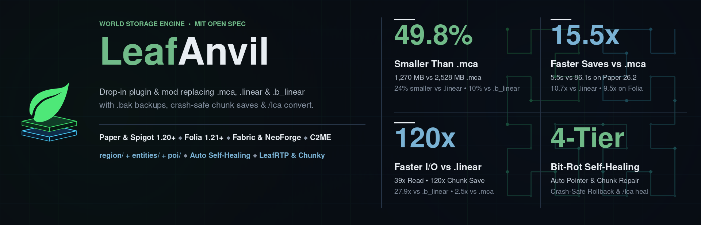
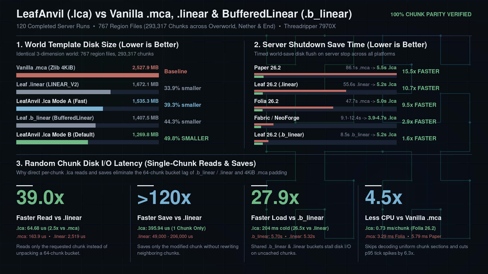
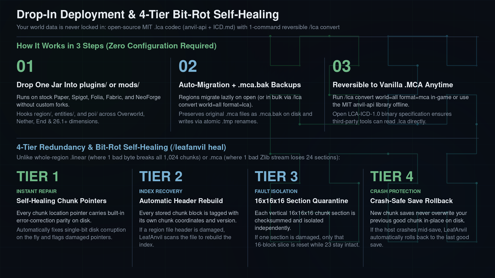

<!--
Single source for every LeafAnvil storefront page (BuiltByBit, Modrinth, Hangar, SpigotMC).
Follows docs/dev/RULES.md Rule D-006 (first-person plain voice, 3-Zone hierarchy,
ASCII punctuation only, concrete benchmark numbers and honest caveats).
  BuiltByBit Card Title: "LeafAnvil - 50% Smaller Worlds & 15x Faster Saves"
  BuiltByBit Card Thumbnail: docs/assets/leafanvil-card-thumbnail.png
  BuiltByBit Carousel Slides: docs/assets/leafanvil-card-thumbnail.png, docs/assets/leafanvil-benchmark-comparison.png, docs/assets/leafanvil-architecture-workflow.png
  Title: "LeafAnvil"  tagline: "Cut world disk & backup size by 50%, speed up server shutdown saves 15.5x, and self-heal chunk corruption on Paper, Folia, Fabric & NeoForge"
-->

# {{name}}: 50% Smaller Worlds, 15.5x Faster Saves & Self-Healing `.lca` Storage

## Storage

**{{name}} is a drop-in `.lca` world storage plugin and mod for stock Paper, Folia, Spigot, Fabric, and NeoForge servers.** Drop the jar into `plugins/` or `mods/` and start the server. Existing `.mca`, `.linear`, and `.b_linear` (`BufferedLinear`) files across `region/`, `entities/`, and `poi/` convert automatically as chunks open while keeping `.bak` backups on disk.

It hooks `RegionFileStorage` in memory at startup, so `Chunky`, `WorldEdit` / `FAWE`, `C2ME`, `BlueMap`, `Dynmap`, `squaremap`, `CoreProtect`, and custom world generators work without changes, and [`LeafRTP`](https://github.com/DailyStruggle/RTP) reads `.lca` files directly.

One jar covers Paper and Spigot (1.20+), Folia (1.21+), Fabric (26.1+), and NeoForge (26.1+). The runtime plugin/mod is commercial (`LicenseRef-LeafCraft-Commercial`), while the `.lca` binary specification ([`ICD.md`](../../../../api/anvil-api/docs/ICD.md)) and standalone Java codec ([`anvil-api`](../../../../api/anvil-api/README.md)) are open-source under the MIT License - your worlds are never locked in, and `/leafanvil convert` switches back to vanilla `.mca` at any time.

### The short version

**Cuts world and backup disk usage by `39.3% to 50.2%`, finishes server shutdown saves up to `15.5x` faster, avoids `.linear` / `.b_linear` random-read bucket stalls, self-heals bit rot across 4 tiers, and converts back to vanilla `.mca` in one command.**

- [**Easy**](#install): drop `{{jar}}` into `plugins/` or `mods/` and start the server; existing `.mca`, `.linear`, and `.b_linear` regions migrate on open or in bulk via `/leafanvil convert`.
- [**Safe**](#resilience-redundancy-and-4-tier-self-healing): keeps `.bak` backups during migration, writes modified chunks to fresh slabs before updating pointers, and repairs bit rot on the fly.
- [**Half size**](#performance): shrinks `2,527.9 MB` `.mca` worlds to `1,269.8 MB` (`-49.8%` at default `zstd-level: 1`, or `1,257.7 MB` at `zstd-level: 6`), smaller than `.linear` (`1,672.1 MB`) and `.b_linear` (`1,407.5 MB`).
- [**Fast saves**](#performance): `1.6x to 15.5x` faster world save on server stop (`5.5s` vs `86.1s` on Paper, `5.0s` vs `47.7s` on Folia) and `5.1x to 9.3x` faster `Chunky` pre-generation.
- [**Reversible**](#features): run `/leafanvil convert world=all format=mca` to convert every `.lca` file back to vanilla `.mca`, or use the open-source MIT `anvil-api` codec offline.
- [**One jar**](#install): runs on stock Paper, Spigot, Folia, Fabric (`+ C2ME`), and NeoForge (`+ C2ME`).

<b>More highlights</b>

- **All three dimension storage folders:** intercepts `region/` (terrain), `entities/` (mobs), and `poi/` (villager beds, job sites, portals) across Overworld, Nether, End, and custom dimensions.
- **Configurable `zstd-level` (`1` default, `0` zero-LZ, `6` archival):** `zstd-level: 1` (`1,269.8 MB`, `-49.8%` vs `.mca`) balances size and speed, `zstd-level: 0` (`1,535.3 MB`, `-39.3%`) skips LZ decompression, and `zstd-level: 6` (`1,257.7 MB`, `-50.2%`) targets archival storage.
- **4-tier bit-rot self-healing (`/leafanvil heal`):** combines Hamming `(72, 64)` pointer parity, self-describing `256B` slab headers, per-section occupancy checks, and Copy-on-Write rollback.
- **No external `.mcc` sidecar files:** chunks up to `16 MiB` stay inline inside the `256B` slab pool instead of spilling into `c.x.z.mcc` files.

## Common setups

These work out of the box with the default `config.yml`:

- **Shrink world disk and backups with zero downtime:** Drop `{{jar}}` into `plugins/` or `mods/`. Each `.mca`, `.linear`, or `.b_linear` file converts to `.lca` on first open and keeps the original as `.bak`.
- **Convert an entire world at once (`/leafanvil convert`):** Run `/leafanvil convert world=all format=lca` after pre-generating with `Chunky` or `LeafRTP` to convert all dimensions on background threads.
- **Revert to vanilla `.mca` before uninstalling:** Run `/leafanvil convert world=all format=mca`, wait for the console completion message, and remove `{{jar}}`.

---

## Install

**Requirements:** Paper or Spigot 1.20+, Folia 1.21+, Fabric 26.1+, or NeoForge 26.1+. Java 17+ (Java 21+ on 1.20.5+, Java 25 on 26.x).

1. Drop `{{jar}}` into `plugins/` (Paper, Spigot, Folia) or `mods/` (Fabric, NeoForge) and start the server.
2. Run `/leafanvil status` (or `/lca status`) to check that `interceptedStorages` shows `3` per loaded dimension (`region/`, `entities/`, and `poi/`).
3. **Optional:** Run `/leafanvil convert world=all format=lca` to convert existing files in the background, or let `auto-migrate-legacy: true` convert regions lazily as chunks open.

---

## Features

- **Cut world & backup size by `-49.8%` (`-24.1%` vs `.linear`, `-9.8%` vs `.b_linear`):** packs single-block sections (`air`, `stone`, `deepslate` - `66.4%` of typical sections) into 2-byte directory entries (`0` body bytes) and replaces `4,096-byte` padded sectors with `256-byte` sub-slabs.
- **Finish server-stop world saves up to `15.5x` faster (`5.5s` vs `86.1s`):** Copy-on-Write (`CoW`) `256-byte` sub-slab allocation writes modified chunks to fresh slabs without rewriting shared `Zstd` buckets.
- **Drop-in `RegionFileStorage` interception:** hooks vanilla and Paper/Folia Moonrise `RegionFileStorage` caches (`region/`, `entities/`, `poi/`) at startup without requiring a custom server fork.
- **Reversible `.lca <-> .mca` batch transcoder:** `/leafanvil convert [world=<name|all>] [format=<lca|mca>]` converts all dimension folders on background worker threads using atomic `.tmp` renames.
- **Online slab compaction & 4-tier bit-rot healer:** `/leafanvil compact` defragments regions above `compact-fragmentation-threshold`, and `/leafanvil heal` repairs pointer bit flips, rebuilds wiped directories, and isolates damaged `16x16x16` sections.

---

## Performance

Benchmarks cover 120 live server runs across 8 platform configurations and isolated JMH codec tests on real region files. Every server run clones the same frozen 3-dimension world (`767` region files, `293,317` chunks), runs 24 Mineflayer bots through a 4-stage `/rtpstress ramp` (`1,496` scheduled teleports at `5x5` view/simulation distance), and times the `stop` world save ([full methodology and raw tables](../../README.md)).

**Live Multi-Platform Server A/B/C Benchmark (`with-lca` Mode A `0-LZ` & `with-lca-b` Mode B `+ Zstd-1` vs `without-lca` `.mca` / `.linear` / `.b_linear`, `767` Region Files / `293,317` Chunks, `120` Runs):**

| Platform (`n` runs: `A/B/Base`, `pairs`) | World Disk (`Mode A` / `Mode B` vs Base) | Completed TPs (`Mode A` / `Mode B` vs Base, `1,496` max) | Stage 0 `p50` (Cold `p50`: `A` / `B` vs Base) | Stage 0 `p95` (`MSPT p95`: `A` / `B` vs Base) | Main CPU/Chunk (`Chunks/TP`: `A` / `B` vs Base) | World Save on Shutdown (`Mode A` / `Mode B` vs Base) |
| :--- | :--- | :--- | :--- | :--- | :--- | :--- |
| **Paper `26.2`** (`6/6/6`, `n=6`) | **`1,545.2`** / **`1,278.8 MB`** vs `2,532.3 MB` (`-39.0%` / `-49.5%`) | **`1,487`** / **`1,479`** vs `1,442` (`1.03x`) | **`200 ms`** / **`200 ms`** vs `224 ms` (`200` / `200` vs `228 ms` cold, `1.13x` / `1.14x` faster) | **`221 ms`** (`31.0 ms`) / **`236 ms`** (`30.9 ms`) vs `466 ms` (`193.8 ms`, **`2.11x` / `1.98x` faster**) | **`1.45 ms`** (`75.6`) / **`1.43 ms`** (`75.2`) vs `5.79 ms` (`17.5`, **`4.01x` / `4.05x`**) | **`5.54 +- 0.21 s`** / **`5.55 +- 0.23 s`** vs `86.12 +- 72.67 s` (**`15.5x` faster**) |
| **Folia `26.2`** (`6/6/6`, `n=6`) | **`1,545.5`** / **`1,279.0 MB`** vs `2,536.1 MB` (`-39.1%` / `-49.6%`) | **`1,496`** / **`1,496`** vs `1,274` (**`1.17x`**) | **`103 ms`** / **`105 ms`** vs `164 ms` (**`103` / `105` vs `968 ms` cold, `9.40x` / `9.25x` faster**) | **`203 ms`** (`19.3 ms`) / **`203 ms`** (`18.5 ms`) vs `218 ms` (`96.3 ms`, `1.08x` faster) | **`0.73 ms`** (`97.9`) / **`0.78 ms`** (`98.0`) vs `3.29 ms` (`6.6`, **`4.53x` / `4.23x`**) | **`5.03 +- 0.01 s`** / **`5.02 +- 0.00 s`** vs `47.69 +- 36.44 s` (**`9.5x` faster**) |
| **Leaf `26.2` (`.linear`)** (`5/5/4`, `n=4`) | **`1,546.4`** / **`1,279.2 MB`** vs `1,672.2 MB` (`-7.5%` / `-23.5%`) | **`1,483`** / **`1,483`** vs `10` (**`152.1x`**; `4.95` vs `0.68 TP/s`) | **`200 ms`** / **`200 ms`** vs `3,369 ms` (**`201` / `201` vs `5,320 ms` cold, `16.8x` / `26.5x` faster**) | **`326 ms`** (`28.3 ms`) / **`314 ms`** (`29.6 ms`) vs `5,178 ms` (`2,731.4 ms`, **`15.9x` / `16.5x` faster**) | **`1.35 ms`** (`75.6`) / **`1.39 ms`** (`76.1`) vs `4.07 ms` (`26.6`, **`3.00x` / `2.93x`**) | **`5.18 +- 0.01 s`** / **`5.20 +- 0.04 s`** vs `55.56 +- 4.66 s` (**`10.7x` faster**) |
| **Leaf `26.2` (`.b_linear`)** (`2/2/2`, `n=2`, `+3` `Zstd-6`) | **`1,546.2`** / **`1,279.5 MB`** (`1,266.5 MB` `Zstd-6`) vs `1,407.5 MB` (`+9.9%` / **`-9.1%`** / **`-10.0%`**) | **`1,428`** / **`1,456`** vs `14` (**`105.8x` / `107.9x`**; `4.95` vs `1.06 TP/s`) | **`204 ms`** / **`204 ms`** vs `2,311 ms` (**`204` / `204` vs `5,704 ms` cold, `11.3x` / `27.9x` faster**) | **`381 ms`** (`28.7 ms`) / **`381 ms`** (`28.3 ms`) vs `5,534 ms` (`1,790.3 ms`, **`14.5x` faster**) | **`1.39 ms`** (`75.2`) / **`1.34 ms`** (`74.8`) vs `2.61 ms` (`32.9`, **`1.88x` / `1.95x`**) | **`5.19 +- 0.01 s`** / **`5.22 +- 0.01 s`** vs `8.47 +- 0.48 s` (**`1.6x` faster**) |
| **Fabric `26.1.2`** (`5/5/5`, `n=5`) | **`1,569.2`** / **`1,298.7 MB`** vs `2,530.7 MB` (`-38.0%` / `-48.7%`) | **`1,494`** / **`1,494`** vs `1,491` (`1.00x`) | **`8 ms`** / **`7 ms`** vs `12 ms` (`18` / `27` vs `19 ms` cold, **`1.58x` / `1.67x` faster**) | **`23 ms`** (`22.3 ms`) / **`19 ms`** (`20.8 ms`) vs `27 ms` (`22.4 ms`, **`1.18x` / `1.47x` faster**) | **`1.58 ms`** (`79.0`) / **`1.50 ms`** (`79.9`) vs `1.59 ms` (`79.4`, `1.00x` / `1.06x`) | **`4.33 +- 0.04 s`** / **`4.31 +- 0.14 s`** vs `11.60 +- 0.90 s` (**`2.7x` faster**) |
| **Fabric `26.1.2` + `C2ME`** (`5/5/5`, `n=5`) | **`1,576.0`** / **`1,304.0 MB`** vs `2,531.2 MB` (`-37.7%` / `-48.5%`) | **`1,496`** / **`1,494`** vs `1,496` (`1.00x`) | **`8 ms`** / **`7 ms`** vs `11 ms` (`19` / `14` vs `16 ms` cold, **`1.36x` / `1.47x` faster**) | **`23 ms`** (`20.7 ms`) / **`18 ms`** (`23.0 ms`) vs `22 ms` (`22.0 ms`, `0.96x` / **`1.22x` faster**) | **`1.17 ms`** (`79.6`) / **`1.17 ms`** (`79.6`) vs `1.16 ms` (`79.6`, `1.00x` / `0.99x`) | **`4.09 +- 0.37 s`** / **`3.93 +- 0.37 s`** vs `9.43 +- 0.42 s` (**`2.3x` / `2.4x` faster**) |
| **NeoForge `26.1.2`** (`5/5/5`, `n=5`) | **`1,569.6`** / **`1,298.5 MB`** vs `2,530.4 MB` (`-38.0%` / `-48.7%`) | **`1,486`** / **`1,494`** vs `1,493` (`1.00x`) | **`15 ms`** / **`21 ms`** vs `25 ms` (`16` / `21` vs `25 ms` cold, **`1.70x` / `1.19x` faster**) | **`42 ms`** (`21.2 ms`) / **`46 ms`** (`23.4 ms`) vs `47 ms` (`22.3 ms`, `1.12x` / `1.02x` faster) | **`1.56 ms`** (`78.8`) / **`1.58 ms`** (`79.5`) vs `1.57 ms` (`78.9`, `1.01x` / `0.99x`) | **`4.27 +- 0.10 s`** / **`4.72 +- 0.43 s`** vs `12.42 +- 0.89 s` (**`2.9x` / `2.6x` faster**) |
| **NeoForge `26.1.2` + `C2ME`** (`5/5/5`, `n=5`) | **`1,578.7`** / **`1,305.1 MB`** vs `2,531.1 MB` (`-37.6%` / `-48.4%`) | **`1,494`** / **`1,496`** vs `1,496` (`1.00x`) | **`12 ms`** / **`16 ms`** vs `16 ms` (`13` / `17` vs `17 ms` cold, **`1.28x` / `0.95x`**) | **`42 ms`** (`18.2 ms`) / **`49 ms`** (`22.6 ms`) vs `54 ms` (`19.3 ms`, **`1.28x` / `1.10x` faster**) | **`1.17 ms`** (`79.3`) / **`1.18 ms`** (`79.2`) vs `1.18 ms` (`79.8`, `1.01x` / `1.00x`) | **`4.14 +- 0.34 s`** / **`4.09 +- 0.38 s`** vs `9.09 +- 0.32 s` (**`2.2x` faster**) |

### Notes and trade-offs

- **Disk and shutdown saves (`120` runs):** On the `293,317`-chunk template, `.lca` shrinks disk usage from `2,527.9 MB` (`.mca`), `1,672.1 MB` (`.linear`), and `1,407.5 MB` (`.b_linear`) to `1,535.3 MB` in Mode A (`zstd-level: 0`) and `1,269.8 MB` in Mode B (`zstd-level: 1`). Shutdown world saves finish in `3.93 to 5.55 s` across all 8 platforms (`15.5x` faster on Paper, `9.5x` on Folia, `10.7x` vs `.linear`).
- **Random teleports vs `.linear` and `.b_linear`:** Shared `Zstd` buckets in `.linear` (`LINEAR_V2`) and `.b_linear` (`BufferedLinear`) decompress 16 to 64 chunks on every cold read and re-pack shared buckets on flush, dropping to `10` and `14` completed teleports under the 24-bot ramp (`5.3 to 5.7 s` cold `p50`). Per-chunk `.lca` slabs complete `1,428 to 1,483` teleports on the same Leaf `26.2` server at `200 to 204 ms` `p50`.
- **Main-thread CPU per chunk (Paper & Folia):** `.lca` cuts main-thread CPU per chunk by `4.0x` on Paper (`1.43 ms` vs `5.79 ms`) and `4.2x to 4.5x` on Folia (`0.73-0.78 ms` vs `3.29 ms`) while streaming the full `5x5` view distance.
- **Choosing `zstd-level` (`1`, `0`, or `6`):** Default `zstd-level: 1` saves `265.5 MB` (`-17.3%`) over `zstd-level: 0` with matching shutdown speed and `1.47x to 1.67x` faster `p50` on Fabric. On NeoForge, `zstd-level: 0` is `4-6 ms` faster per teleport (`15 ms` vs `21 ms`) at the cost of larger files; `zstd-level: 6` saves an extra `12.1 MB` (`1,257.7 MB`) for archival worlds.
- **`Chunky` pre-generation (`radius 512`):** Off-thread slab encoding and lock-free pointer checks raise `Chunky` generation speed from `45.5 cps` to `411.8-422.1 cps` on Paper (`9.0x-9.3x` faster, `-57.5%` disk size), `40.9 cps` to `210.1 cps` on Folia (`5.1x` faster), and `87.5 cps` to `411.8 cps` vs `.linear` (`4.7x` faster).
- **Codec microbenchmarks (`64` chunks):** Outside the server loop, `.lca` reads a cold chunk in `64.68 us` (`2.53x` faster than `.mca`, `39.0x` faster than `.linear`), probes an RTP terrain window in `8.55 us` (`12.84x` faster), and writes a dirty chunk in `395.94 us` (`> 120x` faster than whole-region `.linear`). Full tables and reproduction commands: [`README.md`](../../README.md) and [`ICD.md`](../../../../api/anvil-api/docs/ICD.md).

---

## How it works

All `.lca` region interception, lazy `.mca` migration, internal space-filling curve selection, and `256-byte` Copy-on-Write slab allocation run automatically in the background from the shipped `config.yml` defaults (operators never configure a curve or slab offset):

- **Runtime `RegionFileStorage` & Moonrise bridge:** Hooks `region/`, `entities/`, and `poi/` storage caches on world load and routes chunk I/O through `LcaRegionFileStorage`.
- **64-byte Superblock, `uint64[1024]` Pointer Directory & `256B` CoW Slabs:** Each `r.<rx>.<rz>.lca` file pairs an 8 KiB atomic pointer directory and Hamming `(72, 64)` parity table with a `256-byte` Copy-on-Write slab pool so live saves never overwrite active readers.
- **Self-describing ChunkFrames & 1-pass section encoding:** Uniform sections inline into 2-byte directory offsets (`0` body bytes), while non-uniform `16x16x16` sections encode minority blocks and 4-bitplane lighting in a single pass alongside block entities and scheduled ticks.

### Resilience, redundancy, and 4-tier self-healing

In whole-region `.linear` files, 1 corrupted byte in the shared `Zstd` stream can break all `1,024` chunks; in vanilla `.mca`, 1 corrupted `Zlib` stream loses all `24` sections of that chunk. `.lca` isolates faults across four tiers ([`BIT_CODES.md`](../dev/BIT_CODES.md), `/leafanvil heal`):

- **Tier 1 - Extended Hamming `(72, 64)` pointer parity (`< 10 ns`):** Repairs any single-bit flip in a 64-bit chunk pointer in `O(1)` and flags 2-bit errors for Tier 2.
- **Tier 2 - Self-describing `256B` slab headers:** Every slab embeds its chunk index and `DataVersion`, allowing `LeafAnvil` to reverse-scan the slab pool and rebuild wiped or corrupted directory pointers from disk.
- **Tier 3 - Per-section occupancy syndrome & `palette[0]` fallback:** Each `16x16x16` section carries an 8-byte occupancy mask and dominant block state (`palette[0]`), quarantining interior bit rot to that single section while keeping the other 23 sections intact.
- **Tier 4 - Copy-on-Write rollback & `.bak` backups:** Live saves keep prior slab generations in a 4-epoch grace ring for instant rollback if a write is interrupted, and migrations keep `.bak` copies on disk.

---

## Testing and quality gates

Every build is verified against real Minecraft world fixtures and live multi-loader servers:

- **Cold-restart persistence (`--verify-persistence`):** Boots a live server, mutates directional blocks (`oak_stairs`, `repeater`), chest/barrel item stacks, and persistent mobs, stops and restarts from `.lca` files with `0` `.mca` files present, and verifies `100%` state survival (`6/6 PASS`).
- **Bit-exact `.mca <-> .lca` round-trip parity:** Verifies blocks, block state properties, biomes, heightmaps, block entities, `entities/`, `poi/`, and light nibbles on `.mca` fixtures from Minecraft `1.20.4`, `1.21.4`, `26.1`, and `26.3`.
- **Moonrise & vanilla `RegionFileStorage` interception:** Verifies all 9 dimension storage hooks (`region/`, `entities/`, `poi/` across Overworld, Nether, and End) on Paper, Folia, Fabric, and NeoForge.
- **10,000-save concurrent CoW & bit-rot suite:** Verifies `0` torn reads under concurrent reader/writer threads, `100%` `256B` slab reuse across 10,000 saves, and automatic recovery from injected bit flips and zeroed pointers.
- **Multi-platform A/B/C benchmark harness:** Runs automated head-to-head server benchmarks (`120` completed runs) with Btrfs `--reflink=auto` template resets and full CSV/JSONL telemetry ([`README.md`](../../README.md)).

---

## Why I made it

While profiling `LeafRTP` against `.mca`, `.linear`, and `.b_linear` worlds, I kept running into the same storage bottleneck. Vanilla `.mca` wastes roughly a third of every file on 4 KiB sector padding and spends 45% to 60% of chunk-load CPU inside `Zlib` decompression and NBT parsing. Meanwhile, `.linear` and `.b_linear` require custom server forks and pack 16 to 1,024 chunks into shared `Zstd` buckets that stall random cold reads (`2.3 to 5.7 s` under teleport load), rewrite neighbor chunks on save, and lose an entire multi-chunk bucket if one stream corrupts.

I built `{{name}}` and the `.lca` format to fix both problems in a standard plugin/mod jar without locking in your world files. Every chunk lives in its own `256-byte` Copy-on-Write slab with 4-tier bit-rot recovery, and both the `.lca` binary specification ([`ICD.md`](../../../../api/anvil-api/docs/ICD.md)) and Java reader/writer/transcoder ([`anvil-api`](../../../../api/anvil-api/README.md)) are open-source under the MIT License so you can convert back to `.mca` in-game or offline at any time.

---

## Commands, configuration, and FAQ

Operational commands, permissions, configuration keys, common operator questions, and support channels:

<b>Commands, permissions, configuration files</b>

**Operational commands** (alias: `/lca`; uses `CommandsAPI` `name=value` syntax):

| Command | Description | Permission |
| --- | --- | --- |
| `/leafanvil` / `/leafanvil status` | Show `.lca` runtime state, hooked `RegionFileStorage` count, open handles, and migrated regions | `leafanvil.admin` |
| `/leafanvil convert [world=<name\|all>] [format=<lca\|mca>]` | Asynchronously convert world region files (`region/`, `entities/`, `poi/`) to `.lca` or back to `.mca` | `leafanvil.admin` |
| `/leafanvil compact [world=<name\|all>]` | Compact open `.lca` region files above `compact-fragmentation-threshold` and flush to disk | `leafanvil.admin` |
| `/leafanvil heal [world=<name\|all>]` | Run 4-tier SEC-DED, slab reverse-scan, and section quarantine bit-rot healing across `.lca` files | `leafanvil.admin` |
| `/leafanvil reload` | Reload `config.yml` and `messages.yml` from disk | `leafanvil.admin` |

**Permissions** (`plugin.yml` / `paper-plugin.yml` / Brigadier):

| Permission | Default | Grants |
| --- | --- | --- |
| `leafanvil.admin` | `op` (level 4) | Access to all `/leafanvil` and `/lca` commands |

**Configuration (`plugins/LeafAnvil/config.yml` or `config/leafanvil/config.yml`):**

| Key | Default | Purpose |
| --- | --- | --- |
| `enabled` | `true` | Intercept live `RegionFileStorage` instances (`region/`, `entities/`, `poi/`) on world load |
| `auto-migrate-legacy` | `true` | Automatically transcode existing `.mca` / `.linear` / `.b_linear` files to `.lca` on first access |
| `backup-migrated-legacy-files` | `true` | Preserve original `.mca` / `.linear` / `.b_linear` files as `.bak` after migration |
| `zstd-level` | `1` | Zstd body compression level (`1` = default Mode B `+ Zstd-1` with header SEC-DED parity; `0` = Mode A `0-LZ` direct walk; `6` = archival) |
| `compact-fragmentation-threshold` | `0.35` | Free-slab fragmentation ratio (`0.0..1.0`) triggering compaction |
| `default-data-version` | `4671` | Fallback Minecraft `DataVersion` for newly created empty region headers |

<b>FAQ</b>

**Q: Do I need a custom server fork like LinearPaper or Leaves to use `.lca`?**
A: No. `LeafAnvil` runs as a standard plugin or mod jar on stock Paper, Folia, Spigot, Fabric, and NeoForge servers by hooking `RegionFileStorage` in memory at world load.

**Q: What happens to my existing `.mca`, `.linear`, or `.b_linear` region files when I install `LeafAnvil`?**
A: With the default settings (`auto-migrate-legacy: true` and `backup-migrated-legacy-files: true`), opening an existing `r.x.z.mca`, `.linear`, or `.b_linear` file converts it to `r.x.z.lca` via an atomic temporary file rename and keeps the original as `.bak`. You can also convert the whole world at once with `/leafanvil convert world=all format=lca`.

**Q: How do I switch back to vanilla `.mca` if I want to uninstall `LeafAnvil`?**
A: Run `/leafanvil convert world=all format=mca`, wait for the completion message, stop the server, and remove `LeafAnvil.jar`. Every `region/`, `entities/`, and `poi/` file will be back in vanilla `.mca` format.

**Q: Which `zstd-level` should I use (`1`, `0`, or `6`)?**
A: Keep the default `zstd-level: 1` (Mode B) for most servers: it cuts world size in half (`-49.8%` vs `.mca`, `-24.1%` vs `.linear`, `-9.8%` vs `.b_linear`) with matching shutdown speed. Use `zstd-level: 0` (Mode A `0-LZ`, `-39.3%` vs `.mca`) if you want zero LZ decompression CPU on NeoForge, or `zstd-level: 6` (`-50.2%` vs `.mca`) for archival worlds.

**Q: What happens if a disk sector or region file experiences bit rot or an interrupted save?**
A: `.lca` isolates corruption across four tiers: Hamming `(72, 64)` parity fixes 1-bit pointer flips in `< 10 ns`, self-describing `256B` slab headers rebuild damaged directory pointers via reverse scan, per-section occupancy checks quarantine corruption to a single `16x16x16` section, and Copy-on-Write retains prior slab generations for rollback. Run `/leafanvil heal world=all` at any time to scan and repair regions in the background.

**Q: Does `LeafAnvil` work with `LeafRTP`, `Chunky`, and map plugins?**
A: Yes. `LeafRTP` reads `r.x.z.lca` files directly off-thread (`8.55 us` per terrain probe, `12.84x` faster than `.mca`), while `Chunky`, `WorldEdit` / `FAWE`, `BlueMap`, `Dynmap`, and `squaremap` read and write chunks transparently through the hooked server storage.

**Q: Is the `.lca` file format open, or are my worlds locked into a commercial plugin?**
A: The format and codec are MIT open-source; only the live server interceptor (`{{name}}`) is commercial. Both the `.lca` binary specification ([`ICD.md`](../../../../api/anvil-api/docs/ICD.md), also extracted to `<config-dir>/ICD.md`) and the standalone `io.github.dailystruggle.anvil` reader/writer/transcoder library ([`anvil-api`](../../../../api/anvil-api/README.md)) can read, write, and convert `.lca <-> .mca` files offline without `{{jar}}`.

<b>Support</b>

Support comes from me, the person who wrote the code.

- For command or config questions, check [`COMMANDS.md`](../admin/COMMANDS.md), [`CONFIGURATION.md`](../admin/CONFIGURATION.md), or open a thread in the `LeafCraft Plugin Support` Discord `#support` Forum (or GitHub Discussions).
- A bug report in GitHub Issues or the `#support` Forum needs: `/version`, `/leafanvil status` output, `config.yml`, and the server log uploaded to `mclo.gs`.
- Feature requests go in GitHub Discussions first.

---

## Links

- [**`.lca` Binary Interface Control Document (`ICD.md`, MIT)**](../../../../api/anvil-api/docs/ICD.md): self-contained byte-exact `.lca` specification (`LCA-ICD-1.0`), curve formulas, checksum/Hamming algorithms, and static token tables (also packed inside `{{jar}}` and extracted to `<config-dir>/ICD.md`)
- [**Open-Source `.lca` Codec & Prefilter Library (`anvil-api`, MIT)**](../../../../api/anvil-api/README.md): public MIT Java reader, writer, `.lca <-> .mca` transcoder (`LcaRegionReader`, `LcaRegionWriter`), and Maven/JitPack coordinates
- [**Commands & Permissions Reference (`COMMANDS.md`)**](../admin/COMMANDS.md): `/leafanvil` (`/lca`) subcommands, parameters, and permission nodes
- [**Configuration & Benchmark Reference (`CONFIGURATION.md`)**](../admin/CONFIGURATION.md): `config.yml`, `messages.yml`, and the 120-run multi-platform `.lca` vs `.mca` / `.linear` / `.b_linear` statistical summary
- [**Built-In Testing & 4-Tier Self-Healing (`BIT_CODES.md`)**](../dev/BIT_CODES.md): `PBIT` canary, `CBIT T1..T8` tripwires, and 4-tier bit-rot recovery
- [**`.lca` Architecture Decision Records**](../adr/leafanvil-ADR-001-Multi-Loader-lca-world-storage-and-bytecode-interceptor.md): runtime bytecode interception, [3D Hilbert / Delta-Roaring / Gray-code light containers](../../../../api/anvil-api/docs/adr/anvil-api-ADR-003-hilbert-roaring-gray-chunk-archive.md), and [multi-format `.mca` / `.linear` / `.lca` reader architecture](../../../../api/anvil-api/docs/adr/anvil-api-ADR-002-multi-format-region-support.md)
- [**LeafRTP**](https://github.com/DailyStruggle/RTP): zero-wait random teleportation (`/rtp` & `/wild`) with native `8.55 us` `.lca` terrain pre-filtering
- [**LeafTreeGen**](https://github.com/LeafCraftDev/LeafTreeGen): procedural custom biome trees baked into native vanilla jigsaw worldgen datapacks
- [**LeafSleep (`OnePlayerSleep`)**](https://github.com/DailyStruggle/OnePlayerSleep): multi-loader and cross-server sleep voting (`/sleep` & `/ops`) with population curves and Phantom rest reset
- [**Public Spec, Codec & Issue Tracker (`LeafCraftDev/LeafAnvil`)**](https://github.com/LeafCraftDev/LeafAnvil): public specification, open-source MIT `anvil-api` codec, benchmark documentation, and issue tracker
