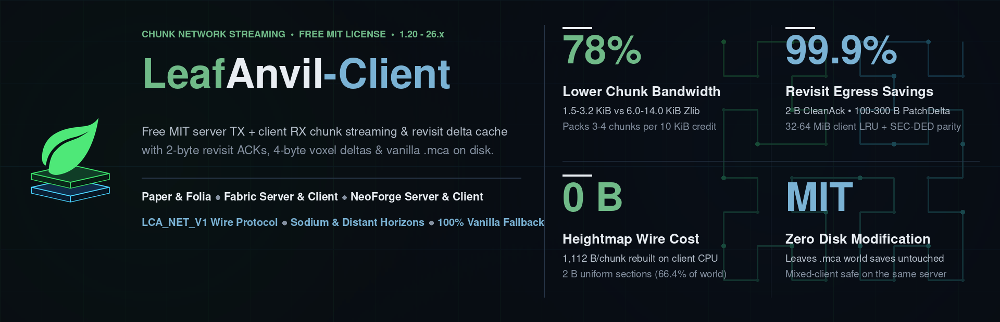
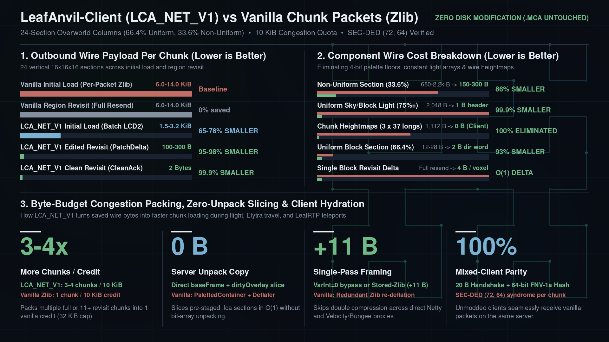
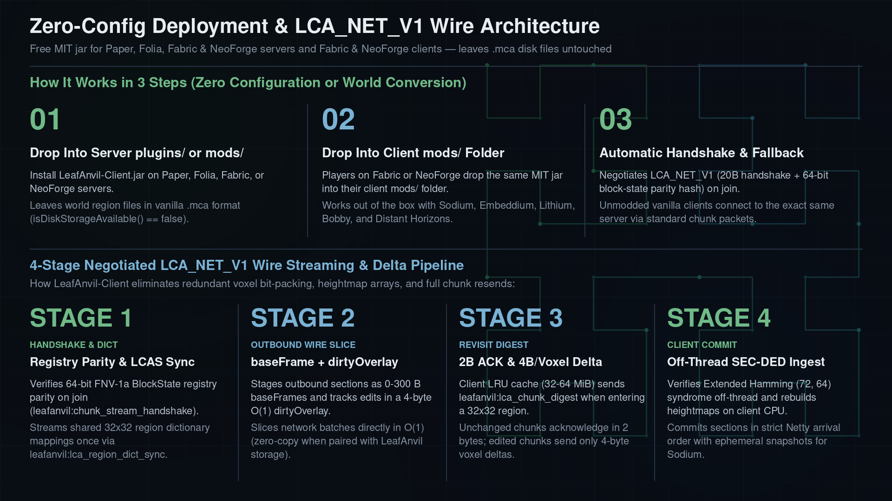

<!--
Single source for every LeafAnvil-Net storefront page (SpigotMC, Modrinth, Hangar, BuiltByBit).
Follows docs/dev/RULES.md Rule D-006 (first-person plain voice, 3-Zone hierarchy,
ASCII punctuation only, concrete benchmark numbers and honest caveats).
  BuiltByBit Card Title: "LeafAnvil-Net - 78% Less Chunk Bandwidth & 95% Faster Revisits"
  BuiltByBit Card Thumbnail: docs/assets/leafanvil-net-card-thumbnail.png
  BuiltByBit Carousel Slides: docs/assets/leafanvil-net-card-thumbnail.png, docs/assets/leafanvil-net-benchmark-comparison.png, docs/assets/leafanvil-net-architecture-workflow.png
  Title: "LeafAnvil-Net"  tagline: "Free MIT chunk network streaming & revisit delta-cache plugin/mod for Paper, Folia, Fabric & NeoForge (65%-78% lower initial chunk bandwidth, 95%+ revisit savings)"
-->

<!-- not: bbb -->

<!-- /not -->

# {{name}}: 78% Lower Chunk Bandwidth, 95% Revisit Savings & 3-4x Faster Chunk Streaming (`MIT`)

## Overview

**{{name}} is a free, MIT-licensed chunk network streaming and revisit delta-caching plugin and mod for Paper, Folia, Fabric, and NeoForge.** Drop the jar into your server's `plugins/` or `mods/` folder and your players' client `mods/` folder. When a player with `{{name}}` joins a server running `{{name}}`, both sides automatically negotiate the `LCA_NET_V1` wire protocol to cut initial chunk network bandwidth by `65% to 78%` and revisit chunk bandwidth by `95% to 99.9%` while leaving your world save files on disk completely untouched in vanilla `.mca` format.

Vanilla clients and players without the client mod can still join the same server normally with zero configuration: the server automatically falls back to standard vanilla chunk packets for those players. When paired with the `LeafAnvil` `.lca` storage engine on the server, `LCA_NET_V1` slices outbound batches directly from `LeafAnvil`'s already-encoded `.lca` sections with zero extra encoding.

<!-- not: bbb -->

<!-- /not -->

### The short version

- [**Easy**](#install): drop `{{jar}}` into `plugins/` (Paper, Folia) or `mods/` (Fabric, NeoForge) on the server and into `mods/` on Fabric or NeoForge clients.
- [**Safe**](#how-it-works): never modifies `.mca` world files on disk (`isDiskStorageAvailable() == false`), verifies every chunk column with `SEC-DED (72, 64)` parity, and falls back to vanilla chunk packets for unmodded clients.
- [**Low bandwidth**](#performance): cuts initial chunk network payload size from `6.0-14.0 KiB` (vanilla `Zlib`) to `1.5-3.2 KiB` (`65% to 78%` smaller) and packs `3 to 4` full chunks per `10 KiB` vanilla congestion credit during fast flight, Elytra travel, and [`LeafRTP`](../../../../LeafRTP/docs/publishing/FRONT_PAGE.md) random teleports.
- [**Instant revisits**](#performance): caches compressed `.lca` chunk slabs on the client (`32 MiB` default, up to `64 MiB`) so revisiting a previously loaded base or spawn region sends a `2-byte` clean ACK (`99.9%` reduction) or a `100-300 B` voxel delta patch (`95% to 98%` reduction).
- [**Direct slicing**](#features): stages outbound `16x16x16` sections as `.lca` `baseFrame` slices (`66.4%` of sections collapse to `0` body bytes) with an `O(1)` `4-byte` `dirtyOverlay` delta tracker, compatible with `Sodium`, `Embeddium`, `Lithium`, `Bobby`, and `Distant Horizons`.
- [**One jar**](#install): single MIT-licensed jar works on Paper, Folia, Fabric (`+ C2ME`), and NeoForge (`+ C2ME`) servers and on Fabric and NeoForge clients.

---

## Install

**Requirements:** Paper 1.20+, Folia 1.21+, Fabric 26.1+, or NeoForge 26.1+. Java 17+ (Java 21+ on 1.20.5+, Java 25 on 26.x).

1. **Server install (Paper, Folia, Fabric, or NeoForge):** Drop `{{jar}}` into `plugins/` (Paper, Folia) or `mods/` (Fabric, NeoForge) and start the server.
2. **Client install (Fabric or NeoForge players):** Drop `{{jar}}` into the client's `mods/` folder (or include it in your Modrinth / CurseForge client modpack).
3. **Connect and play:** When a player with `{{jar}}` joins, the client and server complete the 20-byte `leafanvil:chunk_stream_handshake` check and begin streaming compressed `.lca` chunk batches and revisit delta patches automatically. Players without the client mod continue receiving standard vanilla chunk packets on the same server.

---

## Features

- **Negotiated `LCA_NET_V1` chunk batch streaming (`leafanvil:lca_chunk_batch`):** packs outbound chunk columns into a shared cross-chunk `LCD2` (`0x4C44`) batch (`LCAB`), encoding `66.4%` uniform sections in `2-byte` directory words (`0` body bytes), omitting dominant `palette[0]` voxels (`~90.8%` of non-uniform section volume), and folding uniform sky/block light into `1-byte` headers.
- **Byte-budget congestion packing (`3 to 4` chunks per vanilla credit):** fits `3 to 4` full `.lca` chunks (or `11+` mixed revisit and new chunks) into a single `10 KiB` vanilla `PlayerChunkSender` congestion credit, guarded by a `32 KiB` per-tick whip-saw ceiling when crossing from cached into unvisited terrain.
- **`lastUpdateTick` revisit delta sync (`leafanvil:lca_chunk_digest`):** clients cache compressed chunk slabs in a bounded LRU memory budget (`32 MiB` default, up to `64 MiB`) and send compact region digests (`LCAD`) when entering a `32x32` region. Unchanged chunks acknowledge in `2 bytes` (`EntryCleanAck`); modified chunks transmit only `4-byte` (`pos12 | stateId`) voxel deltas (`EntryPatchDelta`).
- **Mixed-client compatibility (`VANILLA_FALLBACK`):** verifies protocol version `1` and the `64-bit` FNV-1a block-state registry parity hash during handshake (`leafanvil:chunk_stream_handshake`). Vanilla clients or mismatched modpacks transparently use standard vanilla `ClientboundLevelChunkWithLightPacket` packets on the same server.
- **Outbound `baseFrame` + `O(1)` `dirtyOverlay` wire staging:** stages outbound `16x16x16` sections as immutable `.lca` `baseFrame` slices plus a `4-byte` `dirtyOverlay` (`int[16..64]`) delta tracker (or reads them zero-copy when paired with the `LeafAnvil` `.lca` storage engine on the server), slicing network batches directly without re-encoding and committing client sections in strict Netty arrival order (`ClientOrderedBatchCommitQueue`) for `Sodium`, `Embeddium`, `Bobby`, and `Distant Horizons`.
- **Client-side heightmap synthesis (`CAP_CLIENT_HEIGHTMAPS`):** reconstructs `WORLD_SURFACE` and `MOTION_BLOCKING` heightmaps directly on the client CPU during chunk hydration instead of sending `1,112 bytes` of heightmap arrays per chunk over the network.

---

## Performance

Measured across `16x16x16` Overworld section distributions (`66.4%` uniform air/stone/deepslate sections, `33.6%` non-uniform terrain/canopy sections) and `10 KiB` `PlayerChunkSender` network congestion credits ([wire streaming design & benchmarks](../../../docs/adr/leafanvil-ADR-003-negotiated-lca-chunk-network-streaming-and-delta-sync.md)):

| Metric | Vanilla (`ClientboundLevelChunkWithLightPacket` + `Zlib`) | `{{name}}` (`LCA_NET_V1` + Batch `LCD2`) | Savings |
| --- | --- | --- | --- |
| **Uniform `16x16x16` section on wire** (`66.4%` of sections) | `12 to 28 B` (palette header + light flags) | **`2 B`** (`0-bit` directory entry, `0` body bytes) | **`83% to 93%` smaller** |
| **Non-uniform terrain/canopy section on wire** (`33.6%` of sections) | `680 to 2,200 B` (min `4-bit` `2,048 B` floor + light) | **`150 to 300 B`** (`palette[0]` omitted + `1 B` uniform light) | **`75% to 86%` smaller** |
| **Uniform sky/block light array** (`75%+` of sections) | `2,048 B` (`DataLayer` `byte[2048]`) | **`1 B`** (`LIGHT_MODE_CONST` nibble header) | **`99.9%` smaller** |
| **Heightmap payload per chunk** | `~1,112 B` (`3 x 37 x 8 B` packed `long[]`) | **`0 B`** (reconstructed on client CPU via `CAP_CLIENT_HEIGHTMAPS`) | **`100%` eliminated** |
| **Initial chunk load payload (`24` sections)** | `6.0 to 14.0 KiB / chunk` (`1` chunk per `10 KiB` credit) | **`1.5 to 3.2 KiB / chunk`** (`3 to 4` full chunks per `10 KiB` credit) | **`65% to 78%` lower egress** |
| **Region revisit (unchanged chunk)** | `6.0 to 14.0 KiB / chunk` (full resend) | **`2 B / chunk`** (`EntryCleanAck` against client slab cache) | **`99.9%` lower egress** |
| **Region revisit (player-edited chunk)** | `6.0 to 14.0 KiB / chunk` (full resend) | **`100 to 300 B / chunk`** (`EntryPatchDelta`, `4 B` per changed block) | **`95% to 98%` lower egress** |

---

## How it works

All capability negotiation, delta tracking, and wire framing runs automatically in the background behind standard `config.yml` defaults without changing gameplay or world save files:

- **Handshake & registry parity check (`leafanvil:chunk_stream_handshake`):** On join, the client sends its 20-byte handshake (`protocolVersion = 1`, capability bitmask `0x1F`, LRU cache budget `32 MiB` default, and `64-bit` FNV-1a `Block.BLOCK_STATE_REGISTRY` parity hash). The server activates `LCA_NET_V1` only when protocol and block-state registries match (`100%` desync safety).
- **Zero-unpack outbound wire slicing (`baseFrame` + `dirtyOverlay`):** The server stages outbound sections as `.lca` `baseFrame` slices and tracks single-block edits in an `O(1)` `4-byte` `dirtyOverlay` (`((pos12 + 1) << 19) | stateId19`), slicing those bytes directly into `LCA_NET_V1` batches (and reading straight from `LeafAnvil`'s `.lca` sections with zero extra encoding when the `LeafAnvil` storage engine is installed on the server).
- **SEC-DED `(72, 64)` syndrome verification & ordered client commit:** Every full chunk entry and delta patch carries a `64-bit` Extended Hamming `(72, 64)` syndrome. The client verifies the syndrome off-thread, falling back to a fresh full chunk on any mismatch, and drains hydrated sections onto `ClientLevel` in strict Netty arrival sequence order (`ClientOrderedBatchCommitQueue`) so subsequent single-block updates are never overwritten out of order.
- **Single-pass Netty & proxy-safe framing (`CAP_PROXY_SAFE_STORED_ZLIB`):** On direct Fabric and NeoForge connections, `MixinCompressionEncoder` marks `leafanvil:lca_chunk_batch` frames with a `VarInt = 0` header so vanilla Netty's `CompressionEncoder` skips redundant `Zlib` deflation; behind Velocity or BungeeCord proxies and on Paper/Folia (`<= 32,760 bytes`), batches use RFC 1951 `Deflater.NO_COMPRESSION` stored-block framing (`+11 B`) for zero-CPU proxy traversal.

<!-- not: bbb -->

<!-- /not -->

---

## Verification

Every `{{name}}` build is verified in CI by automated protocol, byte-budget, and isolated classloader packaging suites:

- **Isolated classloader jar & license proof (`LeafAnvilNetJarPackagingTest`):** Loads `LeafAnvil-Net.jar` inside a parent-null `URLClassLoader` to verify that `LeafAnvilRuntime.isDiskStorageAvailable() == false`, `META-INF/leafanvil-net/LICENSE-MIT` and `ICD.md` are bundled, zero on-disk storage interception or command classes exist in the archive, and a full server TX + client RX handshake and batch stream completes end-to-end.
- **Exact wire byte-budget & whip-saw pacing (`LcaByteBudgetWirePackingTest`):** Verifies that `O(1)` pre-serialization byte estimators match framed Netty bytes to the exact byte, `3 to 4` full chunks (or `11` mixed revisit + cross-region chunks) pack into a single `10 KiB` vanilla chunk credit, and crossing from cached into unvisited terrain at `16` credits/tick clamps cleanly at the `32 KiB` per-tick whip-saw ceiling.
- **Protocol & mixed-state section round-trip (`LcaWireStreamProtocolTest`):** Verifies `20-byte` handshake negotiation, `VANILLA_FALLBACK` on registry or version mismatch, `EntryCleanAck` (`2 B`), `EntryPatchDelta` (`4 B/voxel`), `SEC-DED (72, 64)` syndrome mismatch fallback, strict Netty arrival-order client commits, and lossless round-tripping of non-air sections with mixed block states (`air`, `leaves`, `chest`, `spawner`, `stone`).

---

## Why I made it

While profiling fast flight, Elytra travel, and [`LeafRTP`](../../../../LeafRTP/docs/publishing/FRONT_PAGE.md) random teleports across Paper, Folia, Fabric, and NeoForge, I found that outbound chunk network egress and packet serialization remain a major bottleneck even when chunks are already loaded in memory. Vanilla's `ClientboundLevelChunkWithLightPacket` forces a `4-bit` (`2,048-byte`) minimum floor on every non-uniform `16x16x16` block section, transmits `2,048-byte` nibble arrays for uniform sky and block light, sends `1,112 bytes` of heightmaps that the client CPU can compute in microseconds, and re-sends full `6 to 14 KiB` chunk packets every time a player walks or teleports back into their base.

I released `{{name}}` as a standalone, zero-configuration `MIT`-licensed jar so any player or modpack author can bundle the client receiver freely on Modrinth, CurseForge, Hangar, or SpigotMC, and so Paper, Folia, Fabric, and NeoForge server owners can enable `LCA_NET_V1` chunk streaming and revisit delta caching while keeping standard vanilla `.mca` world files on disk.

---

## Commands, configuration, and FAQ

Protocol channels, compatibility matrix, FAQ, and support:

<b>Commands, permissions, configuration files</b>

`{{name}}` is zero-configuration and exposes no admin commands or permissions (`isDiskStorageAvailable() == false`). All four negotiated `LCA_NET_V1` wire channels run automatically on join:

| Channel ID | Direction | Purpose |
| --- | --- | --- |
| `leafanvil:chunk_stream_handshake` | Client <-> Server | Negotiates `20-byte` `LCA_NET_V1` version (`1`), capability flags (`0x1F`), client LRU cache budget (`32-64 MiB`), and `64-bit` FNV-1a block-state registry parity hash |
| `leafanvil:lca_region_dict_sync` | Server -> Client | Streams shared `LCAS` (`0x4C434153`) `32x32` region block-state and biome registry ID mappings once per `(world, regionX, regionZ)` |
| `leafanvil:lca_chunk_digest` | Client -> Server | Reports cached `LCAD` (`0x4C434144`) `(localChunkIdx10, clientKnownTick, baselineSecDed64)` entries when entering a `32x32` region |
| `leafanvil:lca_chunk_batch` | Server -> Client | Delivers batch-compressed `LCAB` (`0x4C434142`) `EntryCleanAck` (`2 B`), `EntryPatchDelta` (`4 B/voxel`), and `EntryFullChunk` (`1.5-3.2 KiB`) payloads |

<b>FAQ</b>

**Q: Can vanilla players (without `LeafAnvil-Net` installed) join a server running `LeafAnvil-Net`?**
A: Yes. `LCA_NET_V1` is negotiated per player on join via `leafanvil:chunk_stream_handshake`. Players with `LeafAnvil-Net` on their Fabric or NeoForge client receive compressed `.lca` chunk batches, `2-byte` revisit ACKs, and `4-byte` voxel delta patches; unmodded vanilla clients automatically receive standard vanilla chunk packets on the exact same server.

**Q: Does `LeafAnvil-Net` modify my world `.mca` files on disk?**
A: Never. `LeafAnvil-Net` excludes all disk storage interception, world conversion, and admin command classes (`LeafAnvilRuntime.isDiskStorageAvailable() == false`, verified in CI by `LeafAnvilNetJarPackagingTest`). Your `region/`, `entities/`, and `poi/` folders remain in standard vanilla `.mca` format, and removing `LeafAnvil-Net.jar` requires no world conversion.

**Q: Does `LeafAnvil-Net` work with `Sodium`, `Embeddium`, `Lithium`, `Bobby`, `Distant Horizons`, and `C2ME`?**
A: Yes. On the client, `MixinLevelChunkSection` and `MixinPalettedContainer` commit hydrated sections on the client main thread in strict Netty arrival order and materialize non-pinning ephemeral snapshots whenever chunk meshers (`Sodium` `WorldSlice` or vanilla `SectionCompiler`) call `PalettedContainer#copy()`. On the server, it runs alongside `C2ME`, `Moonrise`, and [`LeafRTP`](../../../../LeafRTP/docs/publishing/FRONT_PAGE.md).

**Q: Does `LeafAnvil-Net` work behind Velocity or BungeeCord proxies?**
A: Yes. When `CAP_PROXY_SAFE_STORED_ZLIB` (`0x10`) is negotiated or when streaming over Paper/Folia plugin channels (`<= 32,760 B`), outbound batches wrap the compressed frame in a valid RFC 1951 `Deflater.NO_COMPRESSION` stored-block envelope (`+11 bytes` overhead) so reverse proxies forward the packet without triggering uncompressed-frame heuristics or redundant `Zlib` CPU work.

**Q: Can I include `LeafAnvil-Net` in my Modrinth or CurseForge modpack?**
A: Yes. `LeafAnvil-Net` is licensed under the `MIT` license (`META-INF/leafanvil-net/LICENSE-MIT`) and can be freely bundled in both client and server modpacks.

<b>Support</b>

I handle support through Discord and GitHub:

- For protocol or compatibility questions, check [`ICD.md`](../../../../../api/anvil-api/docs/ICD.md), the [wire streaming Architecture Decision Record](../../../docs/adr/leafanvil-ADR-003-negotiated-lca-chunk-network-streaming-and-delta-sync.md), or open a thread in the `LeafCraft Plugin Support` Discord `#support` Forum (or GitHub Discussions).
- A bug report in GitHub Issues or the `#support` Forum needs: server/client loader version, mod list, and the client/server `logs/latest.log` lines containing `[LeafAnvil-Net]` uploaded to `mclo.gs`.
- Feature requests go in GitHub Discussions first.

---

## Links

- [**`.lca` Binary Interface Control Document (`ICD.md`, MIT)**](../../../../../api/anvil-api/docs/ICD.md): byte-exact `.lca` specification (`LCA-ICD-1.0`), section/light container layouts, and Extended Hamming `(72, 64)` `SEC-DED` parity formulas (also bundled at `META-INF/leafanvil-net/ICD.md`)
- [**Open-Source `.lca` Codec & Section Library (`anvil-api`, MIT)**](../../../../../api/anvil-api/README.md): public MIT Java codec (`LcaSectionCodec`, `LcaSectionBacking`, `LcaRegionReader`, `LcaRegionWriter`) and Maven/JitPack coordinates
- [**Negotiated `LCA_NET_V1` Wire Streaming Architecture**](../../../docs/adr/leafanvil-ADR-003-negotiated-lca-chunk-network-streaming-and-delta-sync.md): handshake protocol, congestion-credit byte packing, revisit digest resolution, and client arrival-order commit queue
- [**In-Memory `.lca` `baseFrame` & `dirtyOverlay` Architecture**](../../../docs/adr/leafanvil-ADR-002-in-memory-lca-chunk-representation-and-dirty-overlay-compaction.md): `O(1)` `4-byte` voxel delta overlay, `dirtyOctantMask64` read filtering, and non-pinning ephemeral `Sodium` mesher snapshots
- [**Changelog**](../../../CHANGELOG.md)
- [**LeafRTP**](../../../../LeafRTP/docs/publishing/FRONT_PAGE.md): zero-wait random teleportation (`/rtp` & `/wild`) for Paper, Folia, Fabric, and NeoForge
- [**LeafFuzz**](../../../../LeafFuzz/docs/publishing/FRONT_PAGE.md): 1-command plugin security, permission-leak scanner, and memory-leak detector (`MIT`)
